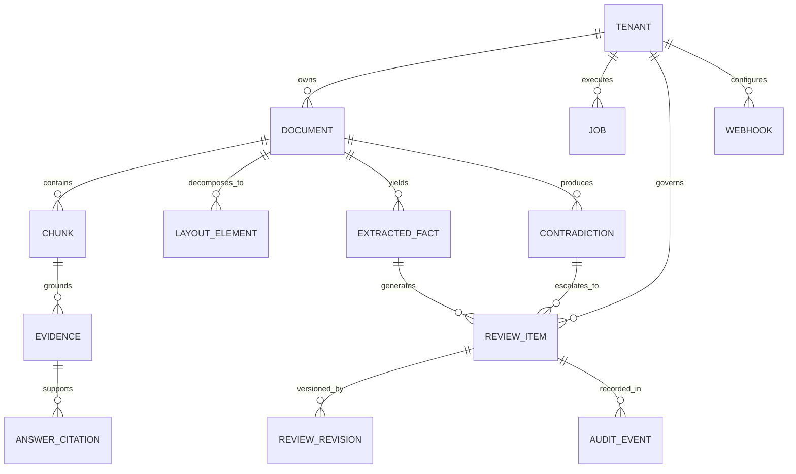
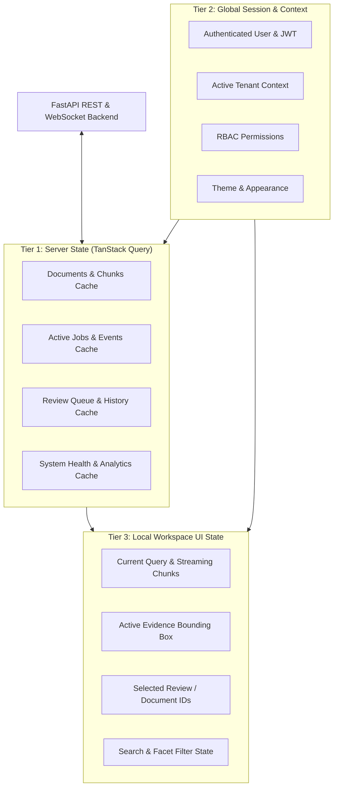
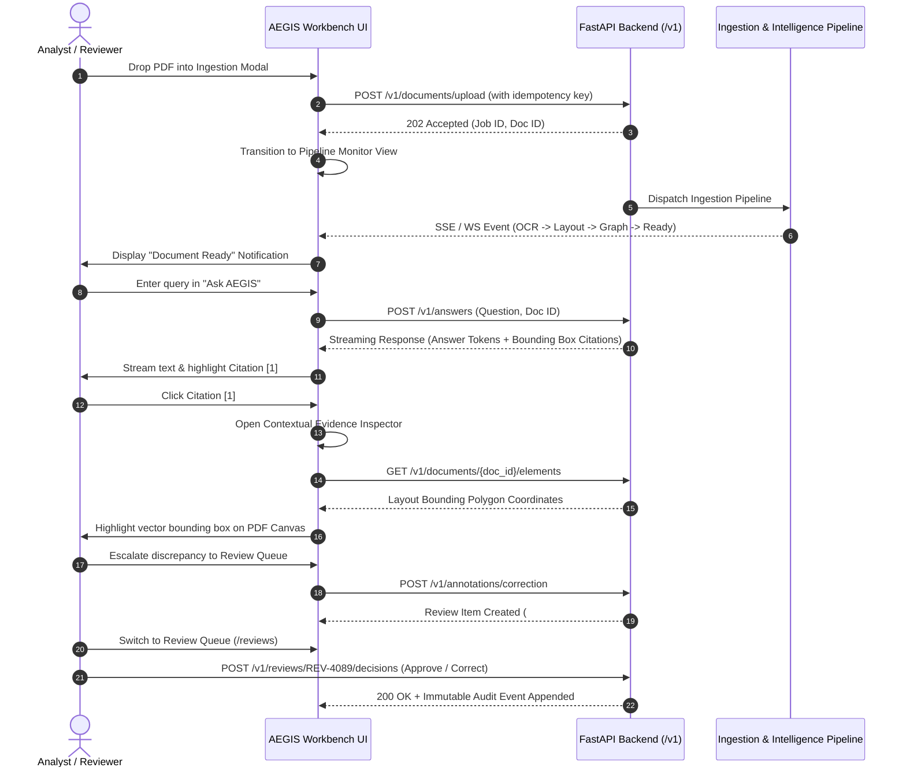

# AEGIS-DocIntel — Information Architecture & Domain Model
**Document Identifier**: `AEGIS-DOCINTEL-UX-INF-001`  
**Work Package**: `WP-UI-01: Product UX Architecture`  
**Version**: `2.0.0`  
**Classification**: Formal Architectural Specification  
**Status**: APPROVED BASELINE  
**Effective Date**: 2026-11-09  

---

## 1. Executive Overview

The Information Architecture (IA) of **AEGIS Workbench 2.0** reflects the actual domain structure of the underlying Document Intelligence Operating System. It avoids arbitrary chatbot patterns, organizing user interactions around verified knowledge entities, mathematical structures, and human governance workflows.

---

## 2. Domain Entity Model in the UI

The user interface operates over ten first-class domain entities:



### Entity Definitions & UI Roles

1. **Tenant Organization**: Top-level cryptographic boundary. Controls tenant isolation, storage quotas, users, and security settings.
2. **Document Artifact**: Immutable source record (PDF, DOCX, XLSX, etc.) characterized by SHA-256 fingerprint, page count, and indexing status (`pending`, `indexing`, `ready`, `failed`, `reindexing`).
3. **Document Chunk**: Semantic text partition with token count, section path hierarchy, and embedding vectors.
4. **Layout Element**: Geometric layout primitive (table, heading, paragraph, image, figure, header, footer) defined by bounding polygon coordinates `[ymin, xmin, ymax, xmax]`.
5. **Extracted Fact**: Structured tuple `(Subject, Attribute, Value, Unit, Confidence, EvidenceQuote)` extracted from document passages.
6. **Contradiction / Conflict**: Cross-document clash where two assertions over the same subject/attribute hold incompatible values.
7. **Review Item**: Unit of human governance containing candidate data, current status (`pending`, `in_review`, `approved`, `corrected`, `rejected`, `needs_evidence`), and assignee.
8. **Review Revision**: Versioned mutation capturing reviewer-corrected values, units, types, and rationale.
9. **Audit Event**: Append-only, tamper-evident log entry recording actor ID, status transition, timestamp, and revision link.
10. **Background Job**: Durable operational process (`ingest_document`, `extract_facts`, `compare_documents`) tracking attempts, lease owners, error codes, and progress events.

---

## 3. Global Application Viewport Architecture

AEGIS Workbench 2.0 uses a standardized, modular 3-region layout grid:

```
┌────────────────────────────────────────────────────────────────────────────────────────┐
│ TOP HEADER: Tenant Switcher · Global Search (Ctrl+K) · System Health · Notifications  │
├──────────────┬──────────────────────────────────────────┬──────────────────────────────┤
│ PRIMARY      │ CENTRAL WORKSPACE                        │ CONTEXTUAL INSPECTOR         │
│ SIDEBAR      │                                          │ (SPLIT-PANE / DRAWER)        │
│              │ • Operational Dashboard Overview         │                              │
│ • Workspace  │ • Document Library & Ingestion           │ • Synchronized PDF Canvas    │
│ • Documents  │ • Processing & Job Monitor               │ • Vector Bounding Boxes      │
│ • Processing │ • "Ask AEGIS" Tri-Pane QA                │ • Chunk & Citation Provenance│
│ • Ask AEGIS  │ • Cross-Doc Comparison & Conflict Matrix │ • Audit Event Stream         │
│ • Retrieval  │ • Governance Review Queue                │ • Metadata & Node Inspector  │
│ • Compare    │ • Advanced Math & Topology               │                              │
│ • Reviews    │ • Analytics & Token Economy              │ (Collapsible / Resizable)    │
│ • Advanced   │ • Admin Settings & Webhooks              │                              │
│ • Analytics  │                                          │                              │
│ • Admin      │                                          │                              │
├──────────────┴──────────────────────────────────────────┴──────────────────────────────┤
│ FOOTER STATUS BAR: Connected Backend · Active Latency · Session Status · Build SHA    │
└────────────────────────────────────────────────────────────────────────────────────────┘
```

### 3.1 Primary Navigation Sidebar
* Width: 260px (expanded) or 68px (collapsed).
* Provides rapid access to the ten core modules.
* Grouped logically into four operational tiers:
  1. **Workspace**: Overview, Recent Activity.
  2. **Core Pipelines**: Documents, Processing Jobs, Library.
  3. **Intelligence & Governance**: Ask AEGIS, Retrieval, Compare, Review Queue.
  4. **System & Operations**: Advanced Math, Analytics, Administration, Settings.

### 3.2 Top Header Context Bar
* Height: 56px. Fixed sticky header.
* Houses:
  * Brand Logo (`AEGIS DocIntel`).
  * Tenant Context Badge & Switcher Dropdown (`Tenant: enterprise-pharma-01`).
  * Universal Command Palette Search Trigger (`Ctrl+K`).
  * System Health Indicator (Green: 99.9% uptime, Yellow: Degraded, Red: Critical).
  * Global Asynchronous Notification Bell with unread badge counter.
  * User Profile Menu with active RBAC role tag.

### 3.3 Central Focus Workspace
* Fluid-width central stage.
* Dedicated to the primary active task (e.g. data table, streaming chat, comparison matrix, review card).
* Supports view modes: Standard, Wide, and Fullscreen.

### 3.4 Contextual Inspector Panel
* Width: 420px (default), resizable up to 50% of viewport, collapsible to 0px.
* Provides immediate contextual inspection without leaving the active workflow:
  * In `/ask`: Renders the Bounding-Box Evidence Inspector and PDF Canvas.
  * In `/reviews`: Renders the Audit History Stream and Revision Diff.
  * In `/processing`: Renders the Job Event Log and Error Stack Trace.
  * In `/documents`: Renders Document Chunks and Metadata.

---

## 4. State & Data Flow Architecture

The user interface manages data through three distinct state tiers:



1. **Tier 1: Server State (TanStack Query)**:
   * Handles caching, background revalidation, optimistic mutations, and garbage collection for all API resources.
   * Query keys are namespaced with the active tenant ID: `['tenant', tenantId, 'documents', docId]`.
2. **Tier 2: Global Session Context (React Context / Zustand)**:
   * Holds verified JWT token, user claims, active tenant scope, notification counters, and persistent layout preferences.
3. **Tier 3: Local Workspace State**:
   * Ephemeral component state: active tab, search inputs, modal open states, zoom levels on the PDF canvas, and active bounding-box coordinates.

---

## 5. End-to-End User Experience Information Flow



This information architecture guarantees that no user action is isolated from its underlying system entity, ensuring seamless continuity from document upload to final governance sign-off.
