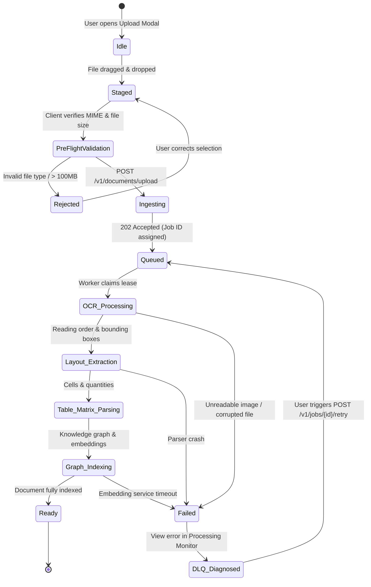

# AEGIS-DocIntel — User Workflow Architecture & Interaction Specs
**Document Identifier**: `AEGIS-DOCINTEL-UX-WRK-001`  
**Work Package**: `WP-UI-01: Product UX Architecture`  
**Version**: `2.0.0`  
**Classification**: Formal Engineering Specification  
**Status**: APPROVED BASELINE  
**Effective Date**: 2026-11-09  

---

## 1. Executive Summary

This specification models the complete, end-to-end user workflows of **AEGIS Workbench 2.0**. Each workflow details the user mental model, interaction triggers, intermediate states, API transactions, error branches, and UI wireframe layouts.

---

## 2. Workflow A: Multi-Format Document Ingestion & Pipeline Observability

### 2.1 Intent & Mental Model
The user uploads one or more complex document artifacts (PDF, DOCX, XLSX, TIFF, audio). The user expects immediate validation, continuous pipeline transparency, stage-by-stage progress tracking, and instant diagnostic feedback if an ingestion failure occurs.

### 2.2 Ingestion State Machine



### 2.3 Step-by-Step Interaction Specifications

1. **Triggering Upload**:
   * User clicks `Upload Documents` button in `/documents` or uses keyboard shortcut `Ctrl+U`.
   * Upload modal opens with a large drag-and-drop target zone.
2. **Pre-Flight Configuration**:
   * Drop area accepts `.pdf`, `.docx`, `.xlsx`, `.png`, `.tiff`, `.mp3`, `.wav`.
   * Optional toggles:
     * [ ] *Auto-scan and redact PII entities before embedding* (`/v1/advanced/compliance/pii-scan`)
     * [ ] *Run deep table structure matrix extraction*
3. **Dispatch & Idempotency**:
   * UI computes client-side SHA-256 fingerprint and UUID idempotency key.
   * Dispatches multipart request `POST /v1/documents/upload`.
   * On `202 Accepted`, modal displays an active progress bar with link to `/processing/jobs/[jobId]`.
4. **Live Pipeline Observability**:
   * The UI subscribes via SSE to `/v1/documents/{doc_id}/status`.
   * Visual stage progression card updates in real-time:
     * `[✓] Ingestion & Virus Scan` (120ms)
     * `[✓] Multi-Engine OCR & Clean Text` (1.4s)
     * `[✓] Layout Geometry & Reading Order` (850ms)
     * `[✓] Table Structure & Matrix Normalization` (600ms)
     * `[⟳] Knowledge Graph & Hybrid Embeddings...` (Active, 42% complete)
5. **Completion or Actionable Failure**:
   * When status reaches `ready`, a green toast appears: *"Document successfully indexed (48 pages, 312 chunks)"* with a button: `Open in Workspace &rarr;`.
   * If any stage fails, the stage turns red, displaying the exact backend error code (e.g. `PARSER_CORRUPTED_PDF_TABLE`), stack trace summary, and a `Retry Job` button.

---

## 3. Workflow B: "Ask AEGIS" & Grounded Intelligence Reasoning

### 3.1 Intent & Mental Model
The user asks a nuanced question over one or more documents. The user demands a rigorously cited, grounded answer where every statement is traceable to exact source text and bounding boxes on the original page, with zero tolerance for hallucinations.

### 3.2 Wireframe Layout Specification: Tri-Pane Grounded QA Console

```
┌─────────────────┬───────────────────────────────────────────────┬──────────────────────────────┐
│ LEFT PANE (20%) │ CENTER PANE (45%)                             │ RIGHT PANE (35%)             │
│ SOURCE SELECTOR │ GROUNDED QA STREAM & CONVERSATION             │ CONTEXTUAL EVIDENCE STUDIO   │
├─────────────────┼───────────────────────────────────────────────┼──────────────────────────────┤
│ 📂 ACTIVE SCOPE │ 💬 User: "What are the change of control      │ 📄 Credit-Agreement-2026.pdf │
│                 │          termination penalty triggers?"       │ Page 42, Section 8.4(b)      │
│ [x] Credit-Agr- │                                               │                              │
│     2026.pdf    │ 🧠 Query Decomposition:                       │ [ Raw Document Canvas ]      │
│ [x] Term-Sheet- │  1. Retrieve termination clauses              │ ┌──────────────────────────┐ │
│     v2.docx     │  2. Extract penalty percentage & cure periods │ │ Section 8.4: Termination │ │
│                 │                                               │ │ "...shall trigger a 2.5% │ │
│ Filter by tag:  │ 🛡️ AEGIS Answer:                              │ │ [HIGHLIGHT BOX: RED]     │ │
│ [ M&A 2026   ]  │ Under Section 8.4(b) of the Credit Agreement, │ │ fee payable within 30    │ │
│                 │ a Change of Control requires immediate written│ │ calendar days..."        │ │
│ Search depth:   │ notice [1]. If a non-approved acquirer        │ └──────────────────────────┘ │
│ (o) Strict (k=5)│ exceeds 50% voting shares, a termination      │                              │
│ ( ) Broad(k=20) │ penalty of 2.5% of outstanding principal is   │ EVIDENCE METRICS:            │
│                 │ triggered [2], payable within 30 days [3].    │ • Relevance Score: 0.94      │
│                 │                                               │ • Token Count: 68            │
│                 │ ⚠️ WARNINGS:                                  │ • Bounding Box: [120,45,     │
│                 │ • Term-Sheet-v2 contains an amended cure      │                  340,680]    │
│                 │   period (15 days vs 30 days). Conflict       │                              │
│                 │   detected. [View Contradiction &rarr;]       │ [ Escalate to Review Queue ] │
├─────────────────┴───────────────────────────────────────────────┴──────────────────────────────┤
│ INPUT: [ Ask a question across authorized documents... (Enter to send) ]      [ ⚙️ Settings ] │
└────────────────────────────────────────────────────────────────────────────────────────────────┘
```

### 3.3 Step-by-Step Interaction Flow

1. **Scope Selection**: User selects one or more documents or a collection tag in the left pane.
2. **Query Submission**: User enters inquiry in the prompt input. Dispatches `POST /v1/answers`.
3. **Decomposition Stream**:
   * For complex inquiries, the UI displays an expandable accordion: *"Decomposing query into 3 sub-retrieval vectors..."* (`/v1/advanced/query/decompose`).
4. **Token Streaming & Citations**:
   * Text streams into the center console using Server-Sent Events.
   * Numbered citation pills (`[1]`, `[2]`, `[3]`) appear inline as citations are verified by the backend.
5. **Interactive Evidence Inspection**:
   * Hovering over citation `[2]` highlights the citation pill and previews the evidence quote.
   * Clicking citation `[2]` immediately loads the right-hand Evidence Studio, automatically rendering the original PDF page and drawing an animated vector highlight box around the cited passage.
6. **Conflict & Insufficient Evidence Callout**:
   * If the backend returns `insufficient_evidence: true`, the UI displays a yellow warning box:
     *"The corpus does not contain sufficient grounded evidence to definitively answer this question. No assumptions were made."*
   * If contradictory statements are detected between cited documents, a red contradiction banner is rendered with a direct link to Workflow C.

---

## 4. Workflow C: Cross-Document Comparison & Contradiction Resolution

### 4.1 Intent & Mental Model
The user compares two contract versions or related agreements to uncover subtle discrepancies, altered numbers, omitted indemnity clauses, or conflicting legal obligations.

### 4.2 Cross-Document Contradiction Matrix Wireframe

```
┌────────────────────────────────────────────────────────────────────────────────────────────────┐
│ CROSS-DOCUMENT COMPARISON & CONTRADICTION MATRIX                                               │
│ Document A: Credit-Agreement-2026.pdf  vs  Document B: Term-Sheet-Amended-v2.docx              │
├─────────────────┬───────────────────────────────┬───────────────────────────────┬──────────────┤
│ ATTRIBUTE / FACT│ DOCUMENT A CLAIM              │ DOCUMENT B CLAIM              │ STATUS       │
├─────────────────┼───────────────────────────────┼───────────────────────────────┼──────────────┤
│ Interest Rate   │ 7.25% SOFR + 250 bps          │ 7.25% SOFR + 250 bps          │ [✓ MATCH]    │
│                 │ Evidence: Page 12, para 3     │ Evidence: Page 4, para 1      │              │
├─────────────────┼───────────────────────────────┼───────────────────────────────┼──────────────┤
│ Cure Period     │ 30 calendar days              │ 15 calendar days              │ [⚠️ CONFLICT]│
│                 │ Evidence: Page 42, Sec 8.4    │ Evidence: Page 9, Sec 3.1     │ Escalate to  │
│                 │ Quote: "...within 30 days..." │ Quote: "...shortened to 15..."│ Review Queue │
├─────────────────┼───────────────────────────────┼───────────────────────────────┼──────────────┤
│ Max Liability   │ $50,000,000 USD               │ $75,000,000 USD               │ [⚠️ CONFLICT]│
│                 │ Evidence: Page 88, Schedule C │ Evidence: Page 14, Sec 7      │ Escalate to  │
│                 │ Quote: "...capped at $50M..." │ Quote: "...aggregate $75M..." │ Review Queue │
├─────────────────┼───────────────────────────────┼───────────────────────────────┼──────────────┤
│ Governing Law   │ State of New York             │ State of New York             │ [✓ MATCH]    │
└─────────────────┴───────────────────────────────┴───────────────────────────────┴──────────────┘
```

### 4.3 Step-by-Step Interaction Flow

1. **Document Pairing**: User selects Document A and Document B from the library selector.
2. **Comparison Execution**: Dispatches `POST /v1/intelligence/compare`.
3. **Matrix Rendering**:
   * UI displays a categorized comparison table grouping facts by entity subject (e.g., *Financial Terms*, *Termination Obligations*, *Indemnities*).
   * Toggle: `[x] Show Contradictions Only (2 found)`.
4. **Evidence Deep Dive**:
   * Clicking either side of a conflicting row opens the Split-Pane Evidence Viewer, displaying both source documents side-by-side with synchronized bounding boxes.
5. **Governance Escalation**:
   * User clicks `Escalate to Review Queue`.
   * Automatically dispatches `POST /v1/annotations/correction` or registers a new Review Item (`candidate_type: "conflict"`).

---

## 5. Workflow D: Human Governance Review & Cryptographic Audit

### 5.1 Intent & Mental Model
A certified compliance reviewer or subject-matter expert inspects a flagged candidate fact or conflict, verifies the empirical evidence, and issues a sovereign, legally defensible decision (Approve, Correct, Reject, Request Evidence) backed by an immutable audit trail.

### 5.2 Review Workbench Wireframe (`/reviews/[reviewId]`)

```
┌────────────────────────────────────────────────────────────────────────┐
│ REVIEW ITEM: REV-4089  •  Priority: HIGH  •  Assigned to: Marcus Vance │
│ Candidate Type: CONFLICT (Cross-Document Contradiction)                │
├──────────────────────────────────────┬─────────────────────────────────┤
│ CANDIDATE EVALUATION                 │ EVIDENCE & PROVENANCE           │
│                                      │                                 │
│ Subject: Cure Period (Section 8.4)   │ Source Doc 1: Credit-Agr.pdf    │
│ AI Extracted Value: "30 days"        │ Page 42, Sec 8.4 [View PDF]     │
│ Opposing Value:     "15 days"        │ Quote: "...shall cure within    │
│ Source Confidence:  94.2%            │ thirty (30) calendar days..."   │
│                                      │                                 │
├──────────────────────────────────────┤ Source Doc 2: Term-Sheet.docx   │
│ SOVEREIGN DECISION FORM              │ Page 9, Sec 3.1  [View DOCX]    │
│                                      │ Quote: "...period shortened     │
│ Select Decision:                     │ to fifteen (15) days..."        │
│ ( ) APPROVE AS FACT                  │                                 │
│ (*) CORRECT VALUE                    │                                 │
│ ( ) REJECT CANDIDATE                 │                                 │
│ ( ) REQUEST ADDITIONAL EVIDENCE      │                                 │
│                                      │                                 │
│ Corrected Value: [ 15              ] │                                 │
│ Unit:            [ calendar days   ] │                                 │
│ Data Type:       [ integer         ] │                                 │
│                                      │                                 │
│ Mandatory Rationale / Legal Basis:   │                                 │
│ ┌──────────────────────────────────┐ │                                 │
│ │ Term Sheet Amendment dated Nov 2 │ │                                 │
│ │ explicitly supercedes Credit Agr │ │                                 │
│ │ Sec 8.4 per executed Rider B.    │ │                                 │
│ └──────────────────────────────────┘ │                                 │
│                                      │                                 │
│ [ Submit Sovereign Decision & Sign ] │                                 │
├──────────────────────────────────────┴─────────────────────────────────┤
│ IMMUTABLE AUDIT TRAIL (CRYPTOGRAPHICALLY HASH-CHAINED)                 │
│ • 2026-11-09 10:14:02 UTC | System: Created candidate REV-4089        │
│ • 2026-11-09 10:45:11 UTC | Actor: mvance claimed item                 │
│ • Previous Revisions: None (Initial Version v1)                        │
└────────────────────────────────────────────────────────────────────────┘
```

### 5.3 Step-by-Step Interaction Flow

1. **Queue Inspection & Filtering**: Reviewer loads `/reviews`, filtering by `status: pending` and `candidate_type: conflict`.
2. **Claiming Item**: Reviewer clicks item to open workbench. UI automatically dispatches `POST /v1/reviews/{review_id}/claim`. The item status updates to `in_review` with the reviewer's ID.
3. **Evidence Verification**: The reviewer reviews the candidate data side-by-side with quotes and vector bounding boxes from the attached source documents.
4. **Decision Formulation**:
   * **Approve**: Confirms AI extraction is 100% accurate.
   * **Correct**: Reviewer edits value (e.g. changes `30 days` to `15 days`), specifies unit, and enters legal rationale.
   * **Reject**: Rejects candidate as invalid or hallucinated.
   * **Request Evidence**: Sends item back to Knowledge Engineer with request for missing context.
5. **Signing & Dispatch**:
   * Reviewer clicks `Submit Sovereign Decision`.
   * UI dispatches `POST /v1/reviews/{review_id}/decisions` with payload `{ action, corrected_value, corrected_type, unit, rationale }`.
6. **Audit Recording**:
   * Backend commits decision, increments revision counter (`v1` -> `v2`), and appends a tamper-evident audit event.
   * UI displays a success confirmation toast and automatically loads the next prioritized item in the queue.

---

## 6. Workflow E: Mathematical & Topological Inspection

### 6.1 Intent & Mental Model
A Knowledge Engineer or Data Scientist inspects the structural mathematical representations generated by AEGIS's geometry, graph, and optimization engines.

### 6.2 Key Interaction Steps
1. Navigate to `/advanced/topology`.
2. Execute **Topological Percolation Resilience Check** (`GET /v1/advanced/topology/percolation-check`).
   * Visual gauge renders percolation threshold $p_c$ against current knowledge graph density.
   * Identifies isolated semantic clusters or brittle single-point assertion paths.
3. Open **Ising Annealing Optimizer** (`POST /v1/advanced/optimization/ising-anneal`).
   * Configure objective constraints (conflict penalty weight, extraction density target).
   * Run simulated annealing algorithm and visualize energy minimization curve.
4. Inspect **Matrix Normalization Sandbox** (`POST /v1/advanced/matrix/normalize-quantity`).
   * Select tabular chunk; convert raw strings (e.g., `"$4.5M EUR"`, `"350 kW"`, `"12,000 sq ft"`) into normalized canonical floating-point dimensions and SI base units.

---

## 7. Workflow F: Operational Diagnostics & Self-Healing Rescheduling

### 7.1 Intent & Mental Model
A System Administrator identifies a failed background ingestion job, investigates the root cause, and resolves the issue without data loss.

### 7.2 Key Interaction Steps
1. Navigate to `/processing/jobs` and filter by `status: failed`.
2. Click failing job to view `/processing/jobs/[jobId]`.
3. Review **Attempt History & Lease Metadata** (`GET /v1/jobs/{job_id}/events`):
   * Worker ID: `worker-gpu-pool-03`
   * Error Code: `EXTRACTION_OCR_TIMEOUT`
   * Attempt: `3 of 3` (Exhausted retries)
4. Trigger **Manual Reschedule**:
   * Click `Retry Job` (`POST /v1/jobs/{job_id}/retry`).
   * Job transitions to `queued`, attempt counter resets, and a fresh worker claims the lease.
5. In case of runaway or obsolete jobs: Click `Cancel Job` (`POST /v1/jobs/{job_id}/cancel`) with mandatory cancellation rationale.
