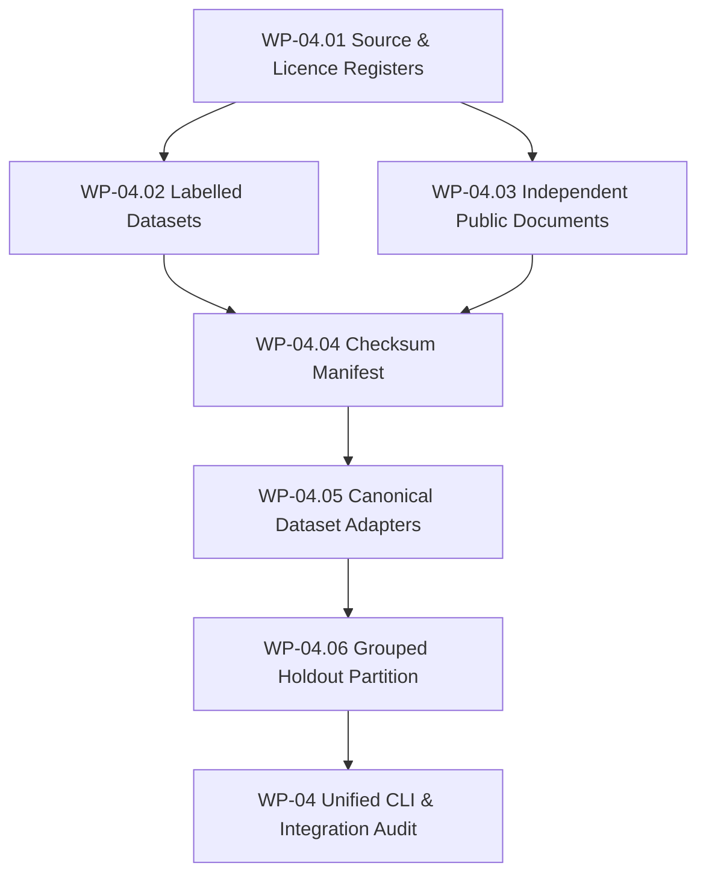

# AEGIS-DocIntel — WP-04: Public Corpus Implementation Baseline

> **Work Package**: WP-04 Public Corpus  
> **Status**: IN_PROGRESS  
> **Active Branch**: `corpus/wp-04-public-corpus`  
> **Baseline Reference**: Canonical Commit `7c05522643e503396795d99e381d201268ebe7fe` (`aegis-baseline-001`)  
> **Preceding Packages**: WP-01 Baseline (PASS), WP-02 Audit Infra (PASS), WP-03 Remediation (PASS)  

---

## 1. Repository Discovery & Current State Analysis

### 1.1 Existing Assets
The repository contains prior preliminary corpus artifacts in:
- `audit/corpus/` & `audit/public-corpus-v1/`:
  - `manifest.csv` (250 candidate document records).
  - `source-register.csv` (10 candidate sources: DocLayNet, PubLayNet, PubTabNet, FUNSD, DocVQA, World Bank, SEC EDGAR, India OGD, arXiv, AEGIS Adversarial).
  - `licence-register.csv` (8 candidate licenses: CDLA-Permissive-1.0, CC-BY-4.0, Public-Domain-USGov, GODL-India, Academic-Evaluation, DocVQA-Challenge, arXiv-OpenAccess, MIT).
  - `checksums.sha256`.
  - `ground-truth/` (layout and table sample JSON annotations).
- `production/benchmark-dataset-real/pdf-corpus/`:
  - 63 real multi-format PDFs and monographs used in previous baseline performance tests.
- `evaluation/datasets/`:
  - `manifest.json`, `qa_eval_dataset.json`, `document_intelligence/` (`extraction_cases.jsonl`, `comparison_cases.jsonl`).

### 1.2 Gaps to Remediate in WP-04
1. **Unenforced Schema Contracts**: The CSV registers lack formal JSON/YAML validation schemas.
2. **Activity-Specific Rights Decoupling**: No fine-grained separation between download, parse, evaluate, train, publish derived annotations, and redistribute.
3. **No Common Dataset Adapter Layer**: Each benchmark script currently reads custom formats without a canonical streaming adapter interface (`DatasetAdapter`).
4. **No Formal Grouped Holdout Partition**: Partitions lack multi-level hierarchy grouping (Publisher -> Family -> Document -> Pages) and automated cross-partition leakage detectors.
5. **No CLI for Corpus Management**: Missing unified `python -m aegis.corpus.cli` command surface.

---

## 2. Reuse Architecture with WP-02 and WP-03

To maintain architectural purity without duplicating infrastructure:
- **WP-02 Audit Runner**: Corpus validation results, integrity checks, and leakage reports will be surfaced as machine-readable evidence objects validating against `schemas/audit/v1/`.
- **WP-03 Manifest-Driven Evaluation**: Canonical datasets and holdouts produced by WP-04 will directly generate `EvaluationManifest` configurations matching `schemas/evaluation/manifest.schema.json`.
- **WP-03 Citation Precision Gate**: Ground-truth evidence spans from WP-04 adapters directly feed into `CitationEvaluator` ($P_c, C_c, R_c, A_c$).

---

## 3. Implementation Plan & Six Work Items

| ID | Module / Task | Deliverables |
| :--- | :--- | :--- |
| **WP-04.01** | `aegis.corpus.registry` | `sources.yaml`, `licences.yaml`, `acquisition_decisions.yaml`, schemas, validators |
| **WP-04.02** | `aegis.corpus.labelled` | Task-to-dataset mapping, ground truth annotations, quality metrics |
| **WP-04.03** | `aegis.corpus.independent` | Diversity tracker across 8 document domains, document metadata inventory |
| **WP-04.04** | `aegis.corpus.integrity` | SHA-256 manifest generator, tamper detection, missing/unregistered file check |
| **WP-04.05** | `aegis.corpus.adapters` | Canonical schema (`CanonicalDocument`, `CanonicalAnnotation`, `CanonicalEvaluationItem`), adapters for DocVQA, FUNSD, CORD, PubLayNet, Generic PDF |
| **WP-04.06** | `aegis.corpus.partition` | Deterministic grouped splitter, leakage detector (exact, SHA, near-duplicate, family), holdout protection |
| **Integration** | `aegis.corpus.cli` & tests | Corpus CLI, integration tests connecting with WP-02/WP-03, final audit report |
