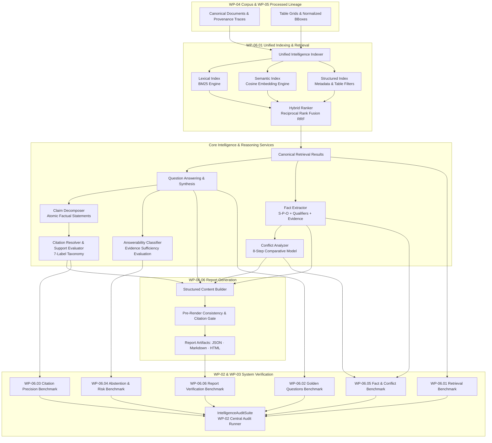

# AEGIS-DocIntel — WP-06: Intelligence Implementation Baseline

> **Work Package**: WP-06 — Intelligence (Retrieval · Reasoning · Evidence · Reporting)  
> **Status**: **Phase A Baseline Established**  
> **Active Branch**: `intelligence/wp-06-intelligence`  
> **Canonical Baseline Commit**: `7c05522643e503396795d99e381d201268ebe7fe` (`aegis-baseline-001`)  
> **Preceding Packages**: WP-01 (Baseline) · WP-02 (Audit Infra) · WP-03 (Remediation) · WP-04 (Public Corpus) · WP-05 (Processing)  

---

## 1. Executive Summary

Work Package 06 (**Intelligence**) establishes whether **AEGIS-DocIntel** can transform validated processed documents into correct, evidence-backed, explainable intelligence.

### Central Operating Principle
> **An answer is not correct merely because it sounds plausible.**  
> It must be supported by verifiable source evidence, the cited source must entail the factual claim, and the system must reliably abstain when evidence is absent, ambiguous, or contradictory.

WP-06 evaluates six core intelligence capabilities:
1. **WP-06.01 — Independent Retrieval Modes**: Benchmark Lexical (BM25), Semantic (embeddings), Hybrid (RRF fusion), and Structured (metadata/table filtering) modes separately.
2. **WP-06.02 — Golden Question Dataset**: 130+ human-verified questions covering direct factual, entity, numeric, temporal, multi-hop, cross-document, and unanswerable categories across WP-04 public corpora.
3. **WP-06.03 — Claim-Level Citation Correctness**: Deconstruct answers into atomic claims and verify evidence entailment using the 7-label support taxonomy (`SUPPORTS`, `PARTIALLY_SUPPORTS`, `CONTRADICTS`, `RELATED_ONLY`, `IRRELEVANT`, `INVALID_REFERENCE`, `INSUFFICIENT_CONTEXT`).
4. **WP-06.04 — Unanswerable Questions & Abstention**: Multi-signal evidence sufficiency evaluation distinguishing `NOT_FOUND`, `INSUFFICIENT_EVIDENCE`, `AMBIGUOUS`, `CONFLICTING_EVIDENCE`, and `RESTRICTED`.
5. **WP-06.05 — Fact & Conflict Extraction**: Canonical subject-predicate-object fact schema with qualifiers and fine-grained conflict classification across documents.
6. **WP-06.06 — Structured Report Generation**: Pre-render validated structured reports with verified citations, numerical consistency, and conflict disclosure.

---

## 2. Inventory of Existing Intelligence Assets

A thorough inspection of the repository reveals substantial reusable components alongside critical architectural gaps:

| Component / Subsystem | Current File Location | Existing Capability | WP-06 Architectural Gap |
| :--- | :--- | :--- | :--- |
| **Hybrid Retrieval** | `src/engines/retrieval/hybrid_retrieval.py` | Combines 7 search strategies with RRF and linear weights. | No independent mode benchmarking; no unified canonical output schema (`retrieval_result.schema.json`). |
| **Lexical Search** | `src/engines/retrieval/frequency_search.py` | TF-IDF and BM25 token-frequency scoring. | Not benchmarked separately with Precision@K, Recall@K, MRR, and nDCG@K. |
| **Semantic Search** | `src/engines/retrieval/semantic_search.py` | Cosine similarity and Euclidean embedding distance. | Lacks isolated latency/percentile profiling and unified query interface. |
| **Structured Search** | `src/engines/retrieval/template_search.py` | Fingerprint-based template matching. | Missing structured metadata, entity, date range, and table cell filtering. |
| **Citation Precision** | `src/models/citation.py` | L1..L5 multi-layer citation precision gate (WP-03). | Lacks atomic claim decomposition and 7-label support entailment taxonomy. |
| **Fact Extraction** | `src/engines/intelligence/fact_extractor.py` | Regex and schema-driven fact extraction with quote offsets. | Needs alignment with canonical WP-06 subject-predicate-object schema. |
| **Conflict Detection** | `src/engines/intelligence/conflict_detection.py` | Attribute divergence, quantity discrepancy, date mismatch. | Missing 8-stage comparative conflict protocol and multi-document scope checks. |
| **Evaluation Runner** | `evaluation/scripts/run_all.py` | Manifest-driven evaluation runner (WP-03). | Needs extension to execute WP-06 intelligence suites without duplicate runners. |
| **Processed Corpus** | `aegis/processing/`, `WP-05` | Normalized tokens, $[0, 1000]$ layout regions, tables, provenance traces. | Ready for consumption by intelligence indexing and citation grounding. |
| **Report Generation** | *None* | No structured pre-rendered report engine currently exists. | Must implement `aegis/intelligence/reports/` data contracts and validator. |

---

## 3. WP-06 Target Architecture

---

## 4. Work Package Implementation Plan

### 4.1 WP-06.01 — Independent Retrieval Modes Benchmark (P0)
- **Objective**: Independently measure Lexical, Semantic, Hybrid, and Structured retrieval performance against identical query sets and ground truth.
- **Components to Implement**:
  - `aegis/intelligence/retrieval/base.py`: Common retrieval interface accepting `RetrievalQuery` and returning `RetrievalResult`.
  - `aegis/intelligence/retrieval/lexical.py`: Standalone BM25 retrieval mode.
  - `aegis/intelligence/retrieval/semantic.py`: Standalone dense vector embedding retrieval mode.
  - `aegis/intelligence/retrieval/structured.py`: Metadata, table cell, and entity filter retrieval mode.
  - `aegis/intelligence/retrieval/hybrid.py`: RRF combination with configurable $k_0$.
  - `aegis/intelligence/retrieval/evaluator.py`: Precision@K, Recall@K, MRR, nDCG@K, MAP, and latency percentiles (median, p95, p99).
- **Deliverable**: `artifacts/intelligence/reports/RETRIEVAL_MODES_BENCHMARK.json`.

### 4.2 WP-06.02 — Golden Question Dataset (P0)
- **Objective**: Curate a human-reviewed, balanced collection of 130+ evaluation questions with independently verified expected answers and evidence references.
- **Components to Implement**:
  - `schemas/intelligence/golden_question.schema.json`: Formal JSON Draft-07 specification.
  - `aegis/intelligence/questions/models.py`: Strongly typed Pydantic models.
  - `aegis/intelligence/questions/loader.py`: Dataset loader and validator.
  - Curate `data/intelligence/golden_questions.jsonl` (130+ records covering Direct Factual, Entity, Numeric, Temporal, Multi-hop, Cross-document, Summarization, and Unanswerable categories across development, validation, and holdout splits).
- **Deliverables**: `data/intelligence/golden_questions.jsonl` and `artifacts/intelligence/reports/GOLDEN_DATASET_CARD.md`.

### 4.3 WP-06.03 — Claim-Level Citation Correctness (P0)
- **Objective**: Ensure that every factual claim in generated answers is directly entailed by resolvable source evidence.
- **Components to Implement**:
  - `aegis/intelligence/citations/claim_extractor.py`: Atomic factual claim decomposition.
  - `aegis/intelligence/citations/citation_resolver.py`: Grounding against WP-05 provenance records and page geometries.
  - `aegis/intelligence/citations/support_evaluator.py`: Strict 7-label support classification (`SUPPORTS`, `PARTIALLY_SUPPORTS`, `CONTRADICTS`, `RELATED_ONLY`, `IRRELEVANT`, `INVALID_REFERENCE`, `INSUFFICIENT_CONTEXT`).
  - Integration with the WP-03 citation precision gate.
- **Deliverable**: `artifacts/intelligence/reports/CITATION_CORRECTNESS_REPORT.json`.

### 4.4 WP-06.04 — Unanswerable Questions & Abstention (P0)
- **Objective**: Prevent hallucination by teaching the system to abstain when evidence is missing, partial, ambiguous, conflicting, or restricted.
- **Components to Implement**:
  - `aegis/intelligence/answerability/classifier.py`: Answerability taxonomy classifier.
  - `aegis/intelligence/answerability/evidence_sufficiency.py`: Multi-signal evidence sufficiency scorer.
  - `aegis/intelligence/answerability/abstention.py`: Abstention decision engine with calibrated thresholding.
  - Metrics: Abstention Precision, Abstention Recall, Selective Risk, Answer Coverage, Unsupported Answer Rate.
- **Deliverable**: `artifacts/intelligence/reports/ABSTENTION_EVALUATION_REPORT.json`.

### 4.5 WP-06.05 — Fact & Conflict Extraction (P0)
- **Objective**: Extract structured facts with qualifiers and identify multi-document conflicts without manufacturing contradictions.
- **Components to Implement**:
  - `aegis/intelligence/facts/schema.py`: Canonical fact schema (subject, predicate, object, qualifiers, evidence).
  - `aegis/intelligence/conflicts/comparator.py`: 8-step comparative conflict evaluation protocol.
  - `aegis/intelligence/conflicts/classifier.py`: Taxonomy classifier (`NO_CONFLICT`, `DIRECT_CONFLICT`, `POTENTIAL_CONFLICT`, `TEMPORAL_DIFFERENCE`, `SCOPE_DIFFERENCE`, `UNIT_DIFFERENCE`, `VERSION_DIFFERENCE`).
- **Deliverables**: `artifacts/intelligence/reports/FACT_EXTRACTION_REPORT.json` and `artifacts/intelligence/reports/CONFLICT_DETECTION_REPORT.json`.

### 4.6 WP-06.06 — Structured Report Generation (P0)
- **Objective**: Generate complete, evidence-backed reports with verified citations and numerical consistency.
- **Components to Implement**:
  - `schemas/intelligence/report.schema.json`: Structured report data contract.
  - `aegis/intelligence/reports/content_builder.py`: Semantic report builder.
  - `aegis/intelligence/reports/validators.py`: Pre-render factual, citation, and numerical consistency validators.
  - `aegis/intelligence/reports/renderer.py`: Markdown, HTML, and JSON renderers.
- **Deliverables**: `artifacts/intelligence/reports/REPORT_GENERATION_REPORT.json` and sample generated reports.

### 4.7 Integration & WP-02 Central Audit Suite
- **Objective**: Register `IntelligenceAuditSuite` in `aegis/audit/suites/intelligence.py` and run full regression.
- **Deliverables**:
  - `WP06_FINAL_AUDIT.md` (Repository root).
  - `WP-06-Intelligence-Acceptance.md` (Brain artifacts directory).

---

## 5. Non-Negotiable Release Gates

1. **Zero Fabricated Citations**: No hallucinated document IDs, pages, or token spans.
2. **Zero Unsupported Factual Claims**: Claims marked as verified must have `SUPPORTS` evidence entailment.
3. **No Silent Conflict Suppression**: Genuine contradictions between sources must be disclosed.
4. **Reliable Abstention**: Unanswerable questions must trigger abstention or clarification, never fabricated answers.
5. **Clean Partition Separation**: Holdout questions and answers remain uncompromised and strictly separated from development.
6. **Central Audit Pass**: All audit suites pass with 0 critical or high findings.

---

## 6. Execution Order & Next Steps

1. **Phase B — Common Contracts & Schemas**: Create JSON Draft-07 schemas in `schemas/intelligence/` and Pydantic models in `aegis/intelligence/`.
2. **Phase C — WP-06.01 Retrieval Benchmark**: Implement separate retrieval modes and run benchmark.
3. **Phase D — WP-06.02 Golden Questions**: Build and validate `GOLDEN_QUESTIONS.jsonl`.
4. **Phase E — WP-06.03 Citation Correctness**: Implement claim decomposition, citation resolver, and support evaluator.
5. **Phase F — WP-06.04 Unanswerable & Abstention**: Implement answerability classifier and evidence sufficiency evaluation.
6. **Phase G — WP-06.05 Fact & Conflict Extraction**: Implement canonical fact and conflict comparison engine.
7. **Phase H — WP-06.06 Report Generation**: Implement structured report builder and validators.
8. **Phase I — Central Audit & Final Deliverables**: Run `python -m aegis.audit run --all`, generate `WP06_FINAL_AUDIT.md` and acceptance artifact.
