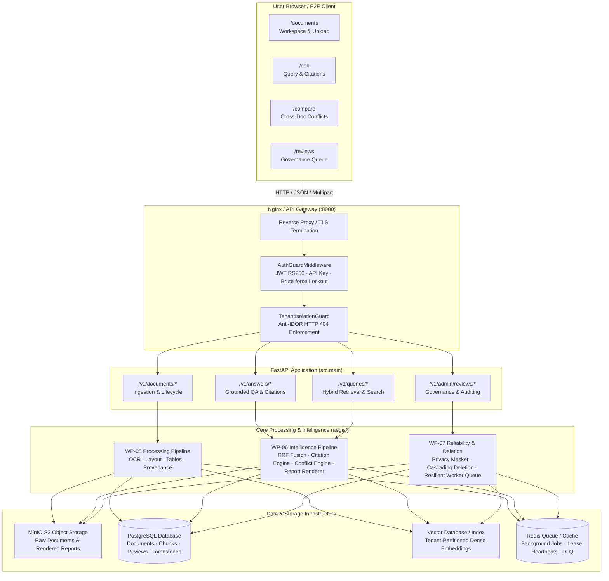
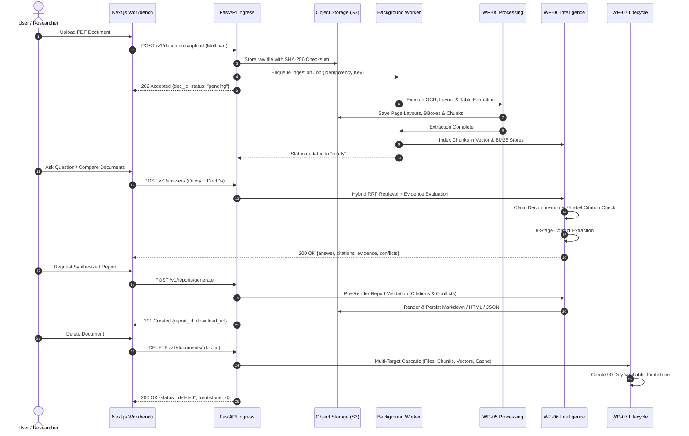

# AEGIS-DocIntel — WP-08: Integration Architecture

> **Work Package**: WP-08 — Integration  
> **Status**: **ARCHITECTURE SPECIFIED**  
> **Date**: 2026-11-04  
> **Target Branch**: `wp-08-integration`  

---

## 1. System Integration Overview

The AEGIS-DocIntel application integrates three primary layers into a cohesive document intelligence platform:
1. **Frontend Presentation & Governance Layer (`web/`)**: Next.js 16 App Router application providing document workspaces, query interfaces, cross-document comparison, and human governance review queues.
2. **API Gateway & Routing Layer (`src/`)**: High-performance FastAPI backend providing authentication, authorization, anti-IDOR tenant scoping, request validation, and asynchronous job coordination.
3. **Processing, Intelligence & Storage Core (`aegis/`)**: Verified multi-modal pipelines executing OCR extraction (WP-05), hybrid retrieval, claim-level citation validation, conflict extraction, report synthesis (WP-06), and security lifecycle enforcement (WP-07).

---

## 2. Integrated Product Architecture Diagram



---

## 3. Frontend-to-Backend Communication Protocol

### 3.1 Networking & Contract Handshake
- **Base URL Resolution**: Client reads `process.env.NEXT_PUBLIC_AEGIS_API_URL` (defaulting to `http://127.0.0.1:8000`).
- **Authentication Headers**:
  - `Authorization: Bearer <jwt_token>`
  - `X-API-Key: <api_key>` (for automated services)
  - `X-Tenant-ID: <tenant_id>` (validated against token claims; mismatch immediately rejected)
- **Runtime Zod Validation**:
  - The client wraps every fetch request in `apiRequest<T>(path, schema, init)` ([`web/src/lib/api-client.ts`](file:///c:/Users/ASUS/Documents/Aegis-DocIntel/web/src/lib/api-client.ts)).
  - Responses that violate TypeScript/Zod schemas fail closed with `ApiError("Response contract validation failed: ...")`.

### 3.2 Standardized Error Model
All backend HTTP error responses conform to a unified contract:
```json
{
  "error": {
    "code": "DOCUMENT_NOT_FOUND",
    "message": "The requested document is unavailable.",
    "request_id": "req-20261104-001",
    "details": {}
  }
}
```
**Security Invariant**: Error messages never expose database stack traces, file system paths, credentials, or other tenants' data. Cross-tenant access triggers `DOCUMENT_NOT_FOUND` (HTTP 404) to prevent IDOR enumeration.

---

## 4. End-to-End Document-to-Report Data Flow



---

## 5. Architectural Quality Invariants

1. **End-to-End Grounding**: No factual claim may be presented in the frontend or in exportable reports without an entailed source citation and bounding box coordinates.
2. **Conflict Preservation**: Contradictions between multiple documents must never be resolved by silent overwriting; they must be surfaced in comparative views and reports with their conflicting values.
3. **Tenant Containment**: All vector similarity calculations, search indexes, and cache lookups must strictly pre-filter on `tenant_id`.
4. **Disaster Recoverability**: All database snapshots are verified via AES-256-GCM encryption and SHA-256 integrity checksums, with post-restoration tombstone replay.
