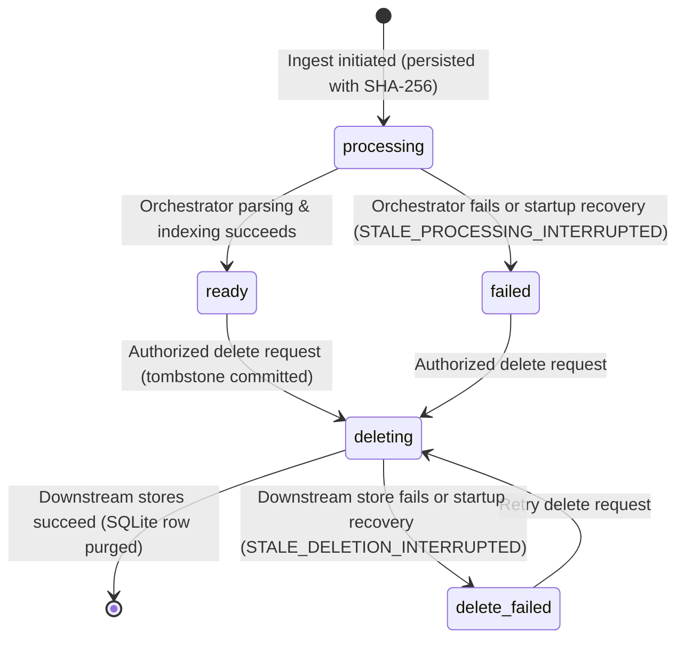
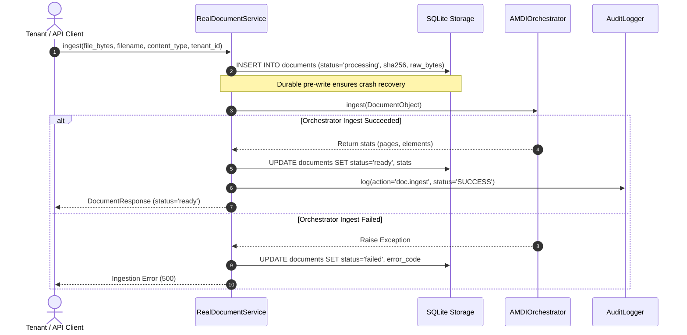

# AEGIS-DocIntel: Document Lifecycle & Persistence Architecture

**Document Version:** 1.0.0  
**Phase:** P1 Implementation  
**Status:** Verified Production Implementation  
**Primary Implementations:**  
- [`src/services/container.py`](file:///c:/Users/ASUS/Documents/Aegis-DocIntel/src/services/container.py)  
- [`src/services/storage_errors.py`](file:///c:/Users/ASUS/Documents/Aegis-DocIntel/src/services/storage_errors.py)  
- [`src/core/orchestrator.py`](file:///c:/Users/ASUS/Documents/Aegis-DocIntel/src/core/orchestrator.py)  

---

## 1. Overview & System Guarantees

The AEGIS-DocIntel Document Lifecycle & Persistence Engine provides durable, multi-tenant document management with strict data integrity guarantees:

1. **Atomic Ingestion Lifecycle:** Documents are recorded in durable storage before orchestrator processing begins. Documents transition through explicit states (`processing` &rarr; `ready` or `failed`).
2. **Fail-Closed Persistence:** Storage failures during initialization, ingestion, update, or deletion raise typed exceptions (`DocumentStorageError`, `DocumentPersistenceError`) rather than returning false success.
3. **Cryptographic Checksum Verification:** Raw bytes stored in SQLite are hashed with SHA-256 upon ingestion and verified against stored digests upon rehydration. Tampered bytes fail immediately with `DocumentRecoveryError`.
4. **Tombstone-Driven Cascading Deletion:** Deletion commits an explicit `deleting` tombstone in SQLite before triggering downstream cleanup across vector indexes and semantic caches. If any downstream store fails, the document transitions to `delete_failed` and returns `False` (retryable) to prevent phantom data leaks.
5. **Cold-Start Crash Recovery:** On service startup, interrupted in-flight documents are automatically reconciled: `processing` &rarr; `failed` (`STALE_PROCESSING_INTERRUPTED`) and `deleting` &rarr; `delete_failed` (`STALE_DELETION_INTERRUPTED`).

---

## 2. Document State Machine



### Valid State Transitions

The lifecycle strictly adheres to `ALLOWED_TRANSITIONS`:

| Source State | Permitted Destination States | Description |
|:---|:---|:---|
| `processing` | `ready`, `failed`, `deleting` | Transition to `ready` upon successful orchestration; `failed` upon processing error or restart interruption. |
| `ready` | `deleting` | Ingestion complete, queryable; may be marked for deletion. |
| `failed` | `processing`, `deleting` | Ingestion aborted or interrupted; eligible for retry or purge. |
| `deleting` | `delete_failed` (or purged) | Downstream vector/cache stores in flight; purged on complete success, marked `delete_failed` if any store errors. |
| `delete_failed` | `deleting` | Downstream store failed during deletion; eligible for retried deletion. |

---

## 3. Persistent Schema & Migration (SQLite Schema v2)

The SQLite database uses `PRAGMA user_version` for automated, non-destructive schema migrations from v1 to v2:

```sql
CREATE TABLE IF NOT EXISTS documents (
    doc_id TEXT PRIMARY KEY,
    tenant_id TEXT NOT NULL,
    filename TEXT NOT NULL,
    status TEXT NOT NULL,
    page_count INTEGER NOT NULL,
    chunk_count INTEGER NOT NULL,
    is_scanned BOOLEAN NOT NULL,
    language TEXT NOT NULL,
    created_at TEXT NOT NULL,
    updated_at TEXT,
    raw_bytes BLOB,
    content_type TEXT,
    byte_size INTEGER,
    sha256 TEXT,
    error_code TEXT
);

CREATE INDEX IF NOT EXISTS idx_documents_tenant_status ON documents(tenant_id, status);
CREATE INDEX IF NOT EXISTS idx_documents_created_at ON documents(created_at DESC);
```

### Schema Migration v1 &rarr; v2

During `_init_db()`, the engine inspects existing columns via `PRAGMA table_info(documents)` and automatically executes `ALTER TABLE documents ADD COLUMN ...` for any missing fields (`updated_at`, `raw_bytes`, `content_type`, `byte_size`, `sha256`, `error_code`), preserving all preexisting document records and updating `PRAGMA user_version = 2`.

---

## 4. Ingestion Lifecycle Protocol



---

## 5. Cascading Deletion & Tombstone Protocol

A document cannot be reported as deleted while derived state remains in downstream stores.

```mermaid
sequenceDiagram
    autonumber
    actor Tenant as Tenant / API Client
    participant Service as RealDocumentService
    participant DB as SQLite Storage
    participant Vector as Vector Store (FAISS/NumPy)
    participant Cache as Semantic Cache (Redis/Local)
    participant Orch as AMDIOrchestrator

    Tenant->>Service: delete(doc_id, tenant_id)
    Service->>DB: Check tenant_id & status IN ('ready', 'failed', 'delete_failed')
    alt Tenant Unauthorized or Not Found
        Service-->>Tenant: False (404/403)
    else Tenant Authorized
        Service->>DB: UPDATE documents SET status='deleting' (Tombstone)
        Service->>Vector: delete(doc_id)
        Service->>Cache: invalidate(doc_id)
        Service->>Orch: delete_document(doc_id, tenant_id)
        alt All Downstream Stores Succeeded
            Service->>DB: DELETE FROM documents WHERE doc_id = ?
            Service-->>Tenant: True (Deleted)
        else Any Store Failed
            Service->>DB: UPDATE documents SET status='delete_failed', error_code
            Service-->>Tenant: False (Pending / Retryable)
        end
    end
```



---

## 6. Restart & Crash Recovery

When `RealDocumentService` starts up, `_load_docs()` executes automated reconciliation against SQLite:
1. Documents left in `status = 'processing'` (due to process crash during ingest) are updated to `status = 'failed'` with `error_code = 'STALE_PROCESSING_INTERRUPTED'`.
2. Documents left in `status = 'deleting'` (due to crash during cascading deletion) are updated to `status = 'delete_failed'` with `error_code = 'STALE_DELETION_INTERRUPTED'`.
3. Only documents with `status = 'ready'` are populated into active in-memory indexes.
