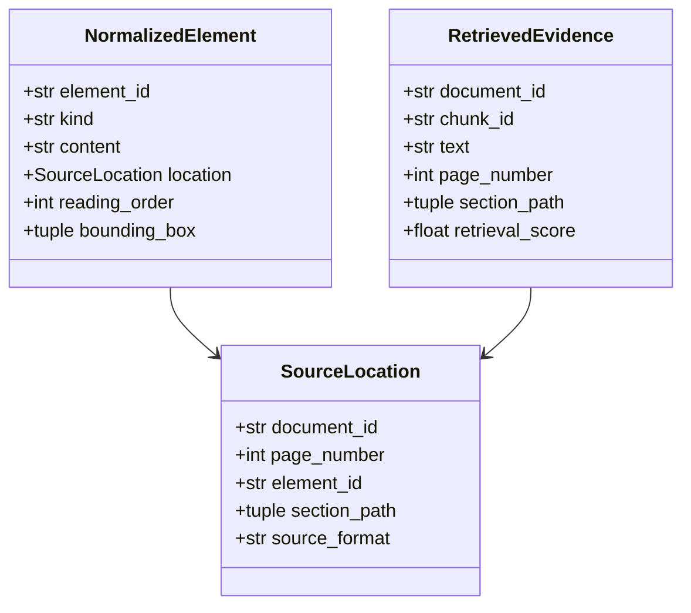
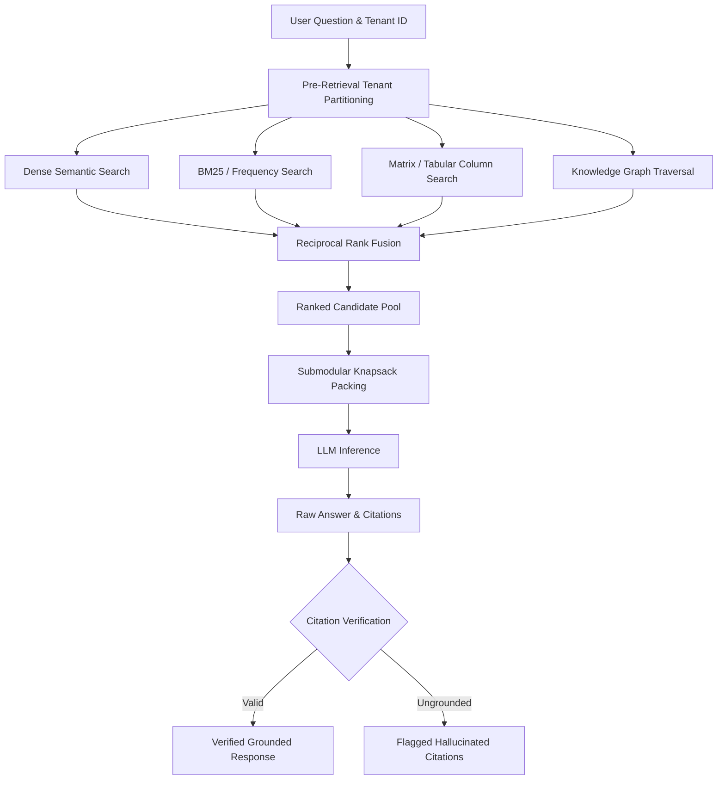

# Retrieval & Answer Grounding Architecture

## 1. Overview

In enterprise document intelligence, ungrounded retrieval or unverified citations destroy trust.
AEGIS-DocIntel implements an evidence-grounded retrieval architecture designed around:
1. **Source Provenance Invariance**: Every extracted text block, table cell, and heading retains immutable source coordinates (`SourceLocation`).
2. **Pre-Retrieval Tenant Isolation**: Search spaces are filtered by authenticated tenant before any embedding calculations or index scans take place.
3. **Hybrid Multi-Strategy Fusion (RRF)**: Reciprocal Rank Fusion across semantic vector search, BM25 keyword matching, tabular cell matching, and graph traversal.
4. **Citation Integrity Verification**: Automated verification that generated citations reference valid chunks in the retrieved evidence set.
5. **Abstention on Unanswerable Queries**: Guaranteed abstention rather than hallucination when no evidence exists in the tenant's authorized documents.

---

## 2. Canonical Provenance Data Models



- **`SourceLocation`**: Immutable record of original document coordinates (`document_id`, `page_number`, `element_id`, `section_path`, `source_format`).
- **`NormalizedElement`**: Intermediate representation carrying bounding coordinates and reading order index.
- **`RetrievedEvidence`**: Chunk delivered to context builders, carrying source provenance and retrieval score.

---

## 3. Multi-Strategy Retrieval Pipeline



### 3.1 Pre-Retrieval Tenant Scoping
Before querying index engines, candidate document IDs are resolved from SQLite:
$$\mathcal{D}_{\text{authorized}} = \{d \in \mathcal{D} \mid \text{tenant\_id}(d) = \text{tenant\_caller}\}$$
If a user passes a `doc_id` belonging to a different tenant, a `PermissionError` is raised immediately before reading vector indices.

### 3.2 Reciprocal Rank Fusion (RRF)
Given ranked lists $\tau_m$ from methods $m \in M$:

$$\text{RRF}(d) = \sum_{m \in M} \frac{w_m}{k + r_m(d)}$$

Where $k = 60$ is the standard smoothing parameter and $r_m(d)$ is the 1-based rank of document $d$ under method $m$.

---

## 4. Citation Validation & Abstention

### 4.1 Citation Integrity Verification (`validate_citations`)
The system validates answer citations against the evidence pool retrieved for the prompt:
- Let $\mathcal{C}$ be the citations cited in the generated answer.
- Let $\mathcal{E}$ be the set of `RetrievedEvidence` items passed to the context.
- For each $c \in \mathcal{C}$, verify that $c.\text{chunk\_id} \in \{e.\text{chunk\_id} \mid e \in \mathcal{E}\}$.
- If citations reference ungrounded chunks, `is_valid` is set to `False` and details are logged.

### 4.2 Abstention Mechanism
When $\mathcal{D}_{\text{authorized}}$ is empty or retrieval returns zero matching candidates, the system refrains from calling the LLM or overrides the output with an explicit abstention response:
```json
{
  "answer": "I do not have sufficient evidence in the authorized documents to answer this question.",
  "confidence": 0.0,
  "confidence_label": "LOW",
  "grounded": false,
  "citations": []
}
```
This guarantees zero hallucinated answers when no evidence exists in the corpus.
