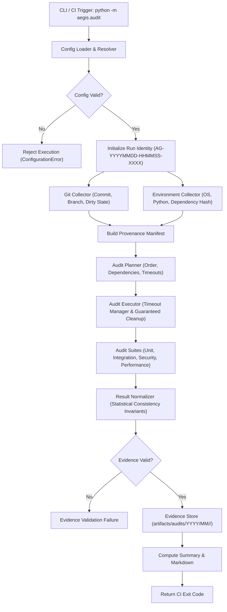

# AEGIS-DocIntel — Audit Infrastructure Architecture (WP-02)

## 1. Overview
WP-02 establishes a centralized, reproducible, traceable, and extensible audit infrastructure for AEGIS-DocIntel.
Every audit execution is backed by:
- Centralized execution coordinator (`aegis.audit.runner.engine.AuditRunner`)
- Strict configuration validation contracts (`configs/audit/*.yaml`, `aegis.audit.config.validator`)
- Standardized machine-readable evidence models (`schemas/audit/v1/*.schema.json`, `aegis.audit.evidence`)
- End-to-end Git and environmental provenance tracking (`aegis.audit.traceability`)

## 2. Core Subsystems

## 3. Mathematical Consistency Guarantees
1. **Suite Execution Accounting**:
   $$N_{\text{total}} = N_{\text{passed}} + N_{\text{failed}} + N_{\text{skipped}} + N_{\text{errors}}$$
2. **Execution Timing**:
   $$T_{\text{run}} = T_{\text{completed}} - T_{\text{started}}$$
3. **Artifact Integrity**:
   $$H_i = \text{SHA256}(A_i)$$
4. **Completion Ratio**:
   $$C = \frac{N_{\text{terminal suites}}}{N_{\text{planned suites}}} \times 100$$
5. **Line-Invariant Finding Fingerprint**:
   $$F = \text{SHA256}(\text{suite\_id} \parallel \text{rule\_id} \parallel \text{normalized\_path} \parallel \text{identity})$$
