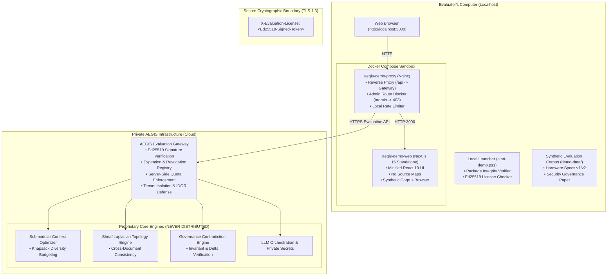
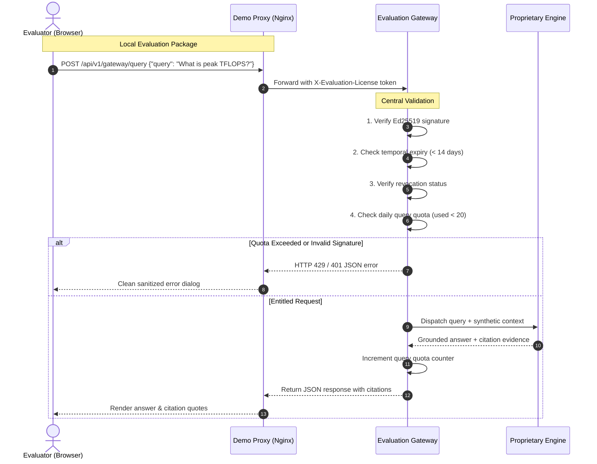

# AEGIS-DocIntel — Protected Downloadable Demo Architecture

**Document Version:** 1.1.0  
**Status:** Certified Architecture Specification  
**Target Environment:** Local Evaluation & Product Hunt Distribution  

---

## 1. System Overview

The **AEGIS-DocIntel Protected Demo Edition** implements a **Hybrid Evaluation Architecture**. It combines the agility and low friction of running a local workbench on the user's computer with strict protection of core proprietary algorithms and cloud provider secrets.

---

## 2. Component Breakdown

### A. Downloadable Local Evaluation Package (`distribution/demo-edition/`)
- **`deploy/compose.yaml`**: Orchestrates the local presentation tier (`aegis-demo-web`) and edge routing proxy (`aegis-demo-proxy`).
- **`deploy/nginx-demo-proxy.conf`**:
  - Serves Next.js web application on port 3000.
  - Proxies `/api/*` to the central Evaluation Gateway.
  - Explicitly intercepts and drops any request to `/admin/*`, returning HTTP 403.
- **`launcher/start-demo.ps1`**:
  - Runs cryptographic package verification (`verify-package.ps1`).
  - Checks container runtime availability (Docker Desktop).
  - Inspects `license/evaluation.lic` validity and remaining evaluation days.
  - Boots Docker Compose, polls health probe, and launches default browser.
- **`license/`**:
  - `public-key.pem`: Ed25519 public key used for local signature checks.
  - `evaluation.lic`: 14-day signed evaluation token issued to evaluator.
- **`demo-data/`**:
  - Pre-packaged synthetic hardware specifications (Revision 1.0 vs 2.0) with intentional contradictions (450 vs 620 TFLOPS, 220W vs 285W TDP) and invariants (128 MB SRAM cache).
  - Synthetic enterprise governance whitepaper specifying SHA-256 audit chaining.

### B. Secure Evaluation Gateway (`services/evaluation_gateway/`)
- **Asymmetric Signature Verification (`license.py`)**: Uses Ed25519 256-bit asymmetric cryptography to authenticate license tokens. The private key remains exclusively in secure cloud storage.
- **Entitlement Checks (`entitlements.py`)**: Validates feature entitlements (`document_upload`, `ask_aegis`, `document_comparison`) before dispatching requests.
- **Server-Side Quota Tracking (`quotas.py`)**:
  - Maximum 5 active document uploads.
  - Maximum 20 Ask AEGIS queries per 24 hours.
  - Maximum 5 cross-document comparisons per 24 hours.
  - Maximum 10 MB per uploaded document.
- **Strict Tenant Isolation & IDOR Defense (`app.py`)**: All document lookups and queries are bound to the `license_id` in the authenticated context. Any cross-license object request returns HTTP 404.
- **Error Sanitation**: Prevents leak of internal stack traces, system file paths, or private configuration.

---

## 3. Communication Sequence

