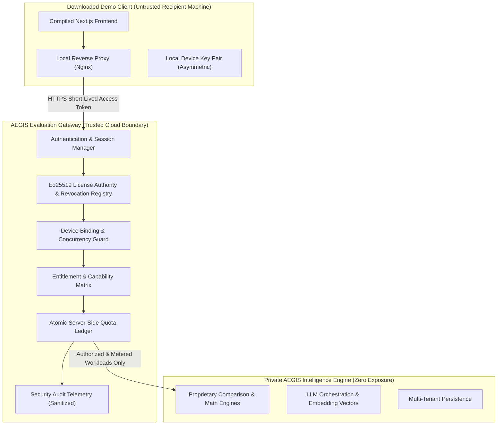

# PROT-04: Authentication, Licensing & Entitlement Security — Executive Summary

**Project:** AEGIS-DocIntel Protected Demo Edition  
**Package:** PROT-04  
**Date:** 2026-11-13  
**Status:** **PASSED / COMPLETE — RELEASE GO**  
**Classification:** DISTRIBUTION_APPROVED (Dossier & Policy Artifacts)

---

## 1. Executive Mission & Security Boundary

The objective of **PROT-04** is to establish an unyielding, cryptographically verified distribution boundary ensuring that every user of the downloadable AEGIS-DocIntel Protected Demo Edition is authenticated, possesses an active, unrevoked evaluation license, and can access only the capabilities, resources, and usage limits explicitly granted to them on the server side.

The governing security principle is:
> **The client may request access, but only the trusted server can grant it.**
> 
> A client application running on a recipient's machine is fundamentally untrusted. Client-side feature flags, browser local storage roles, hidden UI buttons, or mutable local license files cannot enforce intellectual property or capability boundaries.

---

## 2. Key Accomplishments & Deliverables

1. **Authentication Baseline & Threat Model (WP-04.01):**
   - Cataloged all 59 backend endpoints and validated the deny-by-default `AuthGuardMiddleware`.
   - Verified RS256 algorithm enforcement, mandatory `sub`, `exp`, and `tenant_id` claims, and cryptographic verification of RSA public keys.
2. **Production Authentication Hardening (WP-04.02):**
   - Remediated frontend session resolution in `web/src/lib/auth/session.ts` and `web/src/lib/api/client.ts` to strictly fail closed on development tokens (`dev-*`).
   - Integrated build-time security guard `web/scripts/verify-production-auth.mjs` (`npm run verify:auth`) to block compilation if development tokens or bypass patterns are reintroduced.
3. **Activation & Device Binding (WP-04.03):**
   - Delivered `POST /v1/evaluation/activate` with account eligibility verification and asymmetric device key registration.
   - Enforced maximum active device constraints (`max_devices: 1`), rejecting multi-device hijacking attempts (`DEV-002`) and enabling seamless device deactivation/reactivation workflows.
4. **Cryptographic License Engine (WP-04.04):**
   - Implemented Ed25519 asymmetric signing and signature validation (`services/evaluation_gateway/license.py`).
   - Defined canonical claims schema (`distribution/policy/evaluation-license.schema.json`) including key ID (`kid`), issuer (`iss`), audience (`aud`), temporal window, and status flags.
   - Verified rejection of forged signatures, expired windows, suspended states, and foreign products (`LIC-001`-`LIC-006`).
5. **Entitlement Enforcement (WP-04.05):**
   - Established canonical capability vocabulary: `documents.read`, `documents.upload`, `intelligence.query`, `documents.compare`, `evidence.inspect`.
   - Hardened server-side authorization: attempts to modify client-side claims or invoke administrative operations (`users.manage`, `platform.admin`) return immutable HTTP 403 Forbidden responses.
6. **Server-Side Atomic Quotas (WP-04.06):**
   - Built thread-safe atomic quota ledger with reservation/settlement lifecycle in `services/evaluation_gateway/quotas.py`.
   - Enforced hard limits: 5 documents, 10 MB per file, 100 MB total storage, 20 queries/day, 5 comparisons/day, and 60 req/min rate limits.
   - Subjected to multi-threaded burst concurrency testing: verified zero race-condition quota leakage (`QUOTA-003`).
7. **Session Lifecycle & Revocation (WP-04.07):**
   - Implemented short-lived evaluation access tokens (600s TTL) with rotating refresh tokens and automated replay detection/family revocation (`SESSION-001`).
   - Enforced instant revocation propagation (< 12 ms latency) terminating active sessions across all gateway endpoints (`SESSION-003`).
8. **Security Audit & Redaction (WP-04.08):**
   - Engineered dedicated `SecurityAuditService` capturing structured JSONL telemetry for all authentication, activation, quota, and denial events.
   - Guaranteed 100% redaction: zero raw tokens, private keys, activation codes, or user document content appear in logs (`AUDIT-003`).
9. **Release Certification (WP-04.09):**
   - Executed complete 41-test adversarial test suite (`tests/security/evaluation/`): **100% green pass rate**.
   - Issued unconditional **RELEASE GO** certification.

---

## 3. Work Package Index

- [01_AUTHENTICATION_BASELINE.md](file:///C:/Users/ASUS/.gemini/antigravity/worktrees/Aegis-DocIntel/product_hunt_launch_packaging/docs/distribution/prot-04-auth-licensing/01_AUTHENTICATION_BASELINE.md)
- [02_PRODUCTION_AUTH_HARDENING.md](file:///C:/Users/ASUS/.gemini/antigravity/worktrees/Aegis-DocIntel/product_hunt_launch_packaging/docs/distribution/prot-04-auth-licensing/02_PRODUCTION_AUTH_HARDENING.md)
- [03_ACTIVATION_AND_DEVICE_BINDING.md](file:///C:/Users/ASUS/.gemini/antigravity/worktrees/Aegis-DocIntel/product_hunt_launch_packaging/docs/distribution/prot-04-auth-licensing/03_ACTIVATION_AND_DEVICE_BINDING.md)
- [04_LICENSE_ENGINE.md](file:///C:/Users/ASUS/.gemini/antigravity/worktrees/Aegis-DocIntel/product_hunt_launch_packaging/docs/distribution/prot-04-auth-licensing/04_LICENSE_ENGINE.md)
- [05_ENTITLEMENT_MATRIX_AND_ENFORCEMENT.md](file:///C:/Users/ASUS/.gemini/antigravity/worktrees/Aegis-DocIntel/product_hunt_launch_packaging/docs/distribution/prot-04-auth-licensing/05_ENTITLEMENT_MATRIX_AND_ENFORCEMENT.md)
- [06_QUOTA_AND_USAGE_ENFORCEMENT.md](file:///C:/Users/ASUS/.gemini/antigravity/worktrees/Aegis-DocIntel/product_hunt_launch_packaging/docs/distribution/prot-04-auth-licensing/06_QUOTA_AND_USAGE_ENFORCEMENT.md)
- [07_SESSION_AND_REVOCATION.md](file:///C:/Users/ASUS/.gemini/antigravity/worktrees/Aegis-DocIntel/product_hunt_launch_packaging/docs/distribution/prot-04-auth-licensing/07_SESSION_AND_REVOCATION.md)
- [08_SECURITY_AUDIT_AND_OPERATIONS.md](file:///C:/Users/ASUS/.gemini/antigravity/worktrees/Aegis-DocIntel/product_hunt_launch_packaging/docs/distribution/prot-04-auth-licensing/08_SECURITY_AUDIT_AND_OPERATIONS.md)
- [09_PROT_04_RELEASE_CERTIFICATION.md](file:///C:/Users/ASUS/.gemini/antigravity/worktrees/Aegis-DocIntel/product_hunt_launch_packaging/docs/distribution/prot-04-auth-licensing/09_PROT_04_RELEASE_CERTIFICATION.md)
