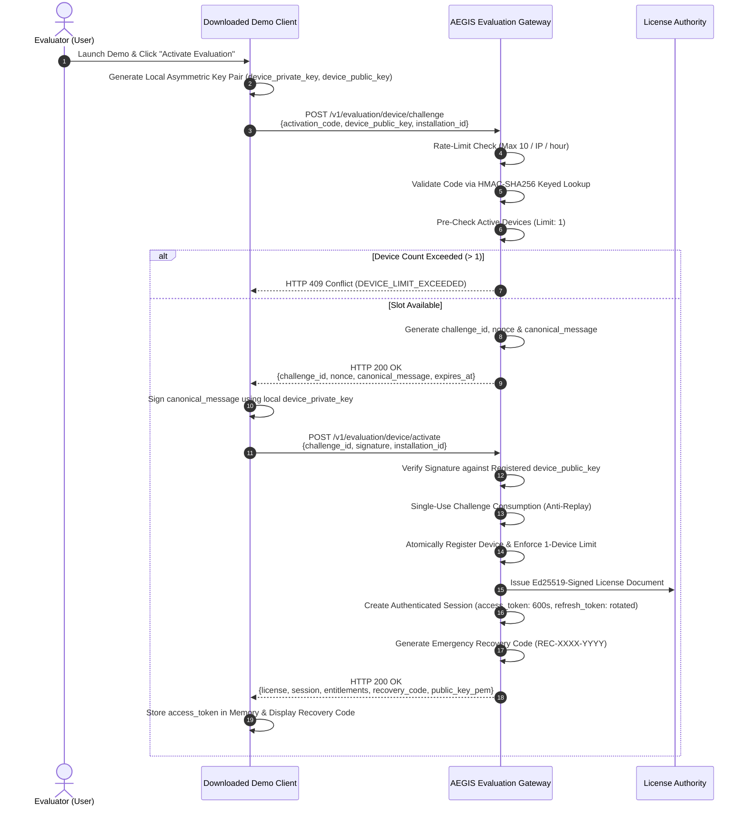

# PROT-04.03: Evaluation Activation & Device Binding

**Work Package:** PROT-04.03  
**Target:** Account-Backed Activation Workflow, Device Cryptographic Binding & Device Quotas  
**Status:** **PASSED / IMPLEMENTED & VERIFIED**  
**Detailed Dossiers:** [wp-04-03-device-binding/](file:///C:/Users/ASUS/.gemini/antigravity/worktrees/Aegis-DocIntel/product_hunt_launch_packaging/docs/distribution/prot-04-auth-licensing/wp-04-03-device-binding/)  

---

## 1. Activation Flow & Architecture

The Protected Demo Edition distribution model replaces insecure embedded static credentials with an asymmetric proof-of-possession device challenge protocol.



---

## 2. API Contract & Schemas

### Stage 1: Request Challenge (`POST /v1/evaluation/device/challenge`)
```json
{
  "activation_code": "AEGIS-EVAL-2026-DEMO",
  "device_public_key": "-----BEGIN PUBLIC KEY-----\nMCowBQYDK2VwAyEA0dev1...",
  "installation_id": "inst-win-dev01",
  "device_label": "Primary Evaluator Laptop",
  "platform": "windows"
}
```

### Stage 2: Submit Proof & Activate (`POST /v1/evaluation/device/activate`)
```json
{
  "challenge_id": "45c43d83-4a11-4770-b49c-f127cb46db07",
  "signature": "MEYCIQD+5r9...base64 signature...",
  "installation_id": "inst-win-dev01",
  "client_version": "1.1.0"
}
```

### Response: `HTTP 200 OK`
```json
{
  "status": "active",
  "client_id": "evaluator-primary",
  "device_id": "8d3e91f1-4a11-4770-b49c-f127cb46db07",
  "recovery_code": "REC-A4B8-9F21",
  "license": {
    "product": "AEGIS_PROTECTED_EVALUATION",
    "license_id": "67a14e9b-0294-4d89-9133-784f1b3c9b71",
    "tier": "evaluation",
    "expires_at": "2026-11-28T09:30:00Z",
    "status": "ACTIVE"
  },
  "session": {
    "access_token": "aegis_eval_at_9d8s7df...",
    "token_type": "Bearer",
    "expires_in": 600,
    "refresh_token": "aegis_eval_rt_8f7d6s5...",
    "device_id": "8d3e91f1-4a11-4770-b49c-f127cb46db07"
  },
  "entitlements": {
    "documents.read": true,
    "documents.upload": true,
    "intelligence.query": true,
    "documents.compare": true,
    "evidence.inspect": true,
    "users.manage": false,
    "platform.admin": false
  },
  "quotas": {
    "max_documents": 5,
    "max_queries_per_day": 20,
    "max_comparisons_per_day": 5
  },
  "license_token": "eyJhbGciOiJFZDI1NTE5...",
  "public_key_pem": "-----BEGIN PUBLIC KEY-----\n..."
}
```

---

## 3. Key Architectural Controls

1. **Maximum Active Devices (`DEV-002`):**
   - Each evaluation license is constrained to exactly 1 active device (`max_devices: 1`).
   - If a second device attempts activation using the same code while device 1 is active, the gateway rejects the request with HTTP 409 Conflict (`DEVICE_LIMIT_EXCEEDED`).
   - Tested under high-concurrency race condition (10 simultaneous threads): exactly 1 succeeds, 9 receive 409 (`DEV-026`).
2. **Device Deactivation Endpoint (`DEV-004`):**
   - Evaluators can deactivate their active device via `POST /v1/evaluation/devices/{device_id}/deactivate`.
   - Deactivating a device instantly invalidates all associated session tokens (`DEV-003`) and frees the slot for another machine.
3. **Emergency Device Recovery (`DEV-020`):**
   - In case of hardware loss or OS wipe, `POST /v1/evaluation/devices/{device_id}/recover` with the emergency recovery code revokes the lost device and frees the license slot.
4. **Device Presence Heartbeat (`DEV-022`):**
   - Active client periodic check-in via `POST /v1/evaluation/device/heartbeat` updates presence timestamps and fails closed if the device has been deactivated (`DEV-023`).
5. **Keyed HMAC-SHA256 Indexing (`DEV-025`):**
   - Zero raw activation codes stored in memory keys, database records, or audit telemetry.
6. **Anti-Scraping Rate Limiting (`DEV-024`):**
   - Ingress activation attempts are restricted to 10 attempts per IP per hour. Exceeding attempts triggers HTTP 429 Too Many Requests (`SEC-DEMO-019`).

---

## 4. Documentation Index

The complete 11-dossier work package documentation is maintained in:
[docs/distribution/prot-04-auth-licensing/wp-04-03-device-binding/](file:///C:/Users/ASUS/.gemini/antigravity/worktrees/Aegis-DocIntel/product_hunt_launch_packaging/docs/distribution/prot-04-auth-licensing/wp-04-03-device-binding/)

1. [01_DEVICE_BINDING_ARCHITECTURE.md](file:///C:/Users/ASUS/.gemini/antigravity/worktrees/Aegis-DocIntel/product_hunt_launch_packaging/docs/distribution/prot-04-auth-licensing/wp-04-03-device-binding/01_DEVICE_BINDING_ARCHITECTURE.md)
2. [02_DEVICE_IDENTITY_AND_KEY_MANAGEMENT.md](file:///C:/Users/ASUS/.gemini/antigravity/worktrees/Aegis-DocIntel/product_hunt_launch_packaging/docs/distribution/prot-04-auth-licensing/wp-04-03-device-binding/02_DEVICE_IDENTITY_AND_KEY_MANAGEMENT.md)
3. [03_ACTIVATION_CODE_SPECIFICATION.md](file:///C:/Users/ASUS/.gemini/antigravity/worktrees/Aegis-DocIntel/product_hunt_launch_packaging/docs/distribution/prot-04-auth-licensing/wp-04-03-device-binding/03_ACTIVATION_CODE_SPECIFICATION.md)
4. [04_CHALLENGE_RESPONSE_PROTOCOL.md](file:///C:/Users/ASUS/.gemini/antigravity/worktrees/Aegis-DocIntel/product_hunt_launch_packaging/docs/distribution/prot-04-auth-licensing/wp-04-03-device-binding/04_CHALLENGE_RESPONSE_PROTOCOL.md)
5. [05_LICENSE_AND_DEVICE_DATABASE_SCHEMA.md](file:///C:/Users/ASUS/.gemini/antigravity/worktrees/Aegis-DocIntel/product_hunt_launch_packaging/docs/distribution/prot-04-auth-licensing/wp-04-03-device-binding/05_LICENSE_AND_DEVICE_DATABASE_SCHEMA.md)
6. [06_DEVICE_LIFECYCLE_AND_RECOVERY.md](file:///C:/Users/ASUS/.gemini/antigravity/worktrees/Aegis-DocIntel/product_hunt_launch_packaging/docs/distribution/prot-04-auth-licensing/wp-04-03-device-binding/06_DEVICE_LIFECYCLE_AND_RECOVERY.md)
7. [07_ACTIVATION_API_SPECIFICATION.md](file:///C:/Users/ASUS/.gemini/antigravity/worktrees/Aegis-DocIntel/product_hunt_launch_packaging/docs/distribution/prot-04-auth-licensing/wp-04-03-device-binding/07_ACTIVATION_API_SPECIFICATION.md)
8. [08_ABUSE_AND_THREAT_MODEL.md](file:///C:/Users/ASUS/.gemini/antigravity/worktrees/Aegis-DocIntel/product_hunt_launch_packaging/docs/distribution/prot-04-auth-licensing/wp-04-03-device-binding/08_ABUSE_AND_THREAT_MODEL.md)
9. [09_SECURITY_TEST_PLAN.md](file:///C:/Users/ASUS/.gemini/antigravity/worktrees/Aegis-DocIntel/product_hunt_launch_packaging/docs/distribution/prot-04-auth-licensing/wp-04-03-device-binding/09_SECURITY_TEST_PLAN.md)
10. [10_TEST_EXECUTION_REPORT.md](file:///C:/Users/ASUS/.gemini/antigravity/worktrees/Aegis-DocIntel/product_hunt_launch_packaging/docs/distribution/prot-04-auth-licensing/wp-04-03-device-binding/10_TEST_EXECUTION_REPORT.md)
11. [11_WP_04_03_SIGNOFF.md](file:///C:/Users/ASUS/.gemini/antigravity/worktrees/Aegis-DocIntel/product_hunt_launch_packaging/docs/distribution/prot-04-auth-licensing/wp-04-03-device-binding/11_WP_04_03_SIGNOFF.md)
