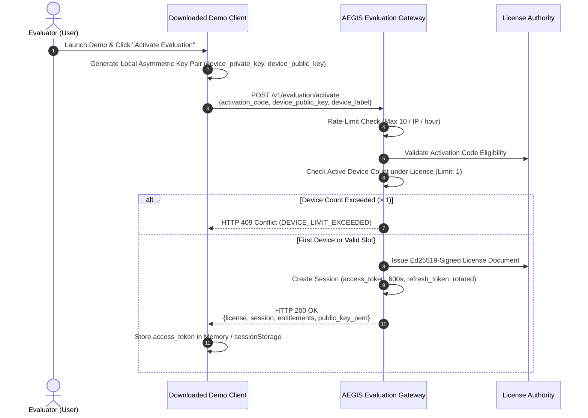

# PROT-04.03: Evaluation Activation & Device Binding

**Work Package:** PROT-04.03  
**Target:** Account-Backed Activation Workflow, Device Cryptographic Binding & Device Quotas  
**Status:** **IMPLEMENTED & VERIFIED**

---

## 1. Activation Flow & Architecture

The Protected Demo Edition distribution model replaces insecure embedded static credentials with an account-backed activation protocol.



---

## 2. API Contract & Schemas

### Request: `POST /v1/evaluation/activate`
```json
{
  "activation_code": "AEGIS-EVAL-2026-DEMO",
  "device_public_key": "MIIBIjANBgkqhkiG9w0BAQEFAAOCAQ8AMIIBCgKCAQEA0dev1pubkey==",
  "device_label": "Primary Evaluator Laptop",
  "platform": "windows",
  "client_version": "1.1.0"
}
```

### Response: `HTTP 200 OK`
```json
{
  "status": "active",
  "client_id": "evaluator-primary",
  "license": {
    "product": "AEGIS_PROTECTED_EVALUATION",
    "license_id": "67a14e9b-0294-4d89-9133-784f1b3c9b71",
    "tier": "evaluation",
    "expires_at": "2026-11-27T04:15:00Z",
    "status": "ACTIVE"
  },
  "session": {
    "access_token": "aegis_eval_at_K3d8...",
    "token_type": "Bearer",
    "expires_in": 600,
    "refresh_token": "aegis_eval_rt_9xP2...",
    "device_id": "d-847291a4"
  },
  "entitlements": {
    "documents.read": true,
    "documents.upload": true,
    "intelligence.query": true,
    "documents.compare": true,
    "evidence.inspect": true,
    "users.manage": false,
    "platform.admin": false
  },
  "quotas": {
    "max_documents": 5,
    "max_queries_per_day": 20,
    "max_comparisons_per_day": 5
  },
  "license_token": "eyJhbGciOiJFZDI1NTE5...",
  "public_key_pem": "-----BEGIN PUBLIC KEY-----\n..."
}
```

---

## 3. Device Binding Enforcement & Deactivation

1. **Maximum Active Devices (`DEV-002`):**
   - Each evaluation license is constrained to exactly 1 active device (`max_devices: 1`).
   - If a second device attempts activation using the same code or account while device 1 is active, the gateway rejects the request with HTTP 409 Conflict (`DEVICE_LIMIT_EXCEEDED`).
2. **Device Deactivation Endpoint (`DEV-004`):**
   - Evaluators can deactivate their active device via `POST /v1/evaluation/device/deactivate`:
     ```json
     { "device_id": "d-847291a4" }
     ```
   - Deactivating a device instantly invalidates all associated session tokens (`DEV-003`) and frees the slot for another machine.
3. **Anti-Scraping Rate Limiting:**
   - Ingress activation attempts are restricted to 10 attempts per IP per hour. Exceeding attempts triggers HTTP 429 Too Many Requests (`SEC-DEMO-019`).
