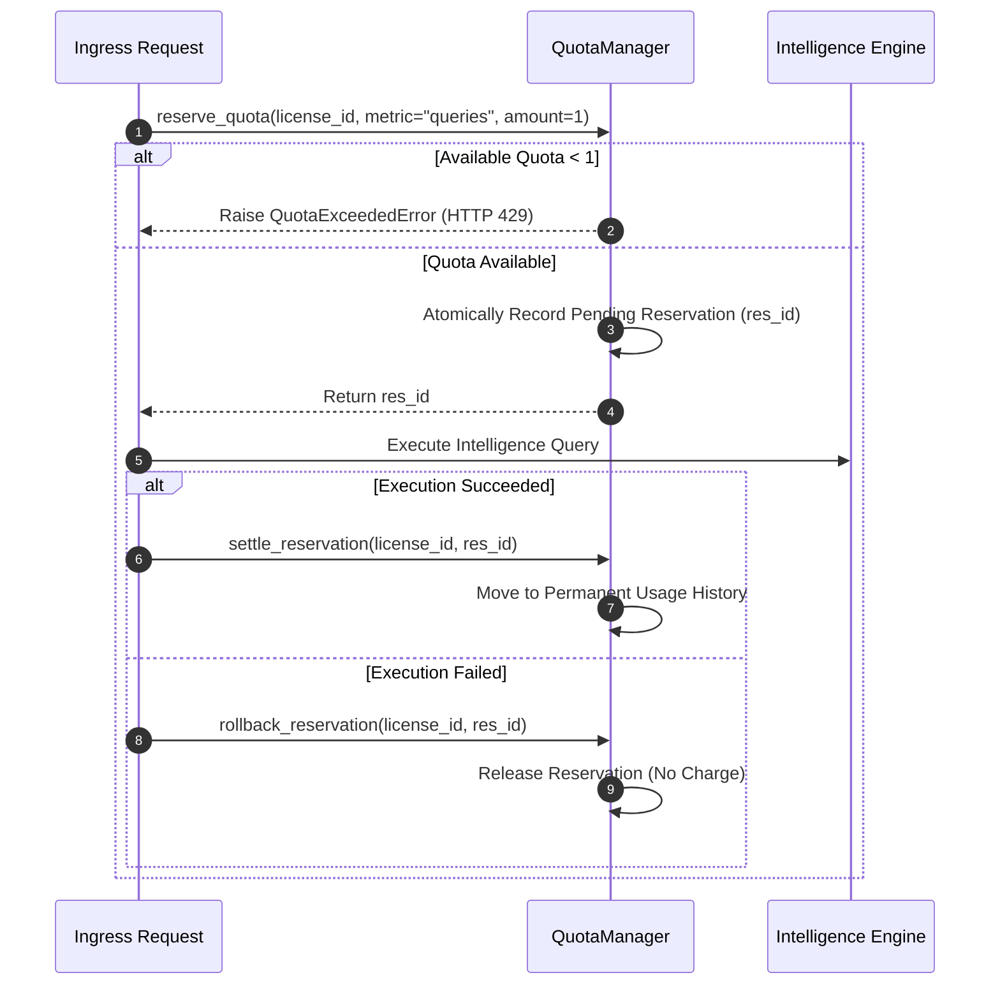

# PROT-04.06: Quota & Usage Accounting Enforcement

**Work Package:** PROT-04.06  
**Target:** Server-Side Atomic Quotas, Concurrency Race Protection & Rate Limiting  
**Status:** **IMPLEMENTED & VERIFIED**

---

## 1. Quota Policy & Allocation

Evaluation edition quotas are codified in `distribution/policy/evaluation-quotas.yaml`:

| Quota Metric | Evaluation Limit | Accounting Window | HTTP Status on Exceeded | Remediation |
| :--- | :--- | :--- | :--- | :--- |
| **Document Ingestion** | 5 active documents | Persistent session | `429 QUOTA_EXCEEDED` | Delete document or run `reset_demo` |
| **Max File Upload Size** | 10 MB (10,485,760 bytes) | Per-request | `413 Payload Too Large` | Compress or truncate file |
| **Total Storage** | 100 MB | Cumulative | `429 QUOTA_EXCEEDED` | Purge unneeded files |
| **Ask AEGIS Queries** | 20 queries | 24-hour sliding window | `429 QUOTA_EXCEEDED` | Resets automatically after 24 hrs |
| **Document Comparisons** | 5 comparisons | 24-hour sliding window | `429 QUOTA_EXCEEDED` | Resets automatically after 24 hrs |
| **Request Rate Limit** | 60 requests/minute | 60-second sliding window | `429 RATE_LIMIT_EXCEEDED` | Back off request velocity |

---

## 2. Atomic Reservation & Settlement Lifecycle

To prevent race conditions where parallel requests bypass quota boundaries, `QuotaManager` (`services/evaluation_gateway/quotas.py`) implements a two-phase reservation protocol protected by `threading.Lock`:

---

## 3. High-Concurrency Race Condition Verification (`QUOTA-003` & Scenario D)

To verify resistance against concurrency race attacks:
- **Test Condition:** A license was pre-configured with exactly 2 remaining query slots out of 20.
- **Attack Payload:** A pool of 20 simultaneous threads dispatched concurrent query requests via `ThreadPoolExecutor(max_workers=20)`.
- **Observed Result:**
  - Exactly **2 requests succeeded** with HTTP 200 OK.
  - Exactly **18 requests were rejected** with HTTP 429 Too Many Requests.
  - Total queries recorded in server ledger: exactly 20. Zero quota leakage occurred.
