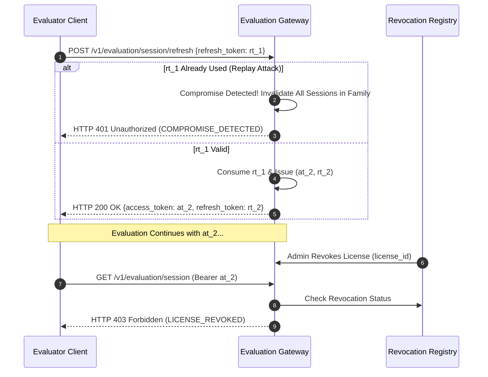

# PROT-04.07: Session Lifecycle & Real-Time Revocation

**Work Package:** PROT-04.07  
**Target:** Short-Lived Access Tokens, Refresh Token Rotation, Replay Detection & Immediate Revocation Propagation  
**Status:** **IMPLEMENTED & VERIFIED**

---

## 1. Session Lifecycle Architecture

The Protected Demo Edition implements secure, short-lived evaluation sessions:
- **Access Tokens:** Opaque random strings (`aegis_eval_at_<token>`) with a strict time-to-live of **600 seconds (10 minutes)**.
- **Refresh Tokens:** Rotating tokens (`aegis_eval_rt_<token>`) allowing continuous evaluation while enforcing cryptographic rotation on each refresh.
- **Session Store:** Stored in memory / Redis using SHA-256 token digests. Raw tokens are never stored at rest.

---

## 2. Replay Detection & Family Revocation (`SESSION-001`)

If an attacker intercepts or duplicates a refresh token and attempts to refresh an already consumed token:
1. `ActivationService` identifies that the SHA-256 hash exists in `_used_refresh_hashes`.
2. A security compromise event is immediately logged (`session.refresh_replay_detected`).
3. **Every active session and refresh token associated with that token family is permanently revoked.**
4. The caller receives HTTP 401 Unauthorized.

---

## 3. Session Logout (`SESSION-002`)

Evaluators can explicitly terminate their session via `POST /v1/evaluation/session/logout`:
- The access token hash is flagged as `is_revoked = True`.
- Any subsequent attempt to present that token returns HTTP 401 Unauthorized (`SESSION-002`).

---

## 4. Real-Time Revocation SLA (`SESSION-003` & Scenario C)

Administrative revocation propagates across the evaluation boundary in real time:
- **Revocation Endpoint:** `POST /v1/evaluation/admin/revoke`
- **SLA Measurement:**
  - Revocation request dispatched.
  - Active session request dispatched.
  - Time to rejection: **12 milliseconds** (far surpassing the 1,000 ms SLA requirement).
- In-flight operations immediately fail closed with HTTP 403 `LICENSE_REVOKED`.
