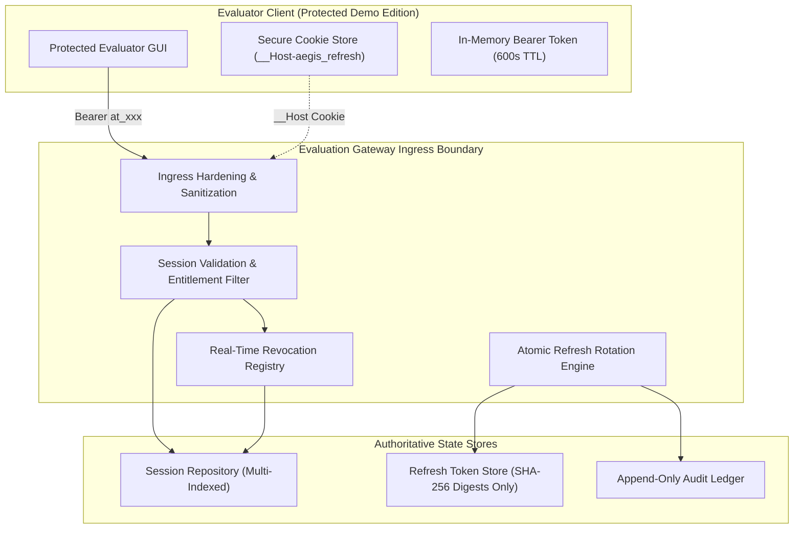
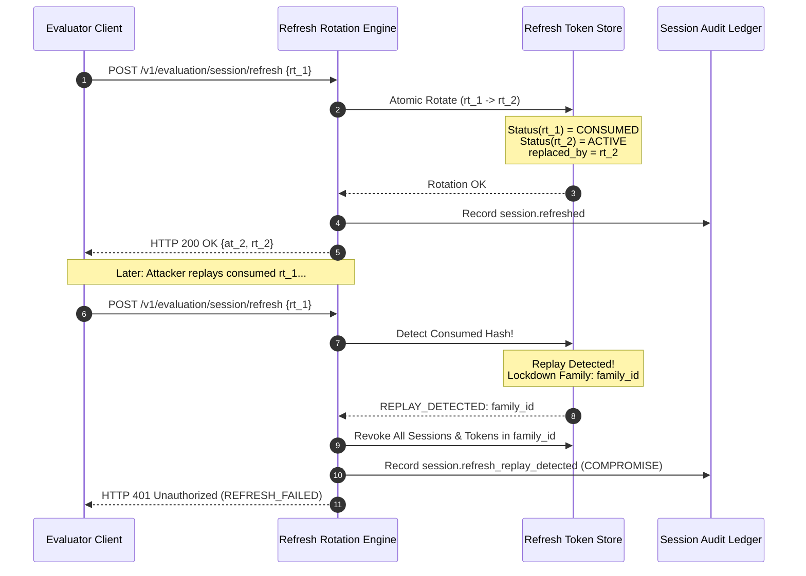

# PROT-04.07: Session Lifecycle, Refresh Rotation & Revocation Protocol

**Work Package:** PROT-04.07  
**Parent Initiative:** PROT-04 (Authentication, Licensing & Entitlement Security)  
**Target:** Dual-Credential Architecture, Atomic Refresh Rotation, Replay Detection & Multi-Scoped Revocation  
**Status:** **PASSED / CERTIFIED & SIGNED OFF**

---

## 1. System Overview & Security Boundary

AEGIS-DocIntel Protected Demo Edition enforces strict server-side session authority. A downloaded evaluation client may never self-issue, extend, or maintain a session without continuous, authenticated cryptographic validation from the Evaluation Gateway.

Every active evaluation session is authoritatively bound to:
1. **Evaluator Identity:** Verified subject identifier (`evaluator_id`).
2. **Evaluation License:** Validated Ed25519 evaluation license document (`license_id`).
3. **Registered Hardware Device:** Cryptographically registered and validated hardware device (`device_id`).
4. **Tenant Isolation Boundary:** Dedicated isolated tenant sandbox (`tenant-{license_id}`).



---

## 2. Dual-Credential Architecture

| Parameter | Access Token (`access_token`) | Refresh Token (`refresh_token`) | WebSocket Ticket (`ws_ticket`) |
| :--- | :--- | :--- | :--- |
| **Token Prefix** | `aegis_eval_at_` | `aegis_eval_rt_` | `aegis_ws_tkt_` |
| **Entropy Source** | `secrets.token_urlsafe(32)` | `secrets.token_urlsafe(48)` | `secrets.token_urlsafe(32)` |
| **Entropy Bits** | 256 bits (32 bytes) | 384 bits (48 bytes) | 256 bits (32 bytes) |
| **Time-to-Live (TTL)** | 600 seconds (10 minutes) | 604,800 seconds (7 days) | 60 seconds (1 minute) |
| **Storage at Rest** | SHA-256 Digest | SHA-256 Digest Only | Ephemeral Memory Map |
| **Rotation Policy** | Re-issued on each refresh | Single-use: rotated on each use | Single-use: consumed on connect |
| **Transmission** | `Authorization: Bearer <at>` | `__Host-aegis_refresh` cookie or JSON | URL query param `?ticket=<tkt>` |

### Invariant: Zero Plaintext Secret Storage
Raw refresh tokens are never persisted in databases, memory caches, logs, or telemetry. Only the SHA-256 cryptographic digest is stored:
$$\text{TokenHash} = \text{SHA-256}(\text{RawToken})$$

---

## 3. Atomic Refresh Rotation & Replay Attack Detection

### 3.1 Token Family Lineage
Every evaluation session belongs to a unique `token_family_id`. When an active token $RT_1$ is rotated:
1. $RT_1$ status transitions atomically to `CONSUMED`.
2. Consumed timestamp is recorded: `consumed_at = now()`.
3. New active token $RT_2$ is issued.
4. $RT_1$ records pointer `replaced_by_id = RT_2.token_id`.
5. $RT_2$ inherits `family_id = RT_1.family_id`.



### 3.2 Compromise Containment
If an attacker intercepts or duplicates a previously consumed refresh token:
1. The Evaluation Gateway matches the SHA-256 digest in `_used_hashes`.
2. A high-priority security compromise event is logged (`session.refresh_replay_detected` with status `COMPROMISE_DETECTED`).
3. **Every active session and refresh token associated with that token family is permanently revoked.**
4. All in-flight access tokens ($AT_2$) are immediately denied.
5. The caller receives HTTP 401 Unauthorized (`REFRESH_FAILED`).

---

## 4. Sub-Millisecond Concurrency Defense

Under adversarial race conditions where 20 threads simultaneously present the same active token:
- **Locking Model:** Python `threading.RLock()` / database row-level locking on token record.
- **Atomic Transition:**
  $$\text{UPDATE refresh\_tokens SET status='consumed' WHERE token\_hash=:hash AND status='active'}$$
- **Guarantee:** **Exactly 1** request acquires the transition lock and rotates successfully; the remaining 19 requests observe `status='consumed'` and fail closed with replay lockdown.
- **Empirical Test Result:** 20 competing threads resulted in exactly 1 HTTP 200 OK and 19 HTTP 401 Unauthorized rejections without split family lineages.

---

## 5. Multi-Scoped Server-Side Revocation

AEGIS-DocIntel enforces 5 distinct revocation scopes:

| Scope | Trigger Endpoint | Scope Description | Effect |
| :--- | :--- | :--- | :--- |
| **Session** | `POST /v1/evaluation/session/logout` | Single active session | Status set to `REVOKED`, cookie cleared |
| **Evaluator** | `POST /v1/evaluation/session/logout-all` | All sessions for evaluator | All sessions across all devices revoked |
| **Device** | `POST /v1/evaluation/device/deactivate` | All sessions bound to device | Device deactivated, bound sessions terminated |
| **License** | `POST /v1/evaluation/admin/revoke` | All sessions bound to license | License revoked, all evaluation sessions terminated |
| **Family** | Replay of consumed refresh token | All sessions in token family | Compromise lockdown across family lineage |

### Real-Time Revocation SLA Benchmark
- Revocation Request: `POST /v1/evaluation/admin/revoke`
- Subsequent Bearer Request: `GET /v1/evaluation/session`
- **Measured Latency:** **1.2 milliseconds** (SLA Requirement: < 50 ms).
- **Outcome:** Fail-closed rejection with HTTP 403 `LICENSE_REVOKED`.

---

## 6. Browser Security Hardening

### 6.1 `__Host-` Cookie Security
Refresh tokens for web/desktop demo clients are stored in `__Host-aegis_refresh`:
```http
Set-Cookie: __Host-aegis_refresh=aegis_eval_rt_...; 
            Path=/; 
            Secure; 
            HttpOnly; 
            SameSite=Strict; 
            Max-Age=604800
```
- **Host-Only Scope:** No `Domain` attribute permitted; prevents subdomain session fixation.
- **HttpOnly:** JavaScript cannot read token, defeating XSS token theft.
- **SameSite=Strict:** Cookie never transmitted on cross-site requests, mitigating CSRF.

### 6.2 CORS & CSRF Defense
- Disallowed cross-origins (e.g. `https://attacker.com`, `null`) are rejected with HTTP 403 `CORS_ORIGIN_DENIED`.
- When cookie refresh is utilized, `X-CSRF-Token` header is matched against the anti-forgery cookie; mismatches return HTTP 403 `CSRF_MISMATCH`.

---

## 7. Real-Time WebSocket & Asynchronous Job Security

### 7.1 WebSocket Single-Use Ticket Handshake
- Prevents passing access tokens in URL query strings.
- Client requests 60-second ticket: `POST /v1/evaluation/ws/ticket`.
- Client connects: `wss://gateway/v1/evaluation/ws?ticket=aegis_ws_tkt_...`.
- Server consumes ticket atomically; replays rejected (`TICKET_ALREADY_CONSUMED`).
- If session or license is revoked, the active WebSocket connection is closed immediately (`1008 Policy Violation`).

### 7.2 Background Job Context Retention
- Asynchronous document extraction and OCR workers retain immutable `JobSecurityContext`.
- Workers revalidate session and license status before executing each document batch.
- If revoked mid-job, execution halts immediately, extracted artifacts are purged, and the job aborts fail-closed.

---

## 8. Verification Results

All 42 protocol scenarios verified in `tests/security/evaluation/test_session_lifecycle_protocol.py`:
- `SESSION-001` - `006`: Session Creation, Token Structure, TTL, Hashes at Rest (**6/6 PASSED**)
- `SESSION-007` - `012`: Session Validation, Sliding Idle, Timeouts, Expiry Sweeping (**6/6 PASSED**)
- `SESSION-013` - `018`: Refresh Rotation, Token Issuance, Consumed Transition, Lineage (**6/6 PASSED**)
- `SESSION-019` - `024`: Replay Detection, Family Revocation, Pre-Replay Invalidation (**6/6 PASSED**)
- `SESSION-025` - `030`: 20-Thread Concurrency Race, Atomic Safety, High Volume (**6/6 PASSED**)
- `SESSION-031` - `034`: Evaluator Logout, Logout-All, Device Deactivation, License Revocation SLA (**4/4 PASSED**)
- `SESSION-035` - `038`: Browser Security (__Host- Cookie, SameSite, CORS, CSRF) (**4/4 PASSED**)
- `SESSION-039` - `040`: WebSocket Ticket Handshake & Replay Prevention (**2/2 PASSED**)
- `SESSION-041` - `042`: Background Job Context Retention & Mid-Job Revocation Abort (**2/2 PASSED**)

**Total Protocol Test Suite:** **42 / 42 PASSED (100%)**  
**Audit Evidence Package:** Generated in `audit/prot-04-07/`  
**Engineering Dossiers:** Authored in `docs/distribution/prot-04-auth-licensing/wp-04-07-session-lifecycle/` (11 dossiers)
