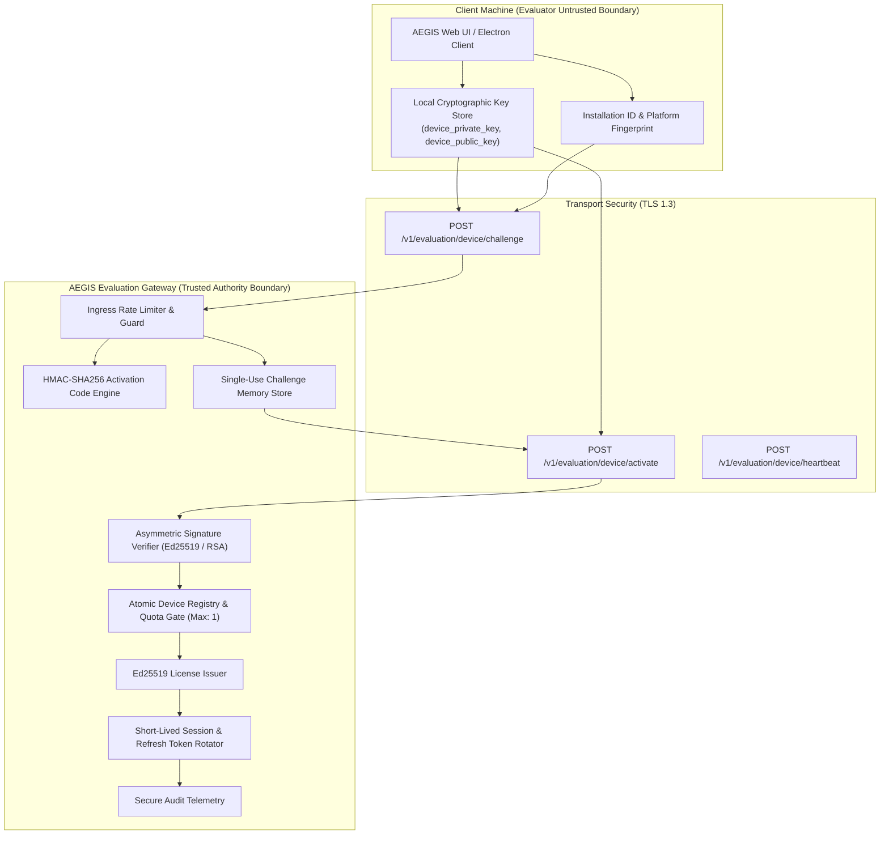

# WP-04.03 Dossier 01: Device Binding Architecture

**Work Package:** PROT-04.03  
**Title:** Evaluation Activation & Device Binding Subsystem Architecture  
**Status:** **PASSED / IMPLEMENTED & VERIFIED**  
**Classification:** Restricted Evaluation Distribution  

---

## 1. Executive Architectural Overview

The AEGIS-DocIntel Protected Demo Edition is packaged and distributed to evaluators as a downloadable bundle. Executing software on an evaluator-controlled machine introduces a fundamental threat vector: client-side licensing files, hardcoded keys, and unauthenticated local bypasses can be inspected, altered, or redistributed.

To prevent unauthorized distribution, licensing fraud, and casual sharing without degrading the evaluation user experience, WP-04.03 implements a **Zero-Trust Asymmetric Device Binding Protocol**.

Under this architecture:
1. The downloaded client generates an asymmetric cryptographic key pair upon installation.
2. The private key never leaves the evaluator's local machine and is never transmitted over the network.
3. The evaluation server challenges the device to prove possession of the private key before issuing a signed evaluation license and authenticated session tokens.
4. The server strictly enforces a **1 active device quota per evaluation license** (`DEV-002`), precluding concurrent sharing across multiple machines.

---

## 2. Security Trust Boundary

---

## 3. Subsystem Architectural Components

### 3.1 Local Key Pair Generation & Storage
- Evaluator clients generate an asymmetric key pair at initial bootstrap using standard cryptographic primitives (Ed25519 preferred; RSA-2048 supported).
- The private key is persisted in OS-level protected storage (Windows DPAPI, macOS Keychain, Linux Secret Service) or secure application memory.
- The public key is exported in Base64 SubjectPublicKeyInfo DER or Raw 32-byte representation.

### 3.2 Two-Stage Proof-of-Possession Challenge Protocol
- **Stage 1 (`/v1/evaluation/device/challenge`):**
  The client submits its activation code, public key, and installation ID. The server verifies code validity, checks device quota eligibility, generates a cryptographic challenge (nonce + expiration), and returns a canonical challenge message to be signed.
- **Stage 2 (`/v1/evaluation/device/activate`):**
  The client signs the canonical challenge message with its private key and submits the digital signature. The server verifies the signature against the registered public key, consumes the challenge (single-use invariant `DEV-010`), binds the device, and issues the evaluation license and authenticated session.

### 3.3 Keyed HMAC-SHA256 Activation Code Indexing
- Activation codes (e.g. `AEGIS-EVAL-2026-DEMO`) are never stored in plaintext within databases, memory dictionaries, or telemetry logs (`DEV-025`).
- The gateway indexes codes using `HMAC-SHA256(K_lookup, code)`, preventing rainbow-table precomputations or unauthorized enumeration from server memory dumps.

### 3.4 Atomic Device Quota Enforcement (`DEV-002`)
- Evaluation licenses are hard-capped to **exactly 1 active registered device**.
- Concurrency locks (`threading.Lock`) guarantee atomic device registration and check-and-set operations, eliminating race conditions during simultaneous activation requests (`DEV-026`).

### 3.5 Session Invalidation on Device Deactivation (`DEV-003`, `DEV-004`)
- Deactivating a device marks `is_active = False` and immediately revokes all active session tokens and refresh families associated with the device ID.
- Deactivating a device instantly frees the single device slot, enabling the evaluator to register a replacement machine.

### 3.6 Emergency Device Recovery Protocol (`DEV-020`, `DEV-021`)
- Upon activation, the server generates an emergency recovery code (e.g. `REC-XXXX-YYYY`) returned to the evaluator.
- In the event of catastrophic local disk failure or ungraceful machine decommission, the evaluator can release the locked device slot using the recovery code without administrative intervention.
