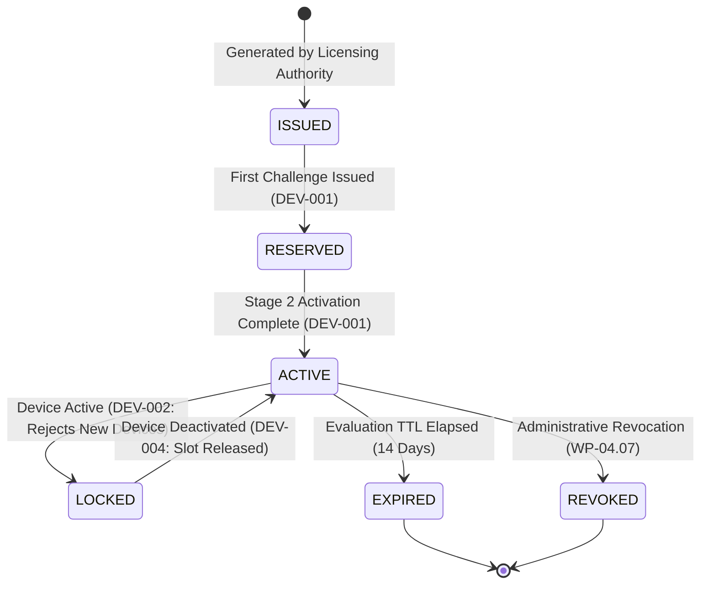

# WP-04.03 Dossier 03: Activation Code Specification

**Work Package:** PROT-04.03  
**Title:** Evaluation Activation Code Format, Validation & Keyed HMAC Storage  
**Status:** **PASSED / IMPLEMENTED & VERIFIED**  

---

## 1. Activation Code Canonical Syntax

Evaluation activation codes follow a strict human-readable and machine-verifiable format:

$$\text{AEGIS-EVAL-}[A-Z0-9]{4}-[A-Z0-9]{4}$$

### Syntax Rules:
1. **Prefix:** Must begin with canonical prefix `AEGIS-EVAL-`.
2. **Character Set:** Uppercase alphanumeric characters `[A-Z0-9]`, excluding visually ambiguous characters (`O`, `0`, `I`, `1`) in production-generated vouchers.
3. **Hyphen Separators:** Delimited by hyphens into segments of 4 characters.
4. **Length:** Minimum 15 characters, maximum 32 characters.
5. **Case Insensitivity:** Normalized to uppercase upon receipt prior to hashing.

### Examples:
- `AEGIS-EVAL-2026-DEMO` (Product Hunt launch evaluation voucher)
- `AEGIS-EVAL-BETA-TEST` (Private beta testing voucher)
- `AEGIS-EVAL-PROD-HUNT` (Campaign partner voucher)

---

## 2. Keyed HMAC-SHA256 Indexing (`DEV-025`)

To prevent offline dictionary attacks, credential harvesting from memory dumps, or audit log leakage:
1. The server loads an isolated master secret `AEGIS_ACTIVATION_HMAC_KEY` from the secure environment.
2. The server computes:
   $$\text{CodeHash} = \text{HMAC-SHA256}(K_{\text{HMAC}}, \text{NormalizedCode})$$
3. In-memory maps (`_eligible_code_hashes`, `_licenses_by_code_hash`) are indexed exclusively by `CodeHash`.
4. Audit events log only the first 16 characters of the `CodeHash` or masked representation (`AEGIS-EVAL-****`), never the plaintext code (`DEV-025`).

```python
HMAC_LOOKUP_KEY = os.getenv("AEGIS_ACTIVATION_HMAC_KEY", "aegis-evaluation-master-hmac-secret-v1").encode("utf-8")

def compute_code_hash(code: str) -> str:
    normalized = (code or "").strip().upper().encode("utf-8")
    return hmac.new(HMAC_LOOKUP_KEY, normalized, hashlib.sha256).hexdigest()
```

---

## 3. Activation Code Lifecycle & State Machine



---

## 4. Input Validation & Error Handling

| Scenario | Input | HTTP Status | Response Error Code |
| :--- | :--- | :--- | :--- |
| **Empty Code** | `""` or `"   "` | `400 Bad Request` | `INVALID_ACTIVATION_CODE` |
| **Malformed Format** | `"INVALID-VOUCHER"` | `400 Bad Request` | `INVALID_ACTIVATION_CODE` |
| **Unregistered Code** | `"AEGIS-EVAL-BOGUS-CODE"` | `400 Bad Request` | `INVALID_ACTIVATION_CODE` |
| **Expired Code** | Valid format, `valid_until < now` | `400 Bad Request` | `INVALID_ACTIVATION_CODE` |
| **Valid Code** | `"AEGIS-EVAL-2026-DEMO"` | `200 OK` | (Challenge Issued) |
