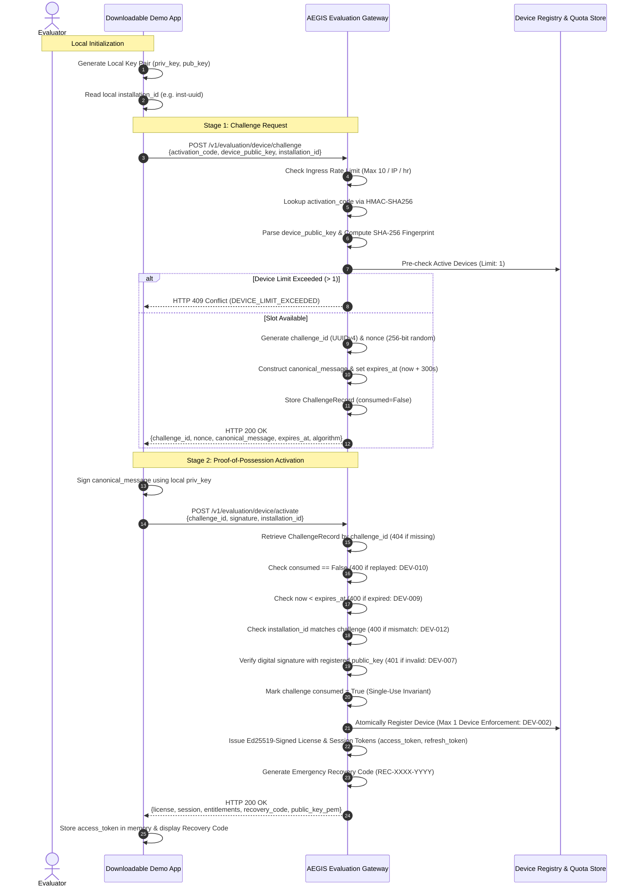

# WP-04.03 Dossier 04: Challenge-Response Protocol

**Work Package:** PROT-04.03  
**Title:** Two-Stage Asymmetric Proof-of-Possession Challenge Protocol  
**Status:** **PASSED / IMPLEMENTED & VERIFIED**  

---

## 1. Protocol Sequence Flow

The two-stage proof-of-possession handshake binds the evaluator's local key pair to their evaluation license without transmitting private credentials.



---

## 2. Canonical Challenge Message Specification

To prevent signature repurposing, replay attacks, or cross-protocol manipulation, the message signed by the client is formatted canonically:

```
AEGIS-EVAL-DEVICE-PROOF-V1
challenge_id=45c43d83-4a11-4770-b49c-f127cb46db07
nonce=7n8K_P9xR2tL6mQ0vW4yZ1aC3eG5iK8m
public_key_fingerprint=8d3e91f16f2c0cbba5b0981b2dae2ec112bf8bfa2e9a3b632dbb73e5bf2ecb61
installation_id=inst-win-dev01
```

### Protocol Fields:
1. **Header:** Pinned protocol identifier `AEGIS-EVAL-DEVICE-PROOF-V1`.
2. **`challenge_id`:** Server-generated UUID uniquely indexing this challenge instance.
3. **`nonce`:** Cryptographic 256-bit entropy ensuring signature uniqueness across time.
4. **`public_key_fingerprint`:** SHA-256 fingerprint of the client's public key, preventing key substitution.
5. **`installation_id`:** Hardware/installation identifier binding proof to specific machine instance.

---

## 3. Cryptographic Invariants & Verification Guarantees

| Invariant ID | Security Property | Guaranteed Outcome |
| :--- | :--- | :--- |
| **INV-CH-01** | **Single-Use Consumption** | A `challenge_id` can be activated exactly once (`consumed=True`). Subsequent activations reject with `HTTP 400 CHALLENGE_ALREADY_CONSUMED` (`DEV-010`). |
| **INV-CH-02** | **Strict TTL Expiration** | Challenges expire 300 seconds after creation. Expired submissions reject with `HTTP 400 CHALLENGE_EXPIRED` (`DEV-009`). |
| **INV-CH-03** | **Non-Repudiation** | Only the possessor of the private key corresponding to `device_public_key` can generate a valid signature (`DEV-007`). |
| **INV-CH-04** | **Message Integrity** | Flipping any bit in `canonical_message` invalidates the signature and fails verification (`DEV-008`, `DEV-029`). |
| **INV-CH-05** | **Installation ID Binding** | If `installation_id` in Stage 2 differs from Stage 1, the request fails with `HTTP 400 INSTALLATION_MISMATCH` (`DEV-012`). |
