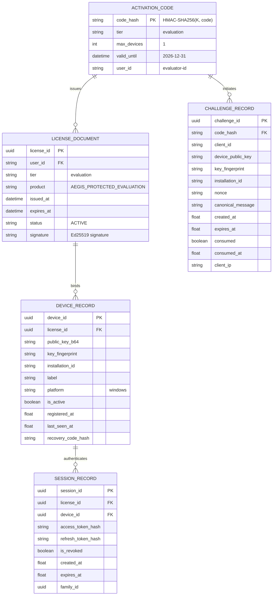

# WP-04.03 Dossier 05: License & Device Database Schema

**Work Package:** PROT-04.03  
**Title:** In-Memory & Relational Schema for Device Registration & Challenges  
**Status:** **PASSED / IMPLEMENTED & VERIFIED**  

---

## 1. Entity-Relationship Model



---

## 2. In-Memory Data Structures (Python Dataclasses)

### 2.1 `ChallengeRecord`
```python
@dataclass
class ChallengeRecord:
    challenge_id: str             # UUIDv4
    activation_code_hash: str     # HMAC-SHA256 digest
    client_id: str                # Evaluator identifier
    max_devices: int              # Allowed active devices (1)
    device_public_key: str        # PEM or Base64 raw key
    key_fingerprint: str          # SHA-256 fingerprint
    installation_id: str          # Hardware installation ID
    device_label: str             # Human-readable workstation name
    platform: str                 # Host OS ('windows', 'darwin', 'linux')
    nonce: str                    # 256-bit URL-safe token
    canonical_message: str        # Canonical protocol string
    created_at: float             # Epoch timestamp
    expires_at: float             # Epoch timestamp (created_at + 300s)
    consumed: bool = False        # Single-use flag
    consumed_at: Optional[float] = None
    client_ip: str = "127.0.0.1"
```

### 2.2 `DeviceRecord`
```python
@dataclass
class DeviceRecord:
    device_id: str                # UUIDv4
    license_id: str               # UUIDv4 of bound license
    public_key_b64: str           # Public key representation
    label: str                    # Device label
    platform: str                 # Host operating system
    is_active: bool               # True if device currently holds active slot
    registered_at: float          # Initial binding timestamp
    last_seen_at: float           # Heartbeat / latest activity timestamp
    key_fingerprint: str = ""     # SHA-256 key fingerprint
    installation_id: str = ""     # Client hardware ID
    recovery_code_hash: Optional[str] = None # SHA-256 of emergency recovery code
```

---

## 3. Storage Invariants & Security Constraints

1. **Uniqueness:** `key_fingerprint` uniquely identifies a hardware key pair.
2. **Atomic Quota:** Under `with self._lock:`, `count(d for d in devices if d.is_active) <= 1`.
3. **No Plaintext Secrets:** `recovery_code_hash` stores `SHA-256(recovery_code)`. The raw recovery code is generated once and returned in the HTTP response of Stage 2.
4. **Referential Revocation:** Deactivating a `DeviceRecord` cascades revocation to all `SessionRecord` instances where `session.device_id == target.device_id`.
