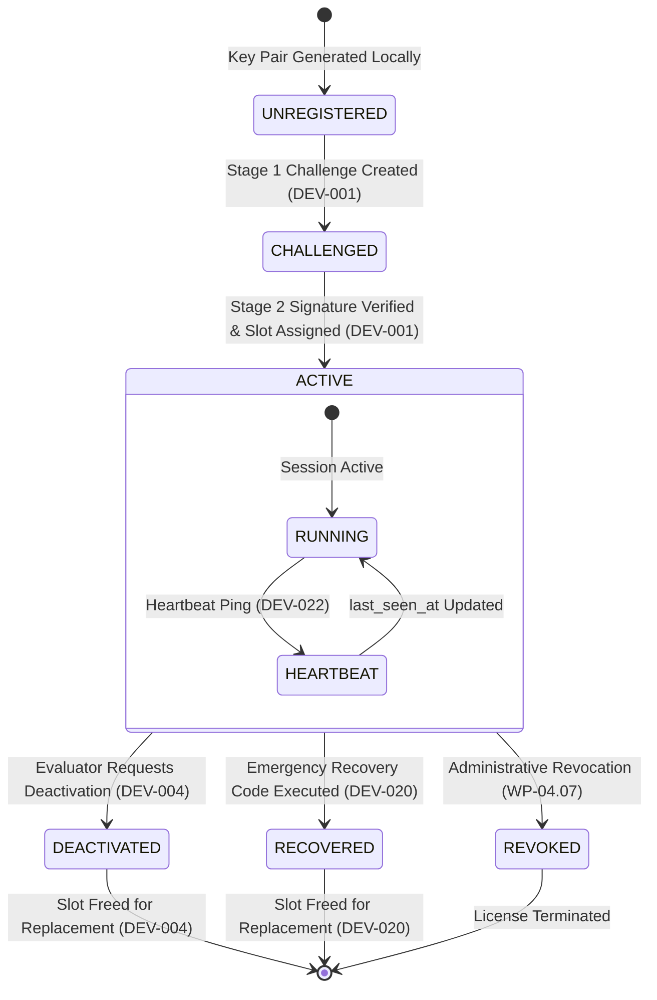

# WP-04.03 Dossier 06: Device Lifecycle & Recovery

**Work Package:** PROT-04.03  
**Title:** Device Lifecycle Transitions, Presence Heartbeat & Emergency Recovery  
**Status:** **PASSED / IMPLEMENTED & VERIFIED**  

---

## 1. Device Lifecycle State Machine



---

## 2. Presence Heartbeat (`DEV-022`, `DEV-023`)

The evaluation client periodically sends a presence check-in to confirm active evaluation status and update server telemetry.

### Request: `POST /v1/evaluation/device/heartbeat`
- **Headers:** `Authorization: Bearer <access_token>`
- **Logic:**
  1. Resolves `EntitlementContext` from Bearer token.
  2. Looks up `device_id` under `license_id`.
  3. Verifies `is_active is True`. If deactivated, fails closed with `HTTP 401 Unauthorized` (`DEVICE_INACTIVE`).
  4. Updates `last_seen_at = time.time()`.
- **Response:**
  ```json
  {
    "status": "alive",
    "device_id": "8d3e91f1-4a11-4770-b49c-f127cb46db07",
    "last_seen_at": 1731557280.45
  }
  ```

---

## 3. Emergency Device Recovery Protocol (`DEV-020`, `DEV-021`)

### The Problem:
If an evaluator uninstalls AEGIS, re-formats their hard drive, or loses access to their workstation, the server still registers that device as active, preventing activation on their new computer (`DEV-002: DEVICE_LIMIT_EXCEEDED`).

### The Solution:
During Stage 2 activation, the server issues an **Emergency Recovery Code**:
$$\text{Format: REC-}[A-F0-9]{4}-[A-F0-9]{4}$$
- The server stores only `SHA-256(recovery_code)`.
- The evaluator saves this code (displayed in the activation confirmation dialog).

### Recovery Execution: `POST /v1/evaluation/devices/{device_id}/recover`
```json
{
  "recovery_code": "REC-A4B8-9F21",
  "license_id": "67a14e9b-0294-4d89-9133-784f1b3c9b71"
}
```

### Verification & Action:
1. Validates `SHA-256(recovery_code) == device.recovery_code_hash`.
2. Marks `device.is_active = False`.
3. Revokes all active session tokens and refresh tokens associated with `device_id`.
4. Frees the evaluation license device slot immediately.
5. Evaluator can now activate their replacement machine without contacting customer support.

### Test Verifications:
- Valid recovery code succeeds and frees device slot (`DEV-020`).
- Invalid recovery code rejects with `HTTP 401 Unauthorized` (`DEV-021`).
