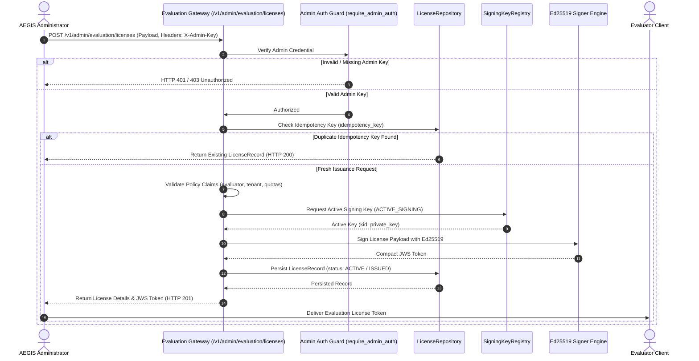

# WP-04.04 Dossier 04: License Issuance Workflow

**Work Package:** PROT-04.04  
**Title:** License Issuance Lifecycle & Administrative Controls  
**Status:** **PASSED / IMPLEMENTED & VERIFIED**  
**Classification:** Restricted Evaluation Distribution  

---

## 1. Architectural Scope

License issuance is an exclusively **server-side, administrative privilege**. Evaluator clients have zero capability to self-issue or mint evaluation licenses.

All license generation requests must pass through the `require_admin_auth` dependency in the Evaluation Gateway, validating administrative credentials before any cryptographic or database operations occur.

---

## 2. Issuance Sequence Diagram



---

## 3. Administrative Issuance API Specification

### Endpoint: `POST /v1/admin/evaluation/licenses`
**Authentication:** Required (`X-Admin-Key: <secret>` or `Authorization: Bearer <admin-token>`)

#### Request Body Schema
```json
{
  "evaluator_id": "eval_acme_corp",
  "tenant_id": "tenant_acme_101",
  "tier": "EVALUATION",
  "policy_version": "2026-01",
  "validity_days": 14,
  "device_limit": 1,
  "features": [
    "document_ingestion",
    "ocr_pipeline",
    "semantic_search"
  ],
  "quotas": {
    "documents_per_day": 50,
    "max_file_size_mb": 25
  },
  "idempotency_key": "idemp-req-20261114-001"
}
```

#### Validation & Policy Verification (`LIC-003`)
The server verifies:
1. `evaluator_id` and `tenant_id` are non-empty strings.
2. `tier` is an authorized tier (`"EVALUATION"`, `"COMMERCIAL_PILOT"`, `"ENTERPRISE_TRIAL"`).
3. `validity_days` is between 1 and 90 days.
4. `device_limit` equals 1 for evaluation licenses.
5. `features` is a list of approved capability identifiers.
6. `quotas` contains non-negative numerical limits.

If any field fails validation, the request is rejected with `HTTP 400 Bad Request` before calling cryptographic functions.

---

## 4. Idempotency Guarantees (`LIC-004`)

Network retries or concurrent deployment scripts could re-send issuance requests. To avoid minting redundant licenses or corrupting tenant quotas:
1. Every issuance request supports an optional `idempotency_key`.
2. The `LicenseRepository` maintains an index of idempotency keys.
3. If a request arrives with an existing key, the server retrieves and returns the previously generated `LicenseRecord` and token immediately without generating a new key pair or updating timestamps.
