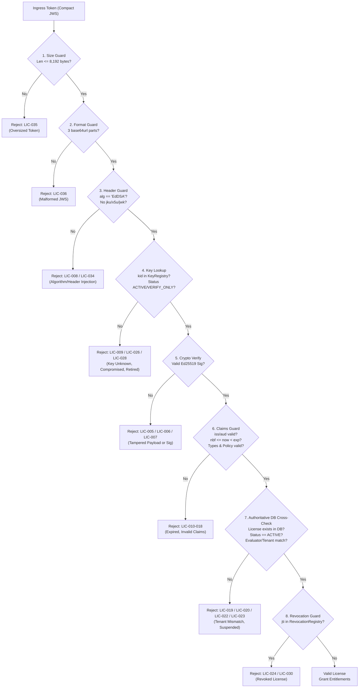

# WP-04.04 Dossier 05: License Validation Workflow

**Work Package:** PROT-04.04  
**Title:** License Validation Engine & Authoritative Verification Protocol  
**Status:** **PASSED / IMPLEMENTED & VERIFIED**  
**Classification:** Restricted Evaluation Distribution  

---

## 1. Architectural Scope

Validation is the gatekeeper of the AEGIS-DocIntel Evaluation Gateway. A license token arriving from an evaluator client must undergo rigorous multi-stage verification before granting access to protected endpoints or high-value ML inference pipelines.

The validation pipeline enforces a strict **Zero-Trust, Fail-Closed Model**:
1. Passing cryptographic signature checks is a **necessary**, but **not sufficient**, condition for authorization.
2. The license must also match the **authoritative server database record** (`LicenseRepository`).
3. The associated device must be **actively registered and bound** (`DeviceRegistry`).
4. The license must not appear in the **revocation registry** (`RevocationRegistry`).

---

## 2. Multi-Stage Validation Pipeline



---

## 3. Detailed Validation Pipeline Steps

### Step 1: Pre-Parse Buffer Size Guard (`LIC-035`)
Prior to base64 decoding or regex matching, the raw token length is measured against a strict ceiling:
$$\text{len}(\text{raw\_token}) \le 8192 \text{ bytes}$$
Any token exceeding 8,192 bytes is immediately dropped, thwarting memory allocation exhaustion attacks.

### Step 2: Format & Serialization Verification (`LIC-036`)
The token must consist of exactly three period-separated substrings:
$$\text{token} = s_0 \mathbin{\Vert} \text{"."} \mathbin{\Vert} s_1 \mathbin{\Vert} \text{"."} \mathbin{\Vert} s_2$$
Tokens with fewer or more segments, or invalid URL-safe Base64 characters, are rejected with `HTTP 400 Bad Request`.

### Step 3: Unverified Header Inspection (`LIC-008`, `LIC-034`)
Before attempting signature verification, the header JSON is extracted to verify:
- `alg == "EdDSA"`: Strictly pinned. Any other algorithm (e.g., `HS256`, `none`, `RS256`) aborts the pipeline.
- `typ == "AEGIS-EVALUATION-LICENSE"`: Verified to prevent cross-protocol token substitution.
- Absence of `jku`, `x5u`, `x5c`, or `jwk`: Token-controlled remote keys are forbidden.

### Step 4: Signing Key Registry Resolution (`LIC-009`, `LIC-026`, `LIC-028`)
The header `kid` is queried against `SigningKeyRegistry`:
- If `kid` is missing or unrecognized $\to$ Rejected (`LIC-009`).
- If key status is `COMPROMISED` $\to$ Rejected immediately; all tokens signed by this key are treated as revoked (`LIC-026`).
- If key status is `RETIRED` $\to$ Rejected (`LIC-028`).
- If key status is `ACTIVE_SIGNING` or `VERIFY_ONLY` $\to$ Public key extracted for verification.

### Step 5: Cryptographic Signature Verification (`LIC-005`, `LIC-006`, `LIC-007`)
Using `PyJWT` with the `cryptography` backend, the Ed25519 signature is evaluated against the signing input:
$$\text{Ed25519Verify}(K_{\text{public}}, \text{Signing Input}, \text{Signature}) \stackrel{?}{=} \text{True}$$
If any bit in the header, payload, or signature was modified, verification fails and the request is aborted with `HTTP 401 Unauthorized`.

### Step 6: Claims & Semantic Validity (`LIC-010` - `LIC-018`)
The payload is verified for required claims, data types, and temporal validity:
- `iss == "aegis-license-authority"`
- `aud == "aegis-evaluation-client"`
- $\text{nbf} \le \text{current\_time} < \text{exp}$
- `license_type` in `["EVALUATION", "COMMERCIAL_PILOT", "ENTERPRISE_TRIAL"]`
- `policy_version` in `["2026-01", "2026-02"]`
- `device_limit == 1`

### Step 7: Authoritative Database Cross-Check (`LIC-019` - `LIC-023`)
The server queries `LicenseRepository.get(jti)`:
- If no record exists $\to$ Token is rejected as untracked/forged (`LIC-022`).
- If `record.status != "ACTIVE"` $\to$ Token is rejected (`SUSPENDED` $\to$ HTTP 403, `REVOKED` $\to$ HTTP 403, `EXPIRED` $\to$ HTTP 403).
- If `record.evaluator_id != token.sub` $\to$ Evaluator identity mismatch rejected (`LIC-019`).
- If `record.tenant_id != token.tenant_id` $\to$ Tenant boundary violation rejected (`LIC-020`).
- If `token.device_id` does not match the active device $\to$ Device mismatch rejected (`LIC-021`).

### Step 8: Revocation Check (`LIC-024`, `LIC-030`)
The `jti` is checked against `RevocationRegistry`. If revoked, or if the license status was recently revoked via admin API, the request is rejected immediately.

---

## 4. Fail-Closed Resilience on Authority Unavailability (`LIC-031`)

If the backend database or authority service becomes unreachable during validation, the pipeline **fails closed**:
```python
try:
    record = license_repo.get(license_id)
except Exception:
    raise LicenseVerificationError("Authoritative license verification unavailable (fail-closed)")
```
Under no circumstances does the system default to "allow" or bypass validation when backing stores are down.
