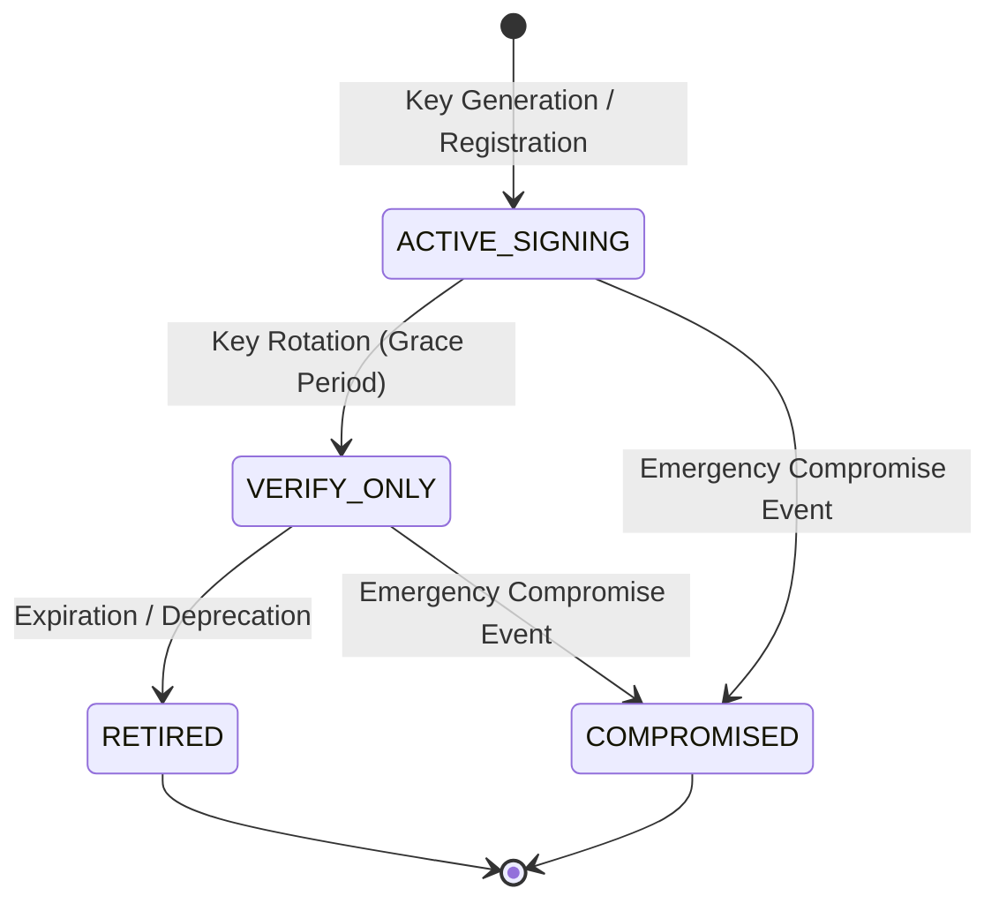

# WP-04.04 Dossier 06: Signing Key Management

**Work Package:** PROT-04.04  
**Title:** Cryptographic Signing Key Lifecycle, State Model & Secret Isolation  
**Status:** **PASSED / IMPLEMENTED & VERIFIED**  
**Classification:** Restricted Evaluation Distribution  

---

## 1. Key Lifecycle State Machine

Signing keys managed by the `SigningKeyRegistry` transition through four strictly defined states:

### Key State Definitions

| State | Permitted Operations | Description |
| :--- | :--- | :--- |
| `ACTIVE_SIGNING` | **Sign & Verify** | The current primary signing key. Used by the issuer to sign new licenses and verify active tokens. |
| `VERIFY_ONLY` | **Verify Only** | Previous active key after rotation. Retained to verify existing valid tokens until their natural expiration. Cannot be used to sign new licenses (`LIC-027`). |
| `RETIRED` | **None** | Fully decommissioned key. Cannot sign or verify. Any token presenting this `kid` is rejected (`LIC-028`). |
| `COMPROMISED` | **None (Revocation)** | Emergency quarantine state. Indicates private key material may have leaked. All tokens signed with this key are immediately invalidated (`LIC-026`). |

---

## 2. Key Identifier (`kid`) Naming Convention

Key IDs follow a deterministic, auditable naming structure:
$$\text{kid} = \text{"aegis-license-ed25519-"} \mathbin{\Vert} \text{YYYY} \mathbin{\Vert} \text{"-"} \mathbin{\Vert} \text{Sequence}$$

Examples:
- `aegis-license-ed25519-2026-01` (Initial production key)
- `aegis-license-ed25519-2026-02` (Post-rotation key)

---

## 3. Secret Isolation & Zero-Exposure Guarantees

### 3.1 Strict Exclusion from Client Bundles (`LIC-037`)
The downloadable evaluator client bundle includes **zero private signing keys**:
- The client receives only its own locally generated device private key and the public key of the evaluation authority (or relies on online validation via the Evaluation Gateway).
- Test `LIC-037` scans the distribution packages (`dist/`, `build/`, `web/dist/`, `demo/`) to ensure no file matches private key PEM headers (`BEGIN PRIVATE KEY`, `BEGIN ED25519 PRIVATE KEY`).

### 3.2 Exclusion from Public Repository (`LIC-038`)
No private signing key material is ever committed to source control:
- Keys are dynamically generated or loaded from secure environment variables (`AEGIS_EVALUATION_SIGNING_KEY_PEM`) or cloud KMS / HSM stores in production.
- Test `LIC-038` and the audit scan (`secret-exposure-scan.txt`) verified zero matching patterns across `src/`, `web/src/`, and `services/`.

### 3.3 Log Sanitization & Token Concealment (`LIC-039`)
License tokens contain sensitive claims regarding tenant identity and capabilities:
- Raw JWS compact strings (`header.payload.signature`) are explicitly excluded from structured application logs.
- Logging wrappers truncate or hash tokens (logging only the sanitized `jti` or masked token prefix `ey...***`) to prevent credentials from leaking into log aggregators (e.g., Datadog, CloudWatch).
