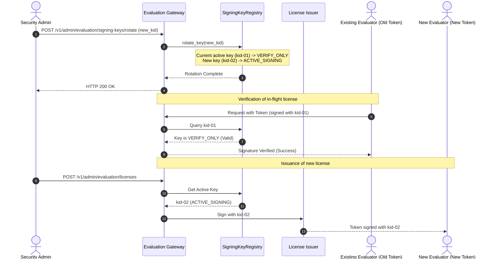
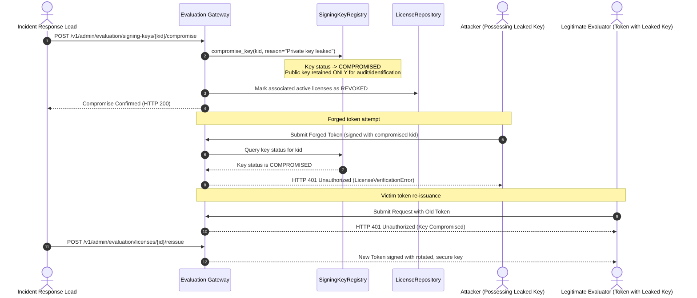

# WP-04.04 Dossier 07: Key Rotation & Compromise Response

**Work Package:** PROT-04.04  
**Title:** Cryptographic Key Rotation Protocol & Emergency Incident Response  
**Status:** **PASSED / IMPLEMENTED & VERIFIED**  
**Classification:** Restricted Evaluation Distribution  

---

## 1. Zero-Downtime Key Rotation Protocol

Cryptographic hygiene requires periodic rotation of signing keys without disrupting currently active evaluation sessions.

### 1.1 Rotation Sequence

### 1.2 Administrative API: Key Rotation (`LIC-029`)
- **Route:** `POST /v1/admin/evaluation/signing-keys/rotate`
- **Guarded by:** `require_admin_auth`
- **Action:** Generates a new Ed25519 key pair, assigns the new `kid`, sets status to `ACTIVE_SIGNING`, and moves the predecessor key to `VERIFY_ONLY`.
- **Guarantee:** Pre-existing licenses continue to pass signature verification until their expiry dates (`LIC-027`), but new licenses are immediately signed with the new key (`LIC-029`).

---

## 2. Emergency Compromise Response Protocol

In the event that an Ed25519 private key is compromised, leaked, or exposed, the platform must react immediately to prevent unauthorized license forging.

### 2.1 Compromise Sequence

### 2.2 Administrative API: Key Compromise (`LIC-026`)
- **Route:** `POST /v1/admin/evaluation/signing-keys/{kid}/compromise`
- **Guarded by:** `require_admin_auth`
- **Action:**
  1. Sets key status to `COMPROMISED`.
  2. Permanently removes the private key from active memory.
  3. Rejects any subsequent signature verification requests presenting this `kid` immediately.
  4. Optionally updates `LicenseRepository` to revoke or flag all licenses originally issued with this `kid`.
