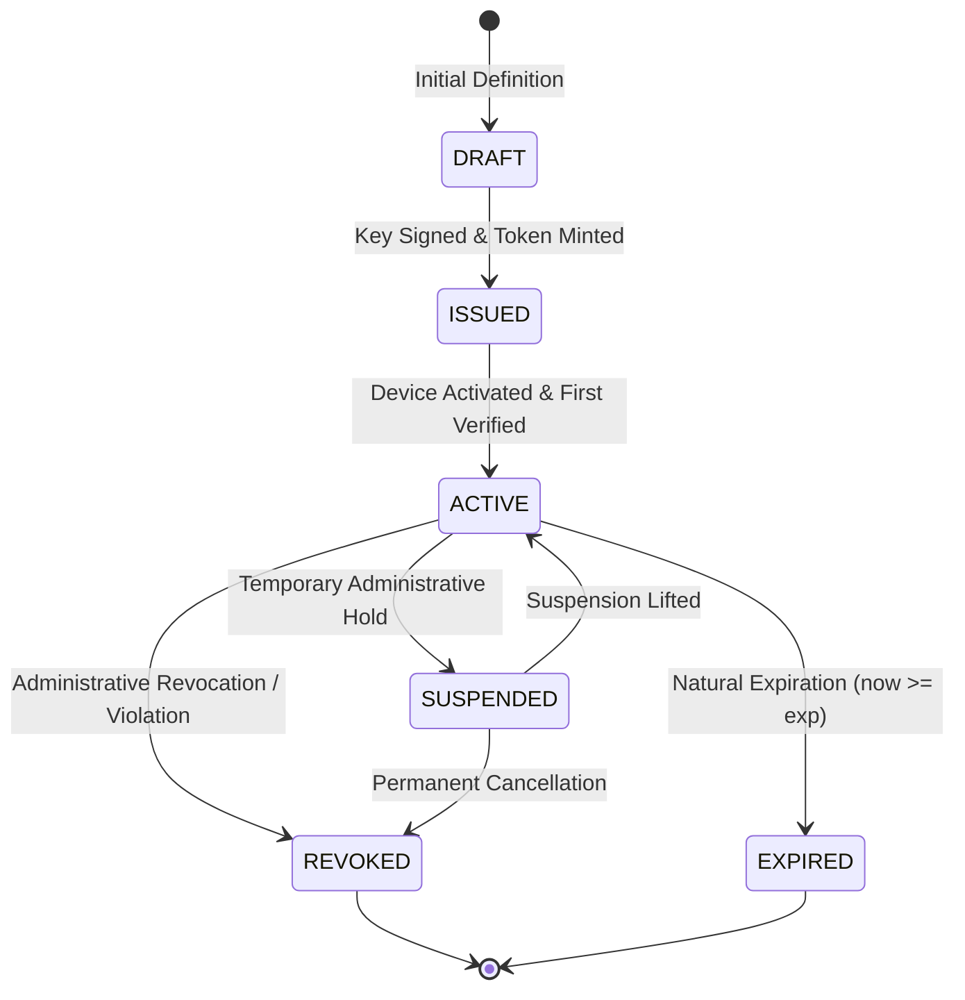

# WP-04.04 Dossier 08: License Revocation & Lifecycle Management

**Work Package:** PROT-04.04  
**Title:** License Status Transitions, Revocation Registry & Real-Time Invalidation  
**Status:** **PASSED / IMPLEMENTED & VERIFIED**  
**Classification:** Restricted Evaluation Distribution  

---

## 1. License Lifecycle State Transitions

Evaluation licenses in `LicenseRepository` follow a strictly governed state machine:

### State Definitions

| Status | Entitlement Access Granted? | Allowed Operations | Description |
| :--- | :--- | :--- | :--- |
| `DRAFT` | **No** | Admin Edit | License record created but token not yet distributed. |
| `ISSUED` | **No** (Pending Activation) | Activate Device | Token distributed to evaluator; awaiting device challenge proof. |
| `ACTIVE` | **Yes** | Validate, Verify, Quota Grant | Active valid license on registered device. |
| `SUSPENDED` | **No** (Temporary Halt) | Unsuspend | Temporarily disabled (e.g., pending payment or compliance review). |
| `REVOKED` | **No** (Permanent Cutoff) | None (Terminal) | Revoked for violation, key compromise, or contract end (`LIC-024`). |
| `EXPIRED` | **No** (Natural Termination)| Renew / Reissue | License validity window elapsed (`LIC-014`). |

---

## 2. Administrative Revocation & Status Controls

AEGIS exposes guarded administrative routes to manage license state in real time:

### 2.1 Suspend License
- **Route:** `POST /v1/admin/evaluation/licenses/{id}/suspend`
- **Guarded by:** `require_admin_auth`
- **Result:** Moves status to `SUSPENDED`. Evaluator receives `HTTP 403 Forbidden` (`"License is suspended"`).

### 2.2 Revoke License
- **Route:** `POST /v1/admin/evaluation/licenses/{id}/revoke`
- **Guarded by:** `require_admin_auth`
- **Result:** Moves status to `REVOKED` in `LicenseRepository` and registers the ID in `RevocationRegistry`. Evaluator receives `HTTP 403 Forbidden` (`"License has been revoked"`).

### 2.3 Renew License
- **Route:** `POST /v1/admin/evaluation/licenses/{id}/renew`
- **Guarded by:** `require_admin_auth`
- **Parameters:** `{"extend_days": 14}`
- **Result:** Extends `expires_at` timestamp in repository; issues an updated JWS token.

### 2.4 Reissue License
- **Route:** `POST /v1/admin/evaluation/licenses/{id}/reissue`
- **Guarded by:** `require_admin_auth`
- **Result:** Invalided old license record, generates a new `jti` and newly signed token with refreshed credentials.

---

## 3. Real-Time Cache Invalidation (`LIC-030`)

To ensure low latency during validation while preventing stale authorizations:
1. Revocation events update both the database record and an in-memory `RevocationRegistry`.
2. Any active authorization tokens or session caches referencing the revoked `license_id` are purged immediately (`test_lic_030`).
3. Subsequent requests fail closed at the gateway without waiting for token TTL expiration.
