# WP-04.04 Dossier 09: Offline Verification Boundaries

**Work Package:** PROT-04.04  
**Title:** Offline vs Online Verification Boundaries & Security Guarantees  
**Status:** **PASSED / IMPLEMENTED & VERIFIED**  
**Classification:** Restricted Evaluation Distribution  

---

## 1. Architectural Dilemma: Offline vs Online Licensing

A downloadable client application running on user hardware inevitably faces network disconnections. However, delegating full licensing authority to the client introduces catastrophic vulnerability:
1. **Clock Rollback Vulnerability**: A client running offline can manipulate the local system clock to prevent license expiration.
2. **Device Cloning**: A valid license file and device key can be cloned across multiple virtual machines without the client knowing another instance is active.
3. **Revocation Blindness**: An offline client has no mechanism to learn that its license was suspended or revoked by the issuer.
4. **Quota Tampering**: Local usage counts stored in client files or SQLite databases can be reset or frozen by the user.

---

## 2. AEGIS Two-Tier Boundary Architecture

AEGIS resolves this dilemma by separating **informational client-side inspection** from **authoritative server-side entitlement enforcement**.

```mermaid
flowchart LR
    subgraph Tier1 ["Tier 1: Client-Side Offline Inspection (Untrusted)"]
        LocalSig["Signature Verification<br/>(Public Key)"]
        DisplayClaims["Display Features & Quotas in UI"]
        LocalTTL["Enforce Local Expiry Warning"]
    end

    subgraph Tier2 ["Tier 2: Gateway Online Authority (Trusted)"]
        AuthCheck["Authoritative DB Cross-Check"]
        RevokeCheck["Revocation & Suspension Gate"]
        DeviceGate["Active Device Quota Gate (Max: 1)"]
        UsageCounter["Atomic Server-Side Quota Enforcement"]
        ModelAccess["ML / Inference Capability Access"]
    end

    Tier1 -->|Online API Ingress| Tier2
```

### 2.1 Permitted Offline Operations (Tier 1)
The downloaded demo client may perform the following offline actions:
- Verify the Ed25519 signature of its locally stored license using the embedded public key of the evaluation authority.
- Decode and display evaluation parameters (evaluator name, granted features, daily quota limits) in the desktop UI.
- Display proactive alerts when the license expiration is approaching ($\text{exp} - \text{now} < 72\text{ hours}$).
- Allow basic UI navigation and local project browsing.

### 2.2 Prohibited Offline Operations (Tier 2 - Strictly Server-Enforced)
The following capabilities **unconditionally require online communication** with the Evaluation Gateway:
- **ML & Document Processing Pipelines**: OCR, document chunking, embeddings generation, vector indexing, and LLM extraction cannot execute without a valid server session.
- **Quota Incrementation**: Usage counters are incremented authoritatively on the server.
- **Entitlement Authorization**: Every backend request must be validated against `LicenseRepository` and `DeviceRegistry`.
- **License Renewal & Device Transfer**: Re-binding devices or renewing licenses requires online challenge-response activation.

---

## 3. Disconnected Grace Period Policy

1. **Short Grace Buffer**: In the event of transient network failure during an active evaluation session, the client is allowed a maximum of **15 minutes** of grace buffering for in-flight UI operations.
2. **Hard Cutoff**: Once the grace period expires without a successful gateway heartbeat or verification check, high-value operations halt and the user is prompted to reconnect.
3. **Clock Skew Tolerance**: The server enforces a strict $\pm 300\text{ second}$ (5 minute) clock skew window. Clocks advanced or set back beyond this threshold are rejected (`LIC-032`, `LIC-033`).
