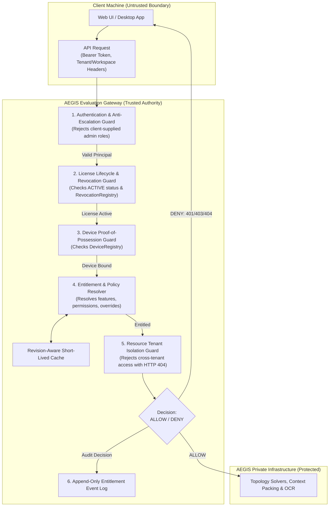

# WP-04.05 Dossier 01: Entitlement Architecture

**Work Package:** PROT-04.05  
**Title:** Server-Side Entitlement Enforcement & Feature Authorization Subsystem Architecture  
**Status:** **PASSED / IMPLEMENTED & VERIFIED**  
**Classification:** Restricted Evaluation Distribution  

---

## 1. Executive Architectural Overview

In the AEGIS-DocIntel Protected Demo Edition, evaluators run a downloadable client bundle on their own machines. Merely validating user identity and cryptographic license signatures is insufficient: a valid evaluator account and valid license must not grant unrestricted access to proprietary backend capabilities or other evaluators' data.

WP-04.05 implements the **Four-Factor Server-Side Authorization Layer**:
Every protected operation requires an authoritative, server-evaluated decision:

$$\mathbf{ALLOW} = \mathbf{I} \land \mathbf{L} \land \mathbf{D} \land \mathbf{E} \land \mathbf{R} \land \mathbf{Q}$$

Where:
1. $\mathbf{I}$ (**Identity**): The requesting principal is securely authenticated; evaluator sessions are strictly forbidden from holding administrator roles (`ROLE_ADMIN`, `ROLE_PLATFORM_ADMIN`).
2. $\mathbf{L}$ (**License**): The evaluation license is cryptographically verified, within its validity window ($\text{nbf} \le \text{now} < \text{exp}$), and currently `ACTIVE` (not `SUSPENDED` or `REVOKED`).
3. $\mathbf{D}$ (**Device**): The requesting device is bound via asymmetric challenge proof and actively registered.
4. $\mathbf{E}$ (**Entitlement**): The applicable policy version grants the requested capability and action permission, factoring in approved administrative overrides.
5. $\mathbf{R}$ (**Resource Scope**): The target resource (workspace, document, job, stream) is owned by the authenticated tenant, enforcing strict IDOR defense.
6. $\mathbf{Q}$ (**Quota**): Server-side usage capacity remains available.

---

## 2. Security Trust Boundary & Decision Pipeline

---

## 3. Non-Negotiable Core Security Invariants

1. **Frontend Permissions are Display Controls Only:** Hiding a button, disabling a menu item, or modifying JavaScript state in the evaluator's browser does not protect backend API endpoints (`BYPASS-001`, `BYPASS-002`).
2. **Strict Evaluator RBAC Boundary:** An evaluation principal can never be assigned an administrator role (`ROLE_ADMIN`, `ROLE_PLATFORM_ADMIN`, `ROLE_TENANT_ADMIN`). Any session containing admin privileges fails closed (`RBAC-001` - `RBAC-003`).
3. **Client-Supplied Headers Ignored:** Headers such as `X-User-Role: admin`, `X-Tenant-ID`, or `X-Client-Entitlements` cannot alter the server's authoritative security context (`RBAC-004`, `RBAC-005`, `BYPASS-002`).
4. **IDOR Enumeration Defense:** Accessing resources across tenant boundaries returns `HTTP 404 Not Found` rather than `403 Forbidden`, preventing attackers from probing for the existence of confidential documents (`TENANT-ENT-002` - `TENANT-ENT-010`).
5. **Fail-Closed Default:** Unknown features, unknown permissions, invalid policy versions, or backend service unavailability unconditionally terminate in access denial (`ENT-007`, `ENT-008`, `ENT-009`, `ENT-018`).
