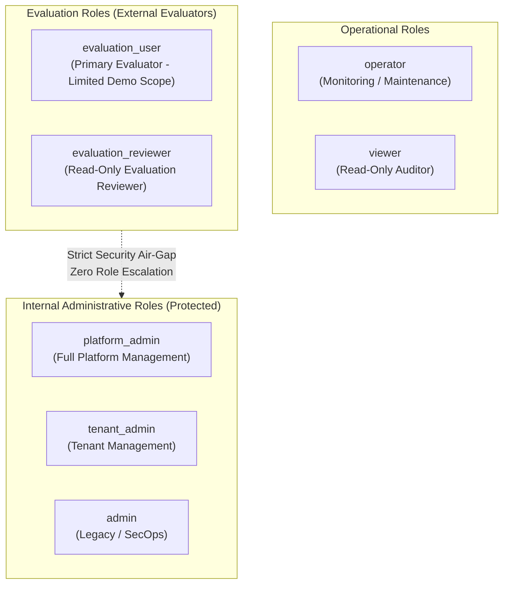

# WP-04.05 Dossier 03: Evaluator RBAC Matrix

**Work Package:** PROT-04.05  
**Title:** Evaluator Role-Based Access Control & Privilege Escalation Defenses  
**Status:** **PASSED / IMPLEMENTED & VERIFIED**  
**Classification:** Restricted Evaluation Distribution  

---

## 1. Role Catalogue Overview

The AEGIS-DocIntel platform maintains an explicit role hierarchy distinguishing external evaluators from internal platform operators:



---

## 2. Role-Permission Enforcement Matrix

| Operation / Capability | `evaluation_user` | `evaluation_reviewer` | `operator` | `platform_admin` / `admin` |
| :--- | :---: | :---: | :---: | :---: |
| **View Dashboard** | Yes | Yes | Yes | Yes |
| **Upload Document** | Yes (capped) | No | Yes | Yes |
| **Preview Document** | Yes (own only) | Yes (assigned) | Yes | Yes |
| **Query Intelligence** | Yes (capped) | Yes (assigned) | Yes | Yes |
| **Compare Documents** | Policy-dependent | Policy-dependent | Yes | Yes |
| **Export Results** | Policy-dependent | No | Yes | Yes |
| **Deactivate Own Device**| Yes | No | No | Yes |
| **View Own Quota** | Yes | Yes | Yes | Yes |
| **Issue Licenses** | **No** (401/403) | **No** (401/403) | **No** (401/403) | **Yes** |
| **Revoke Licenses** | **No** (401/403) | **No** (401/403) | **No** (401/403) | **Yes** |
| **Inspect Other Tenants**| **No** (404/403) | **No** (404/403) | **No** (404/403) | Authorized Only |
| **Configure Engine** | **No** (401/403) | **No** (401/403) | Dedicated Only | **Yes** |

---

## 3. Anti-Escalation Safeguards

### 3.1 Client Header Stripping (`RBAC-002`, `RBAC-004`, `RBAC-005`)
An evaluator cannot elevate their privileges by supplying custom request headers:
- `X-User-Role: admin`
- `X-Role: platform_admin`
- `X-Tenant-Role: platform_admin`
- `X-Tenant-ID: <other-tenant>`
The gateway extracts identity strictly from verified server-side session records or authenticated JWS tokens; client headers are disregarded.

### 3.2 PrincipalContext Model Guard (`RBAC-003`)
In [`src/schemas/evaluation/authorization.py`](file:///C:/Users/ASUS/.gemini/antigravity/worktrees/Aegis-DocIntel/product_hunt_launch_packaging/src/schemas/evaluation/authorization.py), the `PrincipalContext` validator prevents constructing an evaluation principal with administrative roles:
```python
if self.is_evaluator:
    illegal_roles = set(self.roles).intersection(DISALLOWED_EVALUATION_ROLES)
    if illegal_roles:
        raise ValueError(f"Evaluator principal cannot be assigned administrative roles: {illegal_roles}")
```

### 3.3 Administrative Route Protection (`RBAC-001`, `RBAC-009`, `RBAC-010`)
All administrative endpoints (`/v1/admin/...`) require `require_admin_auth` validating a secret administrative credential. Any request without valid administrative credentials receives `HTTP 401 Unauthorized` or `HTTP 403 Forbidden`.
