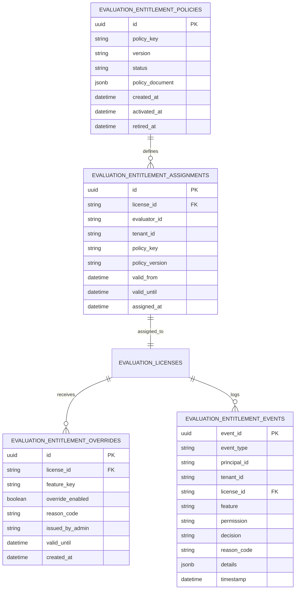

# WP-04.05 Dossier 04: Entitlement Database Schema

**Work Package:** PROT-04.05  
**Title:** Entitlement Storage Subsystem & Relational Entity Specifications  
**Status:** **PASSED / IMPLEMENTED & VERIFIED**  
**Classification:** Restricted Evaluation Distribution  

---

## 1. Entity-Relationship Overview



---

## 2. Table Specifications & Constraints

### 2.1 `evaluation_entitlement_policies`
Stores immutable, versioned policy documents:
- **Constraints:**
  - Unique `(policy_key, version)`.
  - Once status moves to `ACTIVE`, the policy document is immutable (`PolicyImmutabilityError`).
  - Cannot reactivate a `RETIRED` policy version.
  - Policy document must not contain administrative features or permissions (`ENT-015`).

### 2.2 `evaluation_entitlement_assignments`
Maps an evaluation license and evaluator to a specific policy version:
- **Constraints:**
  - Unique index on `license_id`.
  - Foreign keys to authoritative license repository.
  - Temporal check: $\text{valid\_until} > \text{valid\_from}$.

### 2.3 `evaluation_entitlement_overrides`
Records administrative exceptions (e.g., granting temporary document comparison for sales demos):
- **Constraints:**
  - Explicit non-empty `reason_code` required.
  - Identity of issuing administrator (`issued_by_admin`) logged.
  - Optional `valid_until` timestamp; once elapsed, override automatically ceases to grant access (`ENT-013`).
  - Strictly rejects overriding administrative features (`admin.*`).

### 2.4 `evaluation_entitlement_events`
Append-only tamper-evident audit log:
- Records all authorization decisions (`ALLOW`, `DENY`), policy activations, and overrides.
- Redaction policy: zero full JWTs, raw tokens, passwords, private keys, or raw document content are recorded.

---

## 3. Canonical Policy Documents

### 3.1 `evaluation-basic` v1.0
```json
{
  "policy_key": "evaluation-basic",
  "version": "1.0",
  "features": {
    "dashboard.view": true,
    "document.upload": true,
    "document.preview": true,
    "document.parse": true,
    "document.query": true,
    "document.compare": false,
    "document.export": false,
    "workspace.manage": true,
    "usage.view": true,
    "license.view": true,
    "device.manage": true
  },
  "limits": {
    "documents_per_license": 20,
    "max_file_size_bytes": 10485760,
    "storage_bytes": 104857600,
    "queries_per_license": 100,
    "comparisons_per_license": 0,
    "concurrent_jobs": 2
  }
}
```

### 3.2 `evaluation-pro` v1.0 (Commercial Pilot)
```json
{
  "policy_key": "evaluation-pro",
  "version": "1.0",
  "features": {
    "dashboard.view": true,
    "document.upload": true,
    "document.preview": true,
    "document.parse": true,
    "document.query": true,
    "document.compare": true,
    "document.export": true,
    "workspace.manage": true,
    "usage.view": true,
    "license.view": true,
    "device.manage": true
  },
  "limits": {
    "documents_per_license": 50,
    "max_file_size_bytes": 26214400,
    "storage_bytes": 524288000,
    "queries_per_license": 500,
    "comparisons_per_license": 50,
    "concurrent_jobs": 5
  }
}
```
