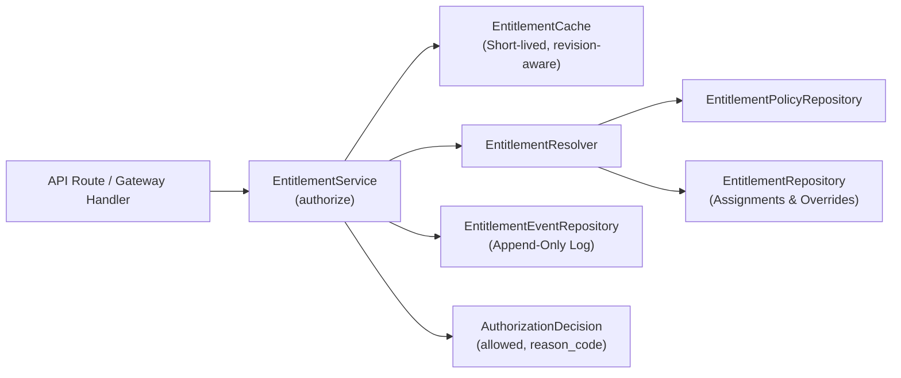
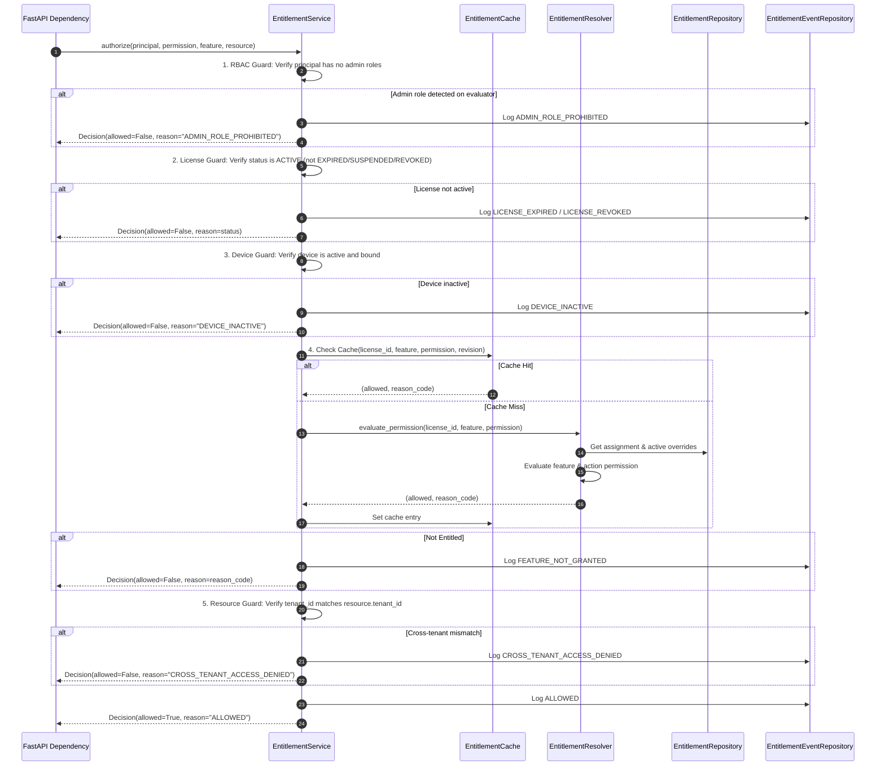

# WP-04.05 Dossier 05: Policy Evaluation Engine

**Work Package:** PROT-04.05  
**Title:** Policy Evaluation Engine & Authorization Decision Algorithm  
**Status:** **PASSED / IMPLEMENTED & VERIFIED**  
**Classification:** Restricted Evaluation Distribution  

---

## 1. Subsystem Architecture

The evaluation engine is organized into decoupled services, repositories, and cache layers:



---

## 2. Evaluation Resolution Sequence

When `EntitlementService.authorize()` is invoked for an incoming request, it executes the following sequential verification gates:



---

## 3. Effective Permission Formula

$$\mathbf{ALLOW} = \mathbf{I} \land \mathbf{L} \land \mathbf{D} \land \mathbf{E} \land \mathbf{R} \land \mathbf{Q}$$

| Factor | Description | Failure Reason Code |
| :--- | :--- | :--- |
| $\mathbf{I}$ (Identity) | Principal authenticated; zero administrative roles | `ADMIN_ROLE_PROHIBITED` |
| $\mathbf{L}$ (License) | License valid, temporal bounds met, not suspended or revoked | `LICENSE_EXPIRED`, `LICENSE_SUSPENDED`, `LICENSE_REVOKED` |
| $\mathbf{D}$ (Device) | Requesting hardware device registered and active | `DEVICE_INACTIVE` |
| $\mathbf{E}$ (Entitlement) | Feature enabled in policy or active override; permission matches | `FEATURE_NOT_GRANTED`, `PERMISSION_DENIED`, `UNKNOWN_FEATURE` |
| $\mathbf{R}$ (Resource) | Target resource belongs strictly to caller's tenant | `CROSS_TENANT_ACCESS_DENIED` |
| $\mathbf{Q}$ (Quota) | Quota reservation succeeds | `QUOTA_EXCEEDED` |

---

## 4. Fail-Closed Resilience (`ENT-018`)

If an unexpected runtime exception, database timeout, or memory corruption occurs during evaluation:
```python
except Exception as exc:
    logger.error(f"EntitlementService error: {exc}", exc_info=True)
    return self._record_and_return(
        principal=principal,
        feature=norm_feature,
        permission=permission,
        allowed=False,
        reason_code=AuditReasonCode.SERVICE_UNAVAILABLE.value,
        details={"error": str(exc)},
    )
```
The pipeline guarantees that errors result in an immediate deny, preventing bypass via fault injection.
