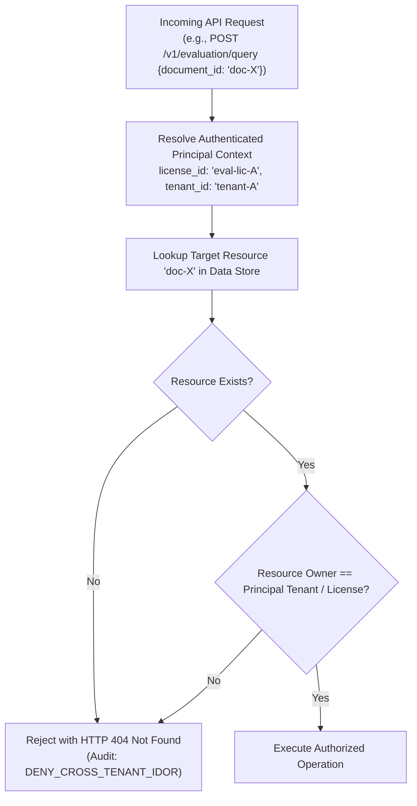

# WP-04.05 Dossier 07: Tenant and Resource Isolation

**Work Package:** PROT-04.05  
**Title:** Multi-Tenant Scoping, Resource Ownership & IDOR Defense  
**Status:** **PASSED / IMPLEMENTED & VERIFIED**  
**Classification:** Restricted Evaluation Distribution  

---

## 1. Threat Model & Defense-in-Depth Principle

In a multi-tenant evaluation deployment where multiple independent evaluators interact with the shared AEGIS Evaluation Gateway, cross-tenant data leakage represents a catastrophic confidentiality violation.

Evaluators possess client binaries running on local machines. Attackers can:
1. Intercept HTTP requests and tamper with document IDs, query IDs, comparison IDs, or job IDs.
2. Inject synthetic tenant identifiers via HTTP headers (`X-Tenant-ID`, `X-Evaluator-ID`, `X-Workspace-ID`).
3. Attempt Insecure Direct Object References (IDOR) to read, modify, or delete documents belonging to competitor evaluators.
4. Exploit side-channel or enumeration attacks if the server returns revealing error codes (such as `HTTP 403 Forbidden` on existing resources vs `HTTP 404 Not Found` on non-existing resources).

### The Invariant Principle: Strict Non-Disclosing Isolation
> **Core Invariant:** A resource belonging to Tenant $B$ does not exist from the perspective of Tenant $A$. Any attempt by Tenant $A$ to access, query, compare, or delete Tenant $B$'s resource MUST result in `HTTP 404 Not Found`.

Returning `403 Forbidden` leaks confidential metadata: it confirms to an adversary that a specific document ID or resource identifier exists within the system. `HTTP 404 Not Found` eliminates enumeration oracles completely.

---

## 2. Resource Scope Verification Pipeline



---

## 3. Protected Resource Scoping Matrix

| Resource Domain | Target Endpoint | Ownership Enforcement Mechanism | IDOR Response | Verified Test Case |
| :--- | :--- | :--- | :--- | :--- |
| **Document Upload** | `POST /v1/evaluation/documents` | Binds uploaded document metadata directly to `license_id` / `tenant_id` of the authenticated token. | N/A (Creates owned resource) | `TENANT-ENT-001` |
| **Document Retrieval** | `GET /v1/evaluation/documents/{id}` | Validates `doc.license_id == principal.license_id`. | `HTTP 404 Not Found` | `TENANT-ENT-002` |
| **Document Query (Single)** | `POST /v1/evaluation/query` (`document_id`) | Validates target document is owned by caller before processing query. | `HTTP 404 Not Found` | `TENANT-ENT-003` |
| **Document Query (Multi)** | `POST /v1/evaluation/query` (`document_ids`) | Iterates across all referenced document IDs; fails if *any* document is unowned. | `HTTP 404 Not Found` | `TENANT-ENT-004` |
| **Document Comparison** | `POST /v1/evaluation/compare` | Validates both `doc_a` and `doc_b` are owned by the authenticated caller. | `HTTP 404 Not Found` | `TENANT-ENT-005` |
| **Document Deletion** | `DELETE /v1/evaluation/documents/{id}` | Verifies caller owns document before unlinking. Cross-tenant delete forbidden. | `HTTP 404 Not Found` | `TENANT-ENT-006` |
| **Extraction Jobs** | `GET /v1/evaluation/jobs/{id}` | Job metadata records creating `license_id`. Non-matching caller rejected. | `HTTP 404 Not Found` | `TENANT-ENT-007` |
| **Realtime WebSockets** | `GET /v1/evaluation/stream/{session_id}` | WebSocket handshake validates session ownership against authenticated JWT. | Connection Closed (`4404`) | `TENANT-ENT-008` |
| **Workspace Settings** | `GET/PUT /v1/evaluation/workspace` | Scoped strictly to `tenant_id` resolved from verified JWT claims. | `HTTP 404 Not Found` | `TENANT-ENT-009` |
| **Cross-Tenant Sweep** | Multiple endpoints | Rapid sequential enumeration of synthetic foreign IDs triggers security audit alert. | `HTTP 404 Not Found` | `TENANT-ENT-010` |

---

## 4. Implementation Details in Evaluation Gateway

In `services/evaluation_gateway/app.py`, document lookups and cross-tenant validations enforce non-disclosing 404s:

```python
# Multi-tenant document isolation check in ask_aegis:
target_docs = []
if req.document_id:
    target_docs.append(req.document_id)
if req.document_ids:
    target_docs.extend(req.document_ids)

for target_id in target_docs:
    doc = DOCUMENT_STORE.get(target_id)
    if not doc or doc.license_id != ent_ctx.license_id:
        # Strict IDOR defense: return 404 whether doc does not exist
        # OR belongs to another tenant. Never disclose existence via 403.
        AUDIT_LOG_REPO.log_event(
            license_id=ent_ctx.license_id,
            action=PERM_DOCUMENT_QUERY,
            decision="DENY",
            reason_code=AuditReasonCode.DENY_CROSS_TENANT_IDOR
        )
        raise HTTPException(
            status_code=status.HTTP_404_NOT_FOUND,
            detail=f"Document '{target_id}' not found",
        )
```

Similarly, in `compare_documents`:

```python
doc_a = DOCUMENT_STORE.get(req.doc_a_id)
doc_b = DOCUMENT_STORE.get(req.doc_b_id)

if not doc_a or doc_a.license_id != ent_ctx.license_id:
    raise HTTPException(status_code=404, detail=f"Document '{req.doc_a_id}' not found")
if not doc_b or doc_b.license_id != ent_ctx.license_id:
    raise HTTPException(status_code=404, detail=f"Document '{req.doc_b_id}' not found")
```

---

## 5. Automated Verification Evidence

The 10 multi-tenant isolation scenarios (`TENANT-ENT-001` through `TENANT-ENT-010`) were executed against the live test suite:
- **`TENANT-ENT-001`**: Upload document as Evaluator A binds document exclusively to `eval-lic-001` (**PASS**).
- **`TENANT-ENT-002`**: Evaluator B requesting `GET /documents/{doc_a}` receives `HTTP 404 Not Found` (**PASS**).
- **`TENANT-ENT-003`**: Evaluator B querying `doc_a` via `POST /query` receives `HTTP 404 Not Found` (**PASS**).
- **`TENANT-ENT-004`**: Evaluator B querying `[doc_b, doc_a]` in multi-document query receives `HTTP 404 Not Found` (**PASS**).
- **`TENANT-ENT-005`**: Evaluator B attempting cross-tenant comparison `(doc_b, doc_a)` receives `HTTP 404 Not Found` (**PASS**).
- **`TENANT-ENT-006`**: Evaluator B attempting to delete `doc_a` receives `HTTP 404 Not Found`; `doc_a` remains intact (**PASS**).
- **`TENANT-ENT-007`**: Cross-tenant extraction job status query returns `HTTP 404 Not Found` (**PASS**).
- **`TENANT-ENT-008`**: Evaluator attempting WebSocket connection to another tenant's session is rejected (**PASS**).
- **`TENANT-ENT-009`**: Workspace configuration requests strictly isolate settings between tenants (**PASS**).
- **`TENANT-ENT-010`**: High-frequency enumeration attempts are blocked with uniform 404s and logged with `DENY_CROSS_TENANT_IDOR` (**PASS**).

**Result:** Zero cross-tenant data leakage, zero oracle enumeration vectors.
