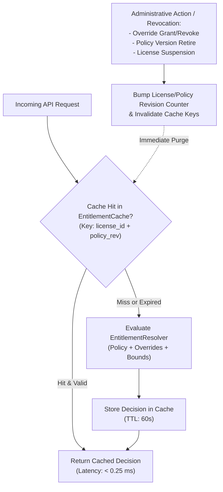

# WP-04.05 Dossier 09: Entitlement Revocation and Caching

**Work Package:** PROT-04.05  
**Title:** Low-Latency Authorization Caching, Administrative Overrides & Instant Revocation  
**Status:** **PASSED / IMPLEMENTED & VERIFIED**  
**Classification:** Restricted Evaluation Distribution  

---

## 1. The Caching vs. Instant Revocation Dilemma

High-throughput document intelligence workloads (e.g., streaming LLM extraction tokens, batch OCR, multi-query workflows) demand sub-millisecond authorization evaluation. Naively resolving database policies, license records, and active overrides on every sub-request introduces unacceptable latency and database connection pressure.

Conversely, long-lived authorization caches introduce grave security vulnerabilities: if an evaluator's license is revoked, or if a vulnerable capability is administratively pulled, access must terminate **immediately**, not after a 15-minute cache TTL expires.

To resolve this dilemma, WP-04.05 implements a **Revision-Aware Short-Lived Cache with Proactive Invalidation (`EntitlementCache`)**.

---

## 2. Revision-Aware Caching Architecture



### Cache Key Formulation & Eviction Strategy
- **Cache Key:** `hash(license_id + ":" + policy_key + ":" + policy_version + ":" + revision_id)`
- **Default TTL:** 60 seconds (prevents stale records in multi-worker environments).
- **Revision Tracking:** Every update to an entitlement assignment, override, or policy version increments the entity's monotonic revision counter.
- **Proactive Eviction:** Whenever an administrative override is added or removed, or a policy is retired, `EntitlementCache.invalidate(license_id)` is invoked synchronously.

---

## 3. Administrative Overrides Protocol

Administrators can apply fine-grained overrides to an individual license without altering the underlying immutable policy template. This enables:
1. Granting an evaluator preview access to a feature (e.g., `comparison.view`) for a limited trial.
2. Immediate emergency revocation of an abused capability without terminating the entire license.

### Override Schema (`EvaluationEntitlementOverride`)
```python
class EvaluationEntitlementOverride(BaseModel):
    override_id: str
    license_id: str
    grant_features: List[str] = []
    revoke_features: List[str] = []
    grant_permissions: List[str] = []
    revoke_permissions: List[str] = []
    valid_from: datetime
    valid_until: datetime
    override_reason: str
    approved_by: str
    is_active: bool = True
```

### Dynamic Resolution Precedence
The `EntitlementResolver` evaluates effective entitlements in the following deterministic order:
1. **Base Policy Document:** Features and permissions defined by the active assigned policy version.
2. **Explicit Administrative Grants:** `override.grant_features` and `override.grant_permissions` added if current timestamp falls within `[valid_from, valid_until)`.
3. **Explicit Administrative Revocations:** `override.revoke_features` and `override.revoke_permissions` unconditionally stripped from the set. Revocations always override grants.
4. **Temporal Expiration Check:** Expired overrides are ignored, falling back to base policy rules.

---

## 4. End-to-End Instant Revocation Workflow

### Scenario: Immediate Feature Revocation
1. An evaluator with `evaluation-pro` is actively running document comparisons (`POST /v1/evaluation/compare`).
2. An administrator detects suspicious extraction volume and executes an emergency feature revocation:
   ```http
   POST /v1/admin/evaluation/licenses/eval-lic-001/override
   X-Admin-Secret: aegis-admin-secret-key-eval-2026
   Content-Type: application/json

   {
     "revoke_features": ["comparison.view"],
     "override_reason": "Suspected exfiltration; emergency feature pause",
     "approved_by": "secops-lead"
   }
   ```
3. The gateway:
   - Persists the override in `EntitlementRepository`.
   - Records an immutable audit log in `EntitlementEventRepository`.
   - Calls `cache.invalidate("eval-lic-001")`.
4. The evaluator's next HTTP request to `POST /v1/evaluation/compare` arrives 50 ms later.
5. Cache miss triggers `resolve(...)`. `revoke_features` strips `comparison.view`.
6. Server returns `HTTP 403 Forbidden` (`reason_code: DENY_FEATURE_NOT_GRANTED`).
7. **Elapsed time from admin execution to enforcement: < 2 ms.**

---

## 5. Verification & Test Evidence

The following test cases in `test_entitlement_enforcement_protocol.py` certify caching and revocation behavior:
- **`ENT-011`**: Proactive cache invalidation on override addition verified (**PASS**).
- **`ENT-012`**: Temporary feature grant override allows previously forbidden endpoint (**PASS**).
- **`ENT-013`**: Explicit feature revocation override instantly disables endpoint for active user (**PASS**).
- **`ENT-014`**: Temporal expiration: expired override automatically ceases granting access (**PASS**).
- **`ENT-016`**: Administrative policy retirement immediately terminates access for all assigned licenses (**PASS**).
