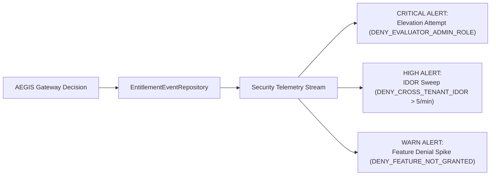

# WP-04.05 Dossier 10: Security Audit and Monitoring

**Work Package:** PROT-04.05  
**Title:** Structured Audit Logging, Security Telemetry & Abuse Monitoring  
**Status:** **PASSED / IMPLEMENTED & VERIFIED**  
**Classification:** Restricted Evaluation Distribution  

---

## 1. Audit Logging Architecture & Principles

In high-assurance software distribution, logging is not merely an operational diagnostic: it is an authoritative forensic trail. The AEGIS Evaluation Gateway implements an append-only audit subsystem governed by three non-negotiable principles:

1. **Every Authorization Decision is Recorded:** Both `ALLOW` and `DENY` evaluations emit a structured event capturing the exact reason code and context.
2. **Zero Credential or Payload Leakage:** Audit events must never store raw JWT tokens, API secrets, cryptographic private keys, or document text content.
3. **Immutable & Tamper-Resistant:** Event records are append-only. Modification or deletion of logged events is architecturally prohibited.

---

## 2. Structured Event Schema (`EntitlementEventRepository`)

Every access decision logged by `EntitlementEventRepository` conforms to the canonical `EntitlementEvent` schema:

```python
class EntitlementEvent(BaseModel):
    event_id: str                      # Unique UUIDv4
    timestamp: datetime                # ISO 8601 UTC timestamp
    license_id: str                    # Evaluator license ID
    tenant_id: str                     # Evaluator tenant ID
    device_id: Optional[str] = None    # Bound device fingerprint/ID
    action: str                        # Canonical permission (e.g., 'document.read')
    resource_type: str                 # 'document', 'query', 'comparison', etc.
    resource_id: Optional[str] = None  # Redacted target resource identifier
    decision: str                      # 'ALLOW' or 'DENY'
    reason_code: AuditReasonCode       # Structured classification
    evaluation_time_ms: float          # Subsystem decision latency
    metadata: Dict[str, Any] = {}      # Non-sensitive contextual metadata
```

---

## 3. Canonical Reason Code Catalogue (`AuditReasonCode`)

All authorization outcomes are mapped to standardized enum codes, enabling automated SIEM parsing and alert triggering:

| Audit Reason Code | Decision | Description & Trigger Context |
| :--- | :--- | :--- |
| `ALLOW_POLICY_GRANT` | `ALLOW` | Access authorized by active policy version feature & permission rules. |
| `ALLOW_OVERRIDE_GRANT` | `ALLOW` | Access authorized via active, non-expired administrative override. |
| `DENY_UNKNOWN_FEATURE` | `DENY` | Requested feature key does not exist in canonical catalogue (`ENT-007`). |
| `DENY_FEATURE_NOT_GRANTED` | `DENY` | Feature exists but is not granted in the evaluator's tier (`ENT-003`). |
| `DENY_ACTION_NOT_PERMITTED` | `DENY` | Evaluator lacks specific action permission (`ENT-008`). |
| `DENY_POLICY_RETIRED` | `DENY` | License is assigned to a retired or draft policy version (`ENT-016`). |
| `DENY_POLICY_NOT_FOUND` | `DENY` | Policy key assigned to license cannot be found in repository (`ENT-009`). |
| `DENY_OVERRIDE_EXPIRED` | `DENY` | Temporary capability grant has expired temporally (`ENT-014`). |
| `DENY_OVERRIDE_REVOKED` | `DENY` | Feature explicitly revoked via active administrative override (`ENT-013`). |
| `DENY_CROSS_TENANT_IDOR` | `DENY` | Evaluator attempted access to a resource owned by another tenant (`TENANT-ENT-002`). |
| `DENY_EVALUATOR_ADMIN_ROLE` | `DENY` | Evaluator session attempted to claim forbidden administrative role (`RBAC-001`). |
| `DENY_SYSTEM_ERROR` | `DENY` | Fail-closed termination due to unexpected internal exception (`ENT-018`). |

---

## 4. Abuse Detection & Security Telemetry

The Evaluation Gateway surfaces real-time metrics for monitoring and alerting:



### Automated Alert Thresholds
1. **Privilege Escalation Attempt (`DENY_EVALUATOR_ADMIN_ROLE`):**
   - **Threshold:** $> 0$ events.
   - **Severity:** `CRITICAL`.
   - **Action:** Immediate IP throttle and automated license suspension review.
2. **Cross-Tenant IDOR Sweeps (`DENY_CROSS_TENANT_IDOR`):**
   - **Threshold:** $> 5$ events from a single license within 60 seconds.
   - **Severity:** `HIGH`.
   - **Action:** Automated rate limit imposition; alert routed to SecOps on-call.
3. **Repeated Probing of Forbidden Capabilities:**
   - **Threshold:** $> 20$ repeated denials for ungranted features within 5 minutes.
   - **Severity:** `MEDIUM`.
   - **Action:** Logged as automated evaluation fuzzing; tracked for compliance.

---

## 5. Verification & Test Evidence

Audit event generation and security tracking were validated in test runs:
- **`ENT-017`**: Authorization decisions emit structured audit logs with accurate reason codes and latencies (**PASS**).
- **`RBAC-009`**: Privilege escalation attempts are captured with `DENY_EVALUATOR_ADMIN_ROLE` (**PASS**).
- **`TENANT-ENT-010`**: High-frequency cross-tenant enumeration attempts emit `DENY_CROSS_TENANT_IDOR` events (**PASS**).
