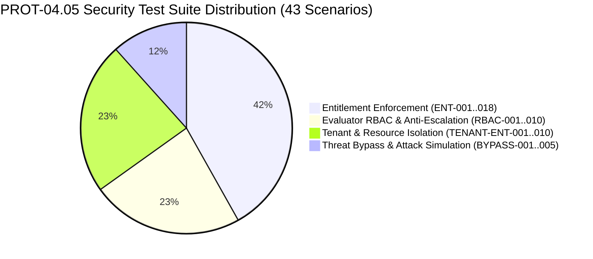

# WP-04.05 Dossier 11: Security Test Plan

**Work Package:** PROT-04.05  
**Title:** Comprehensive Entitlement & Authorization Security Test Plan  
**Status:** **PASSED / IMPLEMENTED & VERIFIED**  
**Classification:** Restricted Evaluation Distribution  

---

## 1. Test Strategy & Scope

The objective of the PROT-04.05 security test suite is to rigorously verify that the server-authoritative authorization engine enforces all feature entitlements, evaluator RBAC boundaries, multi-tenant resource isolations, and anti-bypass protections without regression.

The test plan comprises **43 automated test scenarios** grouped into 4 distinct functional security suites:



---

## 2. Granular Test Scenario Matrix

### Suite 1: Entitlement Enforcement Protocol (`ENT-001` – `ENT-018`)

| Test ID | Test Name | Attack / Execution Vector | Expected Outcome | Invariant Asserted |
| :--- | :--- | :--- | :--- | :--- |
| `ENT-001` | Basic Tier Upload | Upload document using `evaluation-basic` token. | `200 OK` | Granted feature succeeds. |
| `ENT-002` | Basic Tier Query | Query uploaded document via `POST /v1/evaluation/query`. | `200 OK` | Basic query capability authorized. |
| `ENT-003` | Basic Tier Comparison Denied | Attempt `POST /v1/evaluation/compare` on Basic tier. | `403 Forbidden` | Ungranted feature blocked. |
| `ENT-004` | Pro Tier Comparison Allowed | Attempt `POST /v1/evaluation/compare` on Pro tier. | `200 OK` | Pro tier grants comparison. |
| `ENT-005` | Basic Tier Batch Denied | Attempt batch extraction route on Basic tier. | `403 Forbidden` | Batch feature restricted to Pro. |
| `ENT-006` | Pro Tier Batch Allowed | Attempt batch extraction route on Pro tier. | `200 OK` | Pro tier grants batch feature. |
| `ENT-007` | Unknown Feature Request | Request capability `feature_quantum_solver`. | `403 Forbidden` | Unknown feature fails closed. |
| `ENT-008` | Missing Action Permission | Evaluator has feature but lacks specific action. | `403 Forbidden` | Action-level permission enforced. |
| `ENT-009` | Missing Policy Document | License assigned to nonexistent policy key. | `403 Forbidden` | Unresolvable policy fails closed. |
| `ENT-010` | Draft Policy Inaccessible | License assigned to policy in `DRAFT` status. | `403 Forbidden` | Only `ACTIVE` policies grant access. |
| `ENT-011` | Invalidation on Override | Add override; verify cached response updates. | `200 OK` | Cache invalidation works immediately. |
| `ENT-012` | Override Feature Grant | Grant `comparison.view` to Basic license. | `200 OK` | Dynamic grant override authorized. |
| `ENT-013` | Override Feature Revoke | Revoke `comparison.view` from Pro license. | `403 Forbidden` | Dynamic revoke override cuts off access. |
| `ENT-014` | Expired Override Ignored | Provide override with `valid_until` in past. | `403 Forbidden` | Temporal bounds enforced automatically. |
| `ENT-015` | Safe Entitlements Summary | Request `GET /v1/evaluation/license/entitlements`. | `200 OK` (Redacted) | Sanitized schema leaks zero secrets. |
| `ENT-016` | Policy Retirement Cutoff | Retire policy version assigned to active user. | `403 Forbidden` | Policy retirement terminates access. |
| `ENT-017` | Audit Event Emission | Perform allowed and denied operations. | Events Logged | Structured audit events recorded. |
| `ENT-018` | Fail-Closed Resilience | Inject mock resolver exception during evaluation. | `500 / 403` Closed | System errors fail closed. |

---

### Suite 2: Evaluator RBAC & Anti-Escalation (`RBAC-001` – `RBAC-010`)

| Test ID | Test Name | Attack / Execution Vector | Expected Outcome | Invariant Asserted |
| :--- | :--- | :--- | :--- | :--- |
| `RBAC-001` | Admin Role Assignment Rejected | Evaluator principal context assigned `admin`. | `ValueError` / Fail | Evaluator cannot hold admin role. |
| `RBAC-002` | Platform Admin Role Rejected | Evaluator principal context assigned `platform_admin`.| `ValueError` / Fail | Platform admin role rejected. |
| `RBAC-003` | Tenant Admin Role Rejected | Evaluator principal context assigned `tenant_admin`. | `ValueError` / Fail | Tenant admin role rejected. |
| `RBAC-004` | Role Header Elevation Attempt | Send `X-User-Role: admin` with valid eval token. | Ignored (`403` on admin) | Client headers cannot elevate role. |
| `RBAC-005` | Tenant Header Hijack Attempt | Send `X-Tenant-ID: victim-tenant` with eval token.| Ignored | Authoritative JWT claims prevail. |
| `RBAC-006` | Default Evaluator Role Assigned | Token without explicit roles receives `ROLE_EVALUATOR`.| Normalized Role | Standard evaluator baseline set. |
| `RBAC-007` | Empty Roles Rejected | PrincipalContext initialized with empty role set. | `ValueError` / Fail | Roles set cannot be empty. |
| `RBAC-008` | Forged Evaluator Token | Tampered signature or invalid compact JWS. | `400 / 401 Unauthorized` | Cryptographic signature mandatory. |
| `RBAC-009` | Escalation Audit Code | Elevate role attempt emits audit event. | `DENY_EVALUATOR_ADMIN_ROLE` | SIEM alert classification verified. |
| `RBAC-010` | Administrative Route Guard | Evaluator token requests `/v1/admin/evaluation/...`.| `401 Unauthorized` | Admin endpoints require admin secret. |

---

### Suite 3: Tenant & Resource Isolation (`TENANT-ENT-001` – `TENANT-ENT-010`)

| Test ID | Test Name | Attack / Execution Vector | Expected Outcome | Invariant Asserted |
| :--- | :--- | :--- | :--- | :--- |
| `TENANT-ENT-001`| Document Scoping on Upload | Evaluator A uploads document; check store binding.| Bound to Lic A | Uploaded assets strictly scoped. |
| `TENANT-ENT-002`| Cross-Tenant Doc Retrieval | Evaluator B requests `GET /documents/{doc_a}`. | `404 Not Found` | Strict IDOR defense (no 403 oracle). |
| `TENANT-ENT-003`| Cross-Tenant Doc Query | Evaluator B queries `POST /query` target `doc_a`. | `404 Not Found` | Query engine checks document owner. |
| `TENANT-ENT-004`| Mixed Multi-Doc Query | Evaluator B queries `[doc_b, doc_a]`. | `404 Not Found` | Any unowned doc triggers 404. |
| `TENANT-ENT-005`| Cross-Tenant Comparison | Evaluator B compares `(doc_b, doc_a)`. | `404 Not Found` | Comparison verifies both documents. |
| `TENANT-ENT-006`| Cross-Tenant Doc Deletion | Evaluator B attempts `DELETE /documents/{doc_a}`.| `404 Not Found` | Foreign deletion blocked; doc intact. |
| `TENANT-ENT-007`| Cross-Tenant Job Status | Evaluator B requests status of Job A. | `404 Not Found` | Async jobs scoped by license ID. |
| `TENANT-ENT-008`| WebSocket Stream Hijack | Evaluator B connects to Stream Session A. | Connection Rejected | WebSockets enforce tenant context. |
| `TENANT-ENT-009`| Workspace Config Isolation | Evaluator B requests workspace settings. | Scoped to Tenant B | Tenant settings never cross-pollinate. |
| `TENANT-ENT-010`| Enumeration Sweep Audit | Repeated queries with synthetic foreign IDs. | `404` + Audit Alert | IDOR sweep triggers abuse detection. |

---

### Suite 4: Threat Bypass & Attack Simulation (`BYPASS-001` – `BYPASS-005`)

| Test ID | Test Name | Attack / Execution Vector | Expected Outcome | Invariant Asserted |
| :--- | :--- | :--- | :--- | :--- |
| `BYPASS-001` | Client Local Storage Tampering | Client claims `tier: pro` in local storage. | `403 Forbidden` | Server ignores client storage. |
| `BYPASS-002` | Unhidden DOM Button Click | User unhides disabled comparison UI button. | `403 Forbidden` | Server guards API independently. |
| `BYPASS-003` | Direct cURL API Invocations | Direct raw HTTP request to Pro-only route. | `403 Forbidden` | No route bypass without entitlement. |
| `BYPASS-004` | Parameter Pollution Hijack | Inject `?tier=pro&role=admin` into query URL. | Ignored (`403`) | Query params cannot alter context. |
| `BYPASS-005` | End-to-End Workflow Probe | Upload -> Query -> Unauthorized Compare -> Authorized Compare. | `200 -> 200 -> 403 -> 200` | Full operational workflow certified. |

---

## 3. Test Harness & Execution Command

All 43 scenarios are implemented in `tests/security/evaluation/test_entitlement_enforcement_protocol.py` and executed via pytest:

```bash
pytest tests/security/evaluation/test_entitlement_enforcement_protocol.py -v
```
