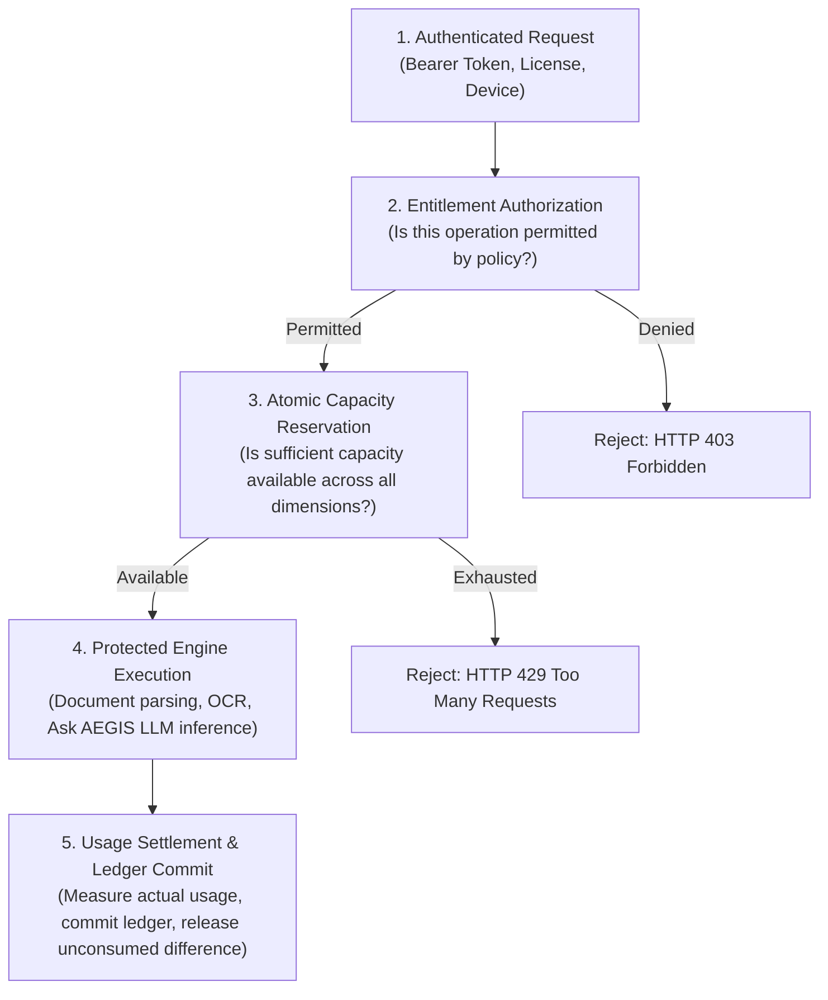
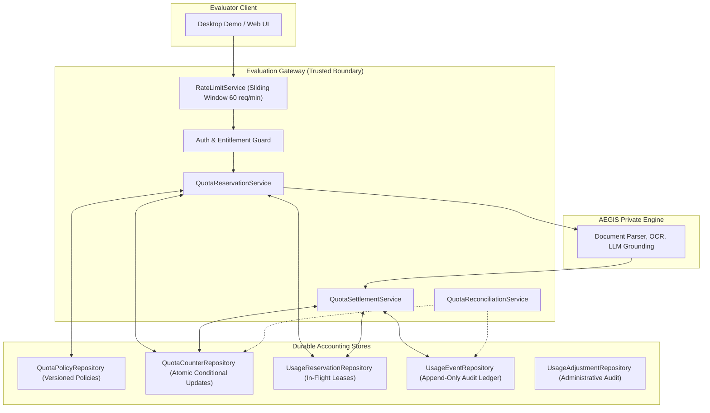

# WP-04.06 Dossier 01: Quota Architecture

**Work Package:** PROT-04.06  
**Title:** Server-Side Quota Enforcement, Two-Phase Reservation & Usage Accounting Architecture  
**Status:** **PASSED / IMPLEMENTED & VERIFIED**  
**Classification:** Restricted Evaluation Distribution  

---

## 1. Executive Architectural Overview

In the AEGIS-DocIntel Protected Demo Edition, evaluators run a downloadable client bundle on local hardware while interacting with proprietary document intelligence engine capabilities hosted on the trusted Evaluation Gateway.

Following WP-04.05 (Entitlement Enforcement), which establishes **what** capabilities an evaluator is permitted to access, WP-04.06 establishes **how much** capacity an evaluator is permitted to consume. Without strict, server-authoritative usage accounting, a malicious or automated evaluator could exhaust expensive LLM token quotas, flood indexing pipelines with unbounded gigabyte archives, or starve backend workers through parallel concurrency exhaustion.

### The Central Architectural Mandate
Every resource-consuming or billable operation MUST follow this strict sequence:

> **The Invariant Rule of Execution Order:**  
> The gateway must **never** execute an expensive private-engine operation and check usage limits retroactively. Capacity MUST be reserved prior to dispatch.

---

## 2. Separate Quota Dimensions vs. Monolithic Usage Limits

Rather than relying on a generic `usage_count`, AEGIS implements independent, multi-dimensional quota tracking across 12 distinct categories:

| Quota Category | Quota Key | Measurement Unit | Primary Enforcement Scope |
| :--- | :--- | :--- | :--- |
| **Document Storage** | `storage` | Bytes (Integer) | Lifetime / Tenant Storage Limit (100 MB default) |
| **Document Count** | `documents` | Documents (Integer) | Lifetime Stored Document Ceiling (20 docs default) |
| **Upload Traffic** | `upload` | Requests (Integer) | Upload frequency & rate limiting |
| **Parsing Jobs** | `parsing` | Jobs / Pages | Document decomposition & structural analysis |
| **OCR Processing** | `ocr` | Pages (Integer) | Optical Character Recognition page budget |
| **Ask AEGIS Queries** | `queries` | Queries (Integer) | Grounded natural language queries (100 lifetime / 20 daily) |
| **Document Comparisons** | `comparisons`| Comparisons (Integer) | Topological contradiction detection (10 lifetime / 5 daily) |
| **Inference Tokens** | `llm_tokens` | Tokens (Integer) | Input + Output LLM token budget (50,000 basic default) |
| **API Requests** | `api_requests`| Requests (Integer) | Gateway request frequency (1,000/day default) |
| **Job Concurrency** | `concurrent_jobs`| Jobs (Integer) | Maximum simultaneously active operations (2 concurrent) |
| **Export Generations** | `exports` | Exports (Integer) | CSV/PDF/JSON synthesized artifacts (5 lifetime default) |
| **Execution Time** | `processing_time`| Milliseconds (Integer) | Engine compute time ceiling per operation |

---

## 3. High-Level Subsystem Architecture

The quota and usage accounting subsystem is structured across distinct service and repository layers:

---

## 4. Key Security Invariants

1. **Two-Phase Reservation Guarantee:** Capacity is atomically checked and locked before execution begins. In-flight requests consume from available capacity ($\text{Available} = \text{Limit} - \text{Consumed} - \text{Reserved}$).
2. **All-or-Nothing Multi-Dimensional Atomicity:** If an operation requires multiple resources (e.g. 1 query, 1 concurrent slot, 2,000 estimated tokens) and any single dimension is exhausted, all other reservations are immediately rolled back (`RES-005`, `CONC-003`).
3. **Double-Spend & Replay Immunity:** Reservations and settlements use cryptographically unique idempotency keys. Repeated settlements return existing state without duplicate accounting (`RES-009`, `RES-014`).
4. **Authoritative Ledger Source of Truth:** Operational counters are fast derived state. The append-only, immutable `UsageEventRepository` is the auditable source of truth. Discrepancies are reconciled automatically (`RECON-001` - `RECON-003`).
5. **No Cross-Tenant Contamination:** Quota consumption, counters, and history are strictly scoped to the authenticated license and tenant (`QUOTA-012`).
