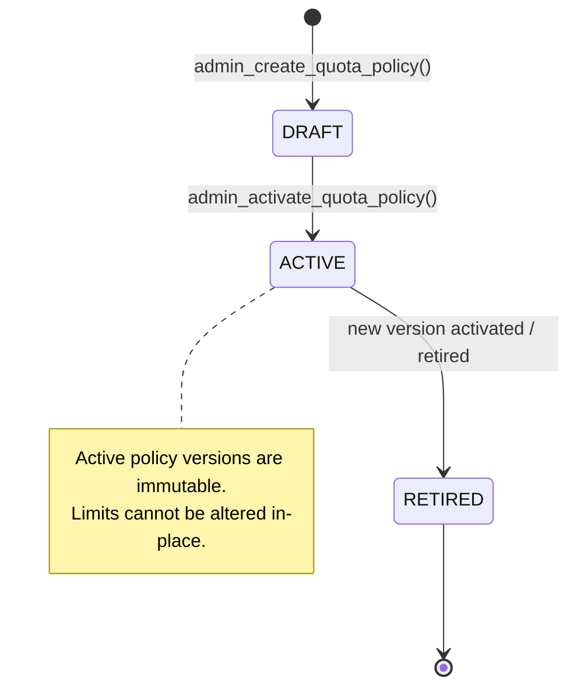

# WP-04.06 Dossier 02: Evaluation Quota Policy

**Work Package:** PROT-04.06  
**Title:** Evaluation Quota Policies, Dimension Profiles & Validation Specification  
**Status:** **PASSED / IMPLEMENTED & VERIFIED**  
**Classification:** Restricted Evaluation Distribution  

---

## 1. Quota Policy Architecture & Schema Validation

Quota definitions in AEGIS are decoupled from application code and stored as versioned, validated policy documents. The policy schema strictly enforces dimension integrity, valid units, period constraints, and non-negative integer limits.

### Schema Definition (`src/schemas/evaluation/quota.py`)
```python
class QuotaDefinition(BaseModel):
    dimension: QuotaDimension
    limit: int = Field(ge=0, description="Maximum permitted units; must be non-negative integer")
    period: QuotaPeriod
    unit: QuotaUnit
    rolling_window_seconds: Optional[int] = Field(default=None, ge=1)
```

### Incompatible Unit Enforcement
The policy engine enforces a strict compatibility map (`DIMENSION_ALLOWED_UNITS`):
- `storage` MUST be in `QuotaUnit.BYTES`.
- `documents` MUST be in `QuotaUnit.DOCUMENTS`.
- `llm_tokens` MUST be in `QuotaUnit.TOKENS`.
- `ocr` MUST be in `QuotaUnit.PAGES`.
- `queries` MUST be in `QuotaUnit.QUERIES`.
- `comparisons` MUST be in `QuotaUnit.COMPARISONS`.

Attempting to configure incompatible units (e.g., storage in requests or queries in tokens) is rejected at schema validation time (`QUOTA-005`). Negative limits are strictly forbidden (`QUOTA-006`).

---

## 2. Standard Evaluation Tier Profiles

AEGIS provides two baseline evaluation policies:

| Quota Dimension | Unit | Period | Evaluation Basic (v1.0) | Evaluation Pro (v1.0) | Test Reference |
| :--- | :--- | :--- | :---: | :---: | :--- |
| **Documents** | `documents` | Lifetime | **20** | **50** | `QUOTA-001` |
| **Total Storage** | `bytes` | Lifetime | **104,857,600 (100 MB)** | **524,288,000 (500 MB)** | `METER-001` |
| **Ask AEGIS Queries** | `queries` | Lifetime | **100** | **500** | `QUOTA-002` |
| **Daily Query Burst** | `queries` | Daily | **20** | **100** | `QUOTA-002` |
| **Document Comparisons** | `comparisons`| Lifetime | **10** | **50** | `QUOTA-001` |
| **Daily Comparison Burst**| `comparisons`| Daily | **5** | **25** | `QUOTA-001` |
| **API Requests** | `requests` | Daily | **1,000** | **5,000** | `RATE-001` |
| **Concurrent Jobs** | `jobs` | Concurrent | **2** | **5** | `QUOTA-010` |
| **LLM Inference Tokens** | `tokens` | Lifetime | **50,000** | **250,000** | `METER-006` |
| **Exports** | `exports` | Lifetime | **5** | **25** | `METER-010` |
| **OCR Pages** | `pages` | Lifetime | **50** | **200** | `METER-005` |
| **Max File Size** | `bytes` | Per-Operation | **10,485,760 (10 MB)** | **26,214,400 (25 MB)** | `METER-002` |

---

## 3. Supported Quota Periods

The engine supports seven distinct quota evaluation periods:

1. **`lifetime`**: Cumulative allowance for the evaluation license. Does not reset automatically (`QUOTA-008`).
2. **`daily`**: Fixed 24-hour UTC window. Period key: `daily:YYYY-MM-DD` (`QUOTA-007`).
3. **`weekly`**: Calendar week allowance. Period key: `weekly:YYYY-Www`.
4. **`monthly`**: Calendar month allowance. Period key: `monthly:YYYY-MM`.
5. **`rolling`**: Continuous sliding-window measurement over `rolling_window_seconds` (`QUOTA-009`).
6. **`concurrent`**: Active resource lease ceiling. Automatically freed when operation settles or releases (`QUOTA-010`).
7. **`per_operation`**: Single-request ceiling (e.g. max file size, max execution timeout).

---

## 4. Policy Versioning & Immutability Rules



- **Immutability of Active Policies:** Once a policy version enters `ACTIVE` status, its limits cannot be modified in-place. Modifying limits requires drafting a new version (e.g. `1.1`) and activating it (`QUOTA-013`).
- **Retirement Cutoff:** Activating a new version transitions the prior version to `RETIRED`. Existing licenses retain their issued version unless explicitly migrated or adjusted.
- **Fail-Closed Missing Policy:** If a license references an unconfigured policy key, all capacity requests fail closed (`QUOTA-004`).
