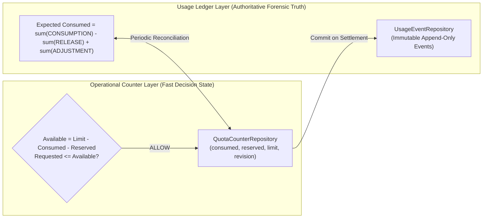

# WP-04.06 Dossier 03: Usage Accounting Model

**Work Package:** PROT-04.06  
**Title:** Double-Entry Ledger, Operational Counters & Centralized Accounting Model  
**Status:** **PASSED / IMPLEMENTED & VERIFIED**  
**Classification:** Restricted Evaluation Distribution  

---

## 1. Dual-Concept Accounting Architecture

A robust evaluation quota subsystem cannot rely solely on fast in-memory variables or Redis counters. In-memory counters can drift during restarts, suffer silent packet drops, or diverge during distributed concurrency. Conversely, querying an append-only event log across millions of rows on every micro-request introduces prohibitive database latency.

To achieve both **sub-millisecond authorization** and **flawless auditable truth**, WP-04.06 implements a dual-concept accounting model:



1. **The Usage Ledger (`UsageEventRepository`):** The immutable, append-only history of every usage consumption, reservation release, and administrative adjustment. This is the **authoritative legal and forensic truth**.
2. **Operational Counters (`QuotaCounterRepository`):** Fast, derived state holding current consumed and reserved amounts, updated atomically during two-phase execution.

---

## 2. Integer-Only Accounting Principle

All measurements in AEGIS accounting are strictly stored as **signed 64-bit integers**:
- **Storage & Uploads:** Measured in **bytes** (never fractional megabytes).
- **Inference Volume:** Measured in **integer tokens** (never estimated decimal costs).
- **Execution Ceilings:** Measured in **integer milliseconds** (never floating-point seconds).
- **Counts:** Stored as exact integer quantities.

This completely eliminates IEEE-754 floating-point rounding errors and accumulator drift over millions of evaluations.

---

## 3. Service Responsibility Separation

The accounting domain strictly isolates responsibilities across specialized services:

| Component | Architecture Role & Primary Responsibility |
| :--- | :--- |
| **`quota_policy_service`** | Loads, validates, and manages immutable quota policies (`evaluation-basic`, `evaluation-pro`). |
| **`quota_reservation_service`** | Atomically reserves multi-dimensional capacity before protected engine execution. |
| **`quota_settlement_service`** | Commits actual usage, records ledger events, and releases unconsumed reserved capacity. |
| **`usage_metering_service`** | Server-side measurement of stream bytes, OCR pages, and LLM input/output tokens. |
| **`usage_aggregation_service`**| Aggregates counters into evaluator-scoped usage summaries (`GET /v1/evaluation/usage`). |
| **`quota_reconciliation_service`** | Detects drift between ledger events and counters; safely auto-recovers stale reservations. |
| **`rate_limit_service`** | Sliding-window frequency limiter protecting against automated flooding. |

---

## 4. Ledger Event Lifecycle & Transition Mechanics

Every entry in `UsageEventRepository` records a discrete event type:

```python
class UsageEventType(str, Enum):
    CONSUMPTION = "consumption"  # Commits actual measured work (positive)
    RELEASE     = "release"      # Frees unconsumed reservation capacity (negative)
    ADJUSTMENT  = "adjustment"   # Administrative correction / credit (signed)
```

### Authoritative Ledger Mathematics
The authoritative usage consumed for any quota dimension over an evaluation window is evaluated by:

$$\text{Authoritative Consumed} = \sum \mathbf{E}_{\text{consumption}} - \sum |\mathbf{E}_{\text{release}}| + \sum \mathbf{E}_{\text{adjustment}}$$

Where:
- $\mathbf{E}_{\text{consumption}}$ represents completed engine operations.
- $\mathbf{E}_{\text{release}}$ represents unused reserved capacity returned to the pool.
- $\mathbf{E}_{\text{adjustment}}$ represents compensating entries logged by administrators or reconciliation daemons.

---

## 5. Verification & Test Evidence

- **`RES-006`**: Actual usage committed to ledger as `CONSUMPTION` events (**PASS**).
- **`RES-008`**: Unused capacity logged as `RELEASE` and credited back to available pool (**PASS**).
- **`RECON-001`**: Zero drift reported when counter matches ledger sum (**PASS**).
- **`RECON-002`**: Synthetic counter drift detected and flagged by reconciliation engine (**PASS**).
