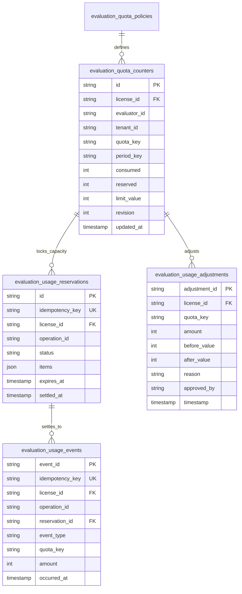

# WP-04.06 Dossier 04: Database Schema & Data Integrity

**Work Package:** PROT-04.06  
**Title:** Relational Entity Schema, Integrity Constraints & Concurrency Controls  
**Status:** **PASSED / IMPLEMENTED & VERIFIED**  
**Classification:** Restricted Evaluation Distribution  

---

## 1. Entity-Relationship Architecture

The accounting and quota subsystem consists of five relational entities enforcing strict referential integrity, idempotency constraints, and monotonic counters:

---

## 2. Granular Table Specifications

### 2.1 `evaluation_quota_counters`
Maintains operational state for real-time authorization decisions.

| Column | Type | Nullable | Constraints & Description |
| :--- | :--- | :---: | :--- |
| `id` | `UUID` | No | Primary Key. |
| `license_id` | `VARCHAR(64)` | No | Evaluation license identifier. |
| `evaluator_id` | `VARCHAR(64)` | No | Requesting user identifier. |
| `tenant_id` | `VARCHAR(64)` | No | Tenant isolation boundary. |
| `quota_key` | `VARCHAR(32)` | No | Quota dimension (`queries`, `documents`, etc.). |
| `period_key` | `VARCHAR(32)` | No | Evaluation window identifier (`lifetime`, `daily:2026-11-14`). |
| `period_start` | `TIMESTAMPTZ` | No | Beginning of period window. |
| `period_end` | `TIMESTAMPTZ` | Yes | End of period window (NULL for lifetime). |
| `consumed` | `BIGINT` | No | Committed usage ($\ge 0$). |
| `reserved` | `BIGINT` | No | In-flight capacity locked by pending reservations ($\ge 0$). |
| `limit_value` | `BIGINT` | No | Maximum permitted capacity ($\ge 0$). |
| `revision` | `BIGINT` | No | Monotonically increasing revision counter. |
| `updated_at` | `TIMESTAMPTZ` | No | Timestamp of latest mutation. |

**Composite Unique Index:** `UNIQUE(license_id, quota_key, period_key)`  
**Check Constraint:** `CHECK (consumed >= 0 AND reserved >= 0 AND limit_value >= 0)`

---

### 2.2 `evaluation_usage_reservations`
Tracks active and historical capacity reservations across requests.

| Column | Type | Nullable | Constraints & Description |
| :--- | :--- | :---: | :--- |
| `id` | `UUID` | No | Primary Key. Unique reservation identifier. |
| `idempotency_key`| `VARCHAR(128)`| No | Scoped deduplication key. |
| `license_id` | `VARCHAR(64)` | No | Scoped license. |
| `operation_id` | `VARCHAR(64)` | No | Associated API request or job UUID. |
| `items` | `JSONB` | No | Map of `quota_key -> {requested, reserved, settled}`. |
| `status` | `VARCHAR(16)` | No | `PENDING`, `COMMITTED`, `RELEASED`, `EXPIRED`. |
| `created_at` | `TIMESTAMPTZ` | No | Reservation timestamp. |
| `expires_at` | `TIMESTAMPTZ` | No | Automatic expiration deadline. |
| `settled_at` | `TIMESTAMPTZ` | Yes | Settlement or release timestamp. |

**Composite Unique Index:** `UNIQUE(license_id, idempotency_key)`

---

### 2.3 `evaluation_usage_events` (The Usage Ledger)
Authoritative forensic history of all billable and resource events.

| Column | Type | Nullable | Constraints & Description |
| :--- | :--- | :---: | :--- |
| `event_id` | `UUID` | No | Primary Key. |
| `license_id` | `VARCHAR(64)` | No | Scoped evaluation license. |
| `evaluator_id` | `VARCHAR(64)` | No | Actor responsible for usage. |
| `tenant_id` | `VARCHAR(64)` | No | Tenant isolation boundary. |
| `operation_id` | `VARCHAR(64)` | No | Request or job UUID. |
| `reservation_id`| `UUID` | Yes | Foreign key to `evaluation_usage_reservations.id`. |
| `event_type` | `VARCHAR(16)` | No | `consumption`, `release`, `adjustment`. |
| `quota_key` | `VARCHAR(32)` | No | Target dimension. |
| `amount` | `BIGINT` | No | Signed integer measurement quantity. |
| `unit` | `VARCHAR(16)` | No | Measurement unit (`bytes`, `tokens`, etc.). |
| `source` | `VARCHAR(64)` | No | Trusted subsystem generating event. |
| `idempotency_key`| `VARCHAR(128)`| No | Unique event deduplication key. |
| `occurred_at` | `TIMESTAMPTZ` | No | Time event executed. |
| `recorded_at` | `TIMESTAMPTZ` | No | Time event committed to DB. |

**Composite Unique Index:** `UNIQUE(license_id, idempotency_key)`

---

## 3. Data Integrity & Concurrency Guarantees

1. **Transactional Invariant:** Counter conditional updates and reservation creation execute in a single atomic transaction.
2. **Terminal State Immutability:** Reservations in status `COMMITTED`, `RELEASED`, or `EXPIRED` can never be transitioned again (`RES-010`).
3. **Ledger Immutability:** Entries in `evaluation_usage_events` are append-only. Modification (`UPDATE`) or deletion (`DELETE`) is prohibited at the database permissions level.
4. **Non-Negative Invariant:** `consumed` and `reserved` quantities can never drop below zero.
