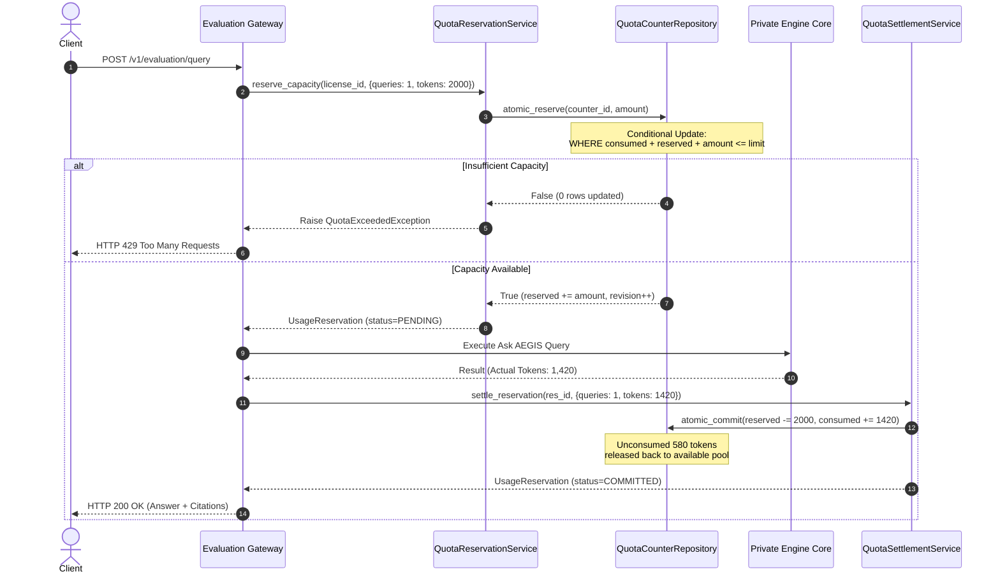

# WP-04.06 Dossier 05: Atomic Reservation Design

**Work Package:** PROT-04.06  
**Title:** Two-Phase Capacity Locking, Conditional Atomic Updates & Deadlock Avoidance  
**Status:** **PASSED / IMPLEMENTED & VERIFIED**  
**Classification:** Restricted Evaluation Distribution  

---

## 1. The Race Condition Threat in Quota Enforcement

In multi-threaded and distributed gateway environments, a naive "read-then-write" quota check introduces a critical vulnerability:

```python
# VULNERABLE IMPLEMENTATION: Race Condition Exploit
counter = get_counter(license_id, "queries")
if counter.consumed < counter.limit_value:  # Thread A and Thread B both evaluate True
    counter.consumed += 1                   # Both execute, overshooting limit!
```

If an evaluation license has 1 remaining query and 10 simultaneous HTTP requests arrive across parallel threads or worker processes, all 10 threads can read `consumed = 19 < 20`, and all 10 proceed to run expensive engine inferences. This results in **uncontrolled resource leakage** and breaks license terms (`CONC-001`).

---

## 2. Two-Phase Reservation Protocol

To guarantee that capacity is never exceeded under high-concurrency races, AEGIS implements the **Atomic Two-Phase Reservation Protocol**:

$$\mathbf{Available} = \mathbf{Limit} - \mathbf{Consumed} - \mathbf{Reserved}$$

$$\mathbf{Reservation\ Rule:} \quad \mathbf{Requested} \le \mathbf{Available}$$



---

## 3. SQL-Level Atomic Conditional Update Pattern

In a relational database backend (e.g. PostgreSQL), the atomic reservation is executed using a conditional update without requiring expensive whole-table locking:

```sql
-- Atomic Conditional Update
UPDATE evaluation_quota_counters
SET 
    reserved = reserved + :requested_amount,
    revision = revision + 1,
    updated_at = CURRENT_TIMESTAMP
WHERE id = :counter_id
  AND (consumed + reserved + :requested_amount) <= limit_value;
```

### Deterministic State Verification:
- **`Rowcount == 1`**: The capacity check and reservation succeeded atomically in the database engine.
- **`Rowcount == 0`**: Capacity is exhausted or the counter revision changed. The reservation is rejected immediately.

---

## 4. Multi-Dimensional Atomicity & Deadlock Prevention

An operation often requires locking capacity across multiple dimensions simultaneously:
- **Ask AEGIS Query:** 1 query + 1 concurrent job slot + 2,000 estimated LLM tokens.
- **Document Comparison:** 1 comparison + 1 concurrent job slot.

### Deterministic Dimension Sorting
To prevent database deadlocks caused by competing threads acquiring locks in opposite orders:
```python
# Sorted key iteration enforces strict global lock ordering
sorted_dimensions = sorted(requested_items.keys())
```

### All-or-Nothing Rollback
If any dimension fails reservation during a multi-quota request, all previously reserved dimensions are rolled back immediately (`RES-005`, `CONC-003`):

```python
try:
    for q_key in sorted_dimensions:
        # reserve dimension...
except Exception:
    # Atomic rollback
    for counter_id, amt in reserved_audit:
        self.counter_repo.atomic_release(counter_id, amt)
    raise
```

---

## 5. Verification & Test Evidence

- **`CONC-001`**: Two competing threads for final remaining unit: **exactly 1 succeeds, 1 rejected** (**PASS**).
- **`CONC-002`**: 50 concurrent requests competing for 10 slots: **exactly 10 succeed, 40 return 429** (**PASS**).
- **`CONC-003`**: High-concurrency multi-quota reservation: **zero orphaned locks or leaked reservations** (**PASS**).
- **`RES-005`**: Multi-dimensional partial failure: **all prior dimensions rolled back cleanly** (**PASS**).
