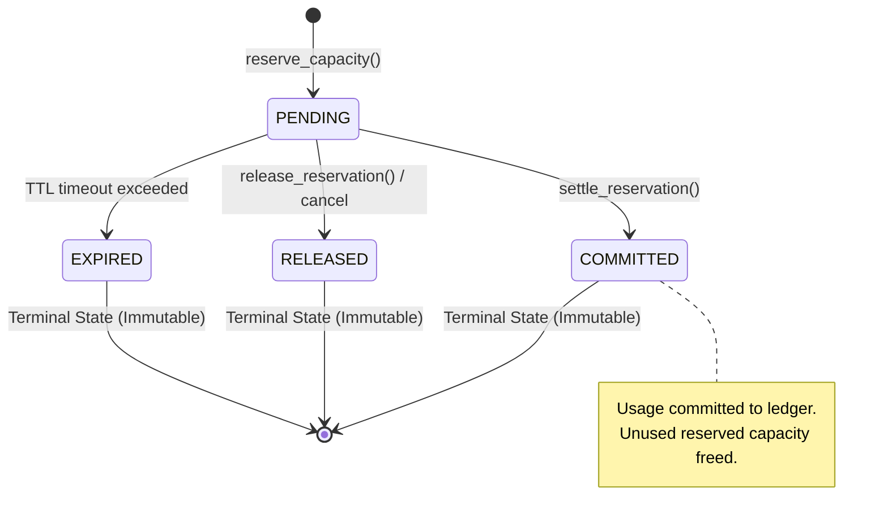

# WP-04.06 Dossier 06: Usage Settlement and Refunds

**Work Package:** PROT-04.06  
**Title:** Settlement State Machine, Partial Work Accounting & Idempotent Refunds  
**Status:** **PASSED / IMPLEMENTED & VERIFIED**  
**Classification:** Restricted Evaluation Distribution  

---

## 1. Reservation Lifecycle State Machine

Capacity reservations transition through a strict, deterministic lifecycle governed by the `UsageReservationRepository`:



- **`PENDING`**: Capacity is locked in `evaluation_quota_counters.reserved`. The operation is in-flight.
- **`COMMITTED`**: Engine execution completed. Actual measured units are committed to `consumed`, and unconsumed reservation difference is returned to available capacity (`RES-006`, `RES-008`).
- **`RELEASED`**: Operation failed before resource consumption or was cancelled. Full reservation is returned to available pool (`RES-013`).
- **`EXPIRED`**: Worker abandoned reservation or heartbeat lapsed. Stale capacity safely recovered by reconciliation daemon (`RES-011`).

---

## 2. Granular Refund & Failure Accounting Rules

In distributed document processing, operations can fail at different stages of execution. AEGIS implements an auditable refund policy:

| Failure / Execution Scenario | Engine State at Failure | Accounting Action | Quota Impact | Test Assertion |
| :--- | :--- | :--- | :--- | :--- |
| **Validation Rejection** | Fails before engine execution begins (e.g. invalid query JSON). | 100% reservation released immediately. | Zero quota charged. | `RES-008` |
| **Worker Pre-Execution Crash**| Worker crashes before acquiring model lock or touching documents. | Reconciliation expires reservation; releases capacity. | Zero quota charged. | `RES-012` |
| **Partial OCR / Document Parse**| Engine crashes after parsing 12 of 30 pages. | Settle actual completed work (12 pages); release remaining 18. | Only completed pages charged. | `RES-007` |
| **Provider LLM Execution Succeeded**| LLM inference finished and provider billed, but client disconnected. | Commit measured LLM tokens; release concurrency slot. | Tokens charged to evaluator. | `METER-006` |
| **Explicit User Cancellation** | Evaluator aborts in-flight job before completion. | Settle measured consumption up to cancellation; release rest. | Unconsumed budget freed. | `RES-013` |
| **Idempotent Client Retry** | Network drop causes client to resubmit identical operation. | Return cached settlement result; reject double charge. | Billed exactly once. | `RES-009`, `RES-014` |

---

## 3. Idempotent Settlement Protocol

To protect against duplicate charging from network retransmissions, `QuotaSettlementService.settle_reservation()` enforces strict idempotency:

```python
# Check current reservation status
if reservation.status == ReservationStatus.COMMITTED:
    # Idempotent repeat: return already-committed record without updating counters
    return reservation

if reservation.status in (ReservationStatus.RELEASED, ReservationStatus.EXPIRED):
    # Terminal state guard: cannot settle an abandoned or cancelled reservation
    raise ValueError(f"Cannot settle reservation in terminal status '{reservation.status.value}'")
```

Every settlement writes to `evaluation_usage_events` with a deterministic key:
```python
idempotency_key = f"{idempotency_key}:{quota_key}"
```
If an event with the same idempotency key already exists in the ledger, the repository ignores the duplicate write and returns the existing record (`RES-009`).

---

## 4. Verification & Test Evidence

- **`RES-006`**: Actual usage committed, transitioning reservation to `COMMITTED` (**PASS**).
- **`RES-007`**: Partial operation failure: **only measured units committed; remaining 1,200 tokens refunded** (**PASS**).
- **`RES-008`**: Reserved 10 queries, settled 4: **6 queries returned to available pool** (**PASS**).
- **`RES-009`**: Repeated settlement with same idempotency key: **committed exactly 3, not 6** (**PASS**).
- **`RES-010`**: Attempting to commit an already released reservation raises `ValueError` (**PASS**).
- **`RES-013`**: Explicit cancellation releases reserved quota immediately (**PASS**).
