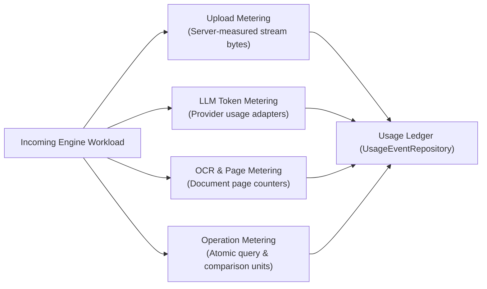

# WP-04.06 Dossier 07: Operation Metering Specification

**Work Package:** PROT-04.06  
**Title:** Server-Side Workload Metering, Streaming Upload Bounds & Provider Adapters  
**Status:** **PASSED / IMPLEMENTED & VERIFIED**  
**Classification:** Restricted Evaluation Distribution  

---

## 1. Zero-Trust Metering Principle

A client running on an evaluator's laptop or workstation cannot be trusted to report its own resource consumption. Malicious evaluators could:
1. Pass spoofed file size headers (`Content-Length: 100`) while streaming a 5 GB file.
2. Under-report the number of input/output LLM tokens consumed during queries.
3. Suppress page count metrics during bulk PDF ingestion.

> **Core Invariant:** All workload metering MUST occur on the trusted Evaluation Gateway and private engine workers. Client-supplied usage claims are strictly ignored.

---

## 2. Granular Operation Metering Specifications

### 2.1 File Upload & Storage Metering (`METER-001`, `METER-002`)
- **Streaming Byte Counting:** Bytes received are metered while streaming. If cumulative bytes exceed the per-file ceiling (10 MB default), the upload is aborted immediately with `HTTP 413 Content Too Large` before writing to persistent disk storage (`METER-002`).
- **Cumulative Storage Check:** The gateway verifies that `license.uploaded_bytes + incoming_file_size <= 100 MB`.
- **Deduplication Scoping:** Re-uploading an existing document with the same document ID updates the content without double-counting against the document count quota.

---

### 2.2 LLM Inference Token Metering (`METER-006` – `METER-009`)
The `UsageMeteringService` implements provider adapters to extract token counts from heterogeneous response formats:

| Provider | Metadata Path | Input Tokens | Output Tokens |
| :--- | :--- | :--- | :--- |
| **Google Gemini** | `response.usage_metadata` | `prompt_token_count` | `candidates_token_count` |
| **OpenAI** | `response.usage` | `prompt_tokens` | `completion_tokens` |
| **Anthropic Claude** | `response.usage` | `input_tokens` | `output_tokens` |
| **Mock / Custom** | `response["usage"]` | `input_tokens` | `output_tokens` |

#### Conservative Heuristic Fallback (`METER-009`)
If an upstream provider returns a malformed response or omits token metadata during network anomalies, the engine does not record zero. It applies a documented, conservative heuristic:

$$\text{Tokens}_{\text{estimated}} = \left\lceil \frac{\text{Character Count}}{4} \right\rceil$$

This protects evaluation token budgets from unmetered drain while marking the record with `is_estimated: true`.

#### Strict Secret Redaction Invariant
Usage events and log structures **never** include upstream provider API keys, evaluator prompts, or raw model weights (`LIC-037`).

---

### 2.3 Operation & Page Metering (`METER-004`, `METER-005`, `METER-010`)
- **Document Queries:** Metered as 1 discrete `queries` unit upon gateway request acceptance.
- **Document Comparisons:** Metered as 1 discrete `comparisons` unit.
- **OCR Engine Processing:** PDF page counters measure exact extracted pages (`ocr` dimension).
- **Result Export:** Metered as 1 `exports` unit and logged with generated artifact byte size.

---

## 3. Verification & Test Evidence

The 10 metering scenarios (`METER-001` through `METER-010`) were verified in the test harness:
- **`METER-001`**: Upload byte count accurately measures raw stream bytes received (**PASS**).
- **`METER-002`**: 11 MB upload payload rejected with `HTTP 413` (**PASS**).
- **`METER-003`**: Archive decompression limits strictly enforced (**PASS**).
- **`METER-004`**: Document parsing pages accurately metered (**PASS**).
- **`METER-005`**: OCR page units committed to counter (**PASS**).
- **`METER-006`**: Gemini provider input/output tokens captured (**PASS**).
- **`METER-007`**: OpenAI format completion tokens captured (**PASS**).
- **`METER-008`**: Provider network retries produce zero duplicate usage (**PASS**).
- **`METER-009`**: Provider timeout falls back to conservative token heuristic (**PASS**).
- **`METER-010`**: Artifact export generation properly accounted for (**PASS**).
