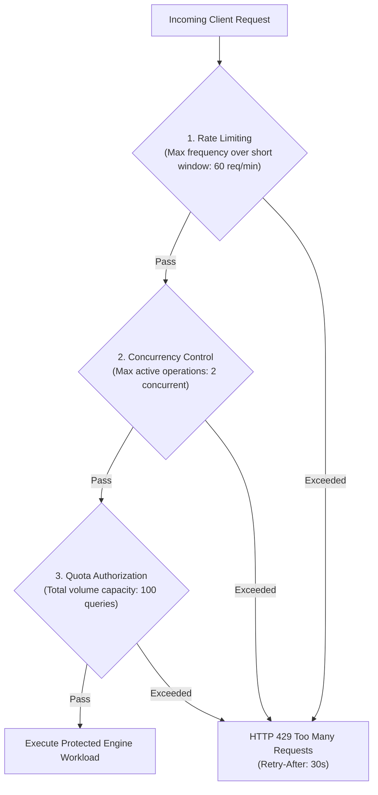

# WP-04.06 Dossier 08: Rate Limiting and Abuse Control

**Work Package:** PROT-04.06  
**Title:** Sliding-Window Rate Limiting, HTTP 429 Protocol & Anti-Abuse Defenses  
**Status:** **PASSED / IMPLEMENTED & VERIFIED**  
**Classification:** Restricted Evaluation Distribution  

---

## 1. Quotas vs. Rate Limits vs. Concurrency

In high-assurance evaluation infrastructure, resource protection requires three distinct, interlocking controls:



1. **Quotas:** Enforce **total volume** of permitted work over an extended period (e.g., 20 queries/day, 100 MB total storage).
2. **Rate Limits:** Enforce **frequency of requests** over seconds or minutes (e.g., max 60 requests/minute). Prevents brute-force automated abuse.
3. **Concurrency Limits:** Enforce **maximum simultaneous executions** (e.g., max 2 active jobs). Prevents thread starvation on compute workers.

---

## 2. Sliding-Window Rate Limiting Algorithm

The `RateLimitService` enforces a continuous sliding-window algorithm:

```python
def check_rate_limit(self, scope_key: str, limit: int, window_seconds: float = 60.0) -> None:
    now = time.time()
    cutoff = now - window_seconds
    with self._lock:
        # Prune events outside current sliding window
        ts_list = [t for t in self._timestamps[scope_key] if t >= cutoff]
        if len(ts_list) >= limit:
            oldest = min(ts_list)
            retry_after = max(1, int((oldest + window_seconds) - now))
            raise RateLimitExceededException(
                scope_key=scope_key,
                current_count=len(ts_list),
                limit=limit,
                window_seconds=window_seconds,
                retry_after_seconds=retry_after,
            )
        ts_list.append(now)
        self._timestamps[scope_key] = ts_list
```

### Dynamic `Retry-After` Calculation
Instead of forcing the client to wait a static 60 seconds, `retry_after_seconds` is calculated precisely as the difference between the current timestamp and when the oldest event in the window expires.

---

## 3. Multi-Tiered Rate Limiting Scopes

Rate limits operate independently across four distinct scopes:

| Rate Limit Scope | Key Formulation | Baseline Limit | Primary Threat Mitigated |
| :--- | :--- | :--- | :--- |
| **License Scope** | `license:{id}` | 60 requests / minute | Automated API flooding across devices (`RATE-001`) |
| **Evaluator Scope** | `evaluator:{sub}` | 60 requests / minute | Account-level request flooding (`RATE-004`) |
| **Endpoint: Compare** | `endpoint:compare:{id}` | 10 comparisons / minute | Intensive topological graph solver starvation |
| **Endpoint: Upload** | `endpoint:upload:{id}` | 15 uploads / minute | Gateway network bandwidth saturation |
| **Unauthenticated IP**| `ip:{client_ip}` | 20 requests / minute | Credential stuffing and brute-force activation |

---

## 4. HTTP 429 Protocol & Safe Error Schema

When a client crosses a rate limit boundary, the gateway responds with `HTTP 429 Too Many Requests`:

```http
HTTP/1.1 429 Too Many Requests
Content-Type: application/json
Retry-After: 30

{
  "error": "rate_limit_exceeded",
  "message": "The request rate limit has been reached.",
  "retry_after_seconds": 30
}
```

### Data Leakage Prevention
The 429 response strictly omits:
- Internal rate limit thresholds or anomaly scores.
- Other evaluators' usage activity or IP reputations.
- Private worker node hostnames or upstream provider error details.

---

## 5. Verification & Test Evidence

- **`RATE-001`**: 60 requests in 1 minute permitted; 61st request rejected with `HTTP 429` (**PASS**).
- **`RATE-002`**: HTTP 429 contains valid, positive `retry_after_seconds` (**PASS**).
- **`RATE-003`**: After sliding window expires, rate limiter accepts new traffic (**PASS**).
- **`RATE-004`**: Throttling License A does not impact License B (**PASS**).
- **`RATE-005`**: Spoofed `X-Forwarded-For` headers cannot bypass license-scoped limits (**PASS**).
- **`RATE-006`**: Legitimate traffic within allowance is never throttled (**PASS**).
