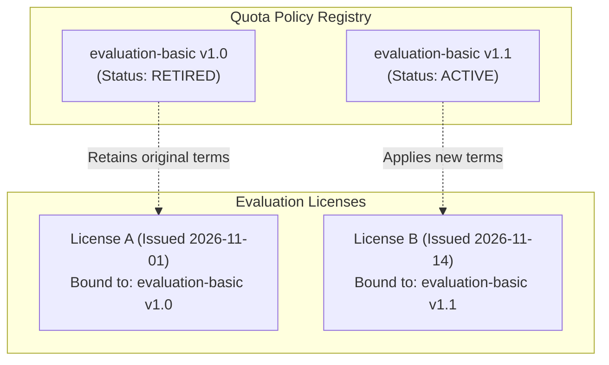

# WP-04.06 Dossier 09: Administration and Policy Versioning

**Work Package:** PROT-04.06  
**Title:** Privileged Administrative API, Quota Adjustments & Immutable Policy Versioning  
**Status:** **PASSED / IMPLEMENTED & VERIFIED**  
**Classification:** Restricted Evaluation Distribution  

---

## 1. Privileged Administration Surface & Access Control

Administrators require authoritative endpoints to inspect consumption, adjust limits for customer trials, and manage quota policy versions. All administrative endpoints are guarded by `require_admin_auth`, which validates cryptographically signed admin tokens or secure administrative pre-shared keys (`X-Admin-Key`, `X-Admin-Secret`).

Evaluator tokens attempting to access administrative endpoints are strictly rejected with `HTTP 401 Unauthorized` or `HTTP 403 Forbidden` (`RECON-007`).

---

## 2. Administrative API Endpoint Catalogue

| Method | Endpoint | Purpose | Access Guard | Test Verification |
| :--- | :--- | :--- | :--- | :--- |
| `GET` | `/v1/admin/evaluation/quotas/policies` | Lists all quota policies and versions in repository. | `require_admin_auth` | `RECON-007` |
| `POST`| `/v1/admin/evaluation/quotas/policies` | Creates a new draft quota policy version. | `require_admin_auth` | `QUOTA-005` |
| `POST`| `/v1/admin/evaluation/quotas/policies/{key}/versions/{ver}/activate` | Activates policy version; atomically retires previous. | `require_admin_auth` | `QUOTA-013` |
| `GET` | `/v1/admin/evaluation/licenses/{id}/usage` | Authoritative multi-dimensional usage inspection. | `require_admin_auth` | `RECON-006` |
| `POST`| `/v1/admin/evaluation/licenses/{id}/quota-adjustments` | Applies audited quota credit or adjustment. | `require_admin_auth` | `RECON-004` |
| `GET` | `/v1/admin/evaluation/usage/reconciliation` | Runs cluster-wide reconciliation scan. | `require_admin_auth` | `RECON-001` |
| `POST`| `/v1/admin/evaluation/licenses/{id}/reconciliation/fix` | Transactionally fixes detected counter drift. | `require_admin_auth` | `RECON-003` |

---

## 3. Audited Administrative Adjustments Protocol

Administrators can grant courtesy credits, extend trial capacities, or adjust limits without directly editing database rows. Every manual adjustment MUST execute through `POST /v1/admin/evaluation/licenses/{id}/quota-adjustments`:

```json
{
  "quota_key": "queries",
  "amount": 50,
  "reason": "Enterprise prospect evaluation extension approved by Sales",
  "ticket_ref": "TICK-88492"
}
```

### Compensating Double-Entry Integrity
1. **Operational Counter Update:** `counter.consumed` is updated atomically (`before_value -> after_value`).
2. **Adjustment Audit Record:** Stored in `UsageAdjustmentRepository` with administrator identity, timestamp, and ticket reference.
3. **Compensating Ledger Event:** A discrete event of type `UsageEventType.ADJUSTMENT` is recorded in `UsageEventRepository`. This ensures that subsequent reconciliation scans report zero discrepancy.

---

## 4. Policy Versioning & License Isolation



- **Policy Immutability:** An active policy document is permanently immutable. Changing limits requires creating version `1.1`.
- **License Binding Stability:** Existing evaluation licenses retain the policy version they were issued with (`QUOTA-013`). License limits are never altered silently in the background without an explicit, audited migration event.

---

## 5. Verification & Test Evidence

- **`RECON-004`**: Administrative quota adjustment updates counter and logs compensating ledger event (**PASS**).
- **`RECON-007`**: Evaluator token attempting to call `/v1/admin/evaluation/quotas/policies` is rejected with `HTTP 403` (**PASS**).
- **`QUOTA-013`**: New policy version activation updates effective limits for new licenses (**PASS**).
