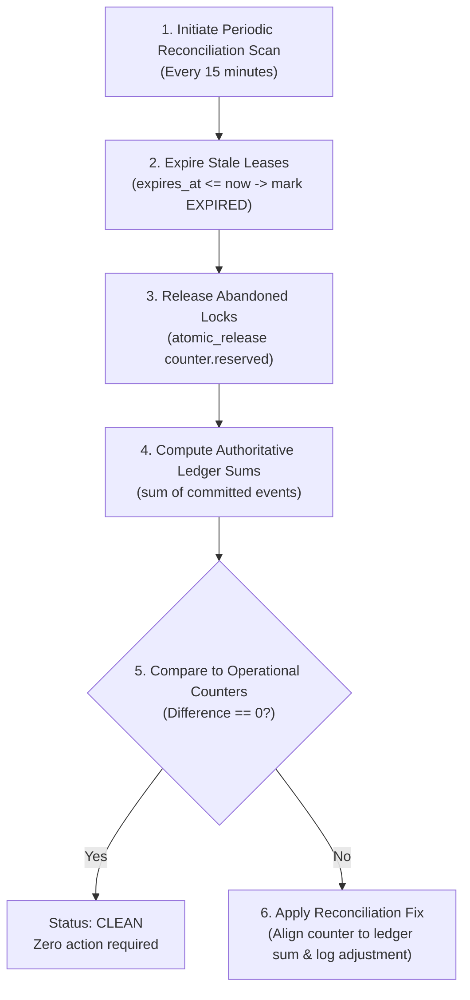

# WP-04.06 Dossier 11: Reconciliation and Integrity

**Work Package:** PROT-04.06  
**Title:** Ledger-to-Counter Reconciliation, Drift Detection & Stale Lease Recovery  
**Status:** **PASSED / IMPLEMENTED & VERIFIED**  
**Classification:** Restricted Evaluation Distribution  

---

## 1. The Need for Accounting Reconciliation

In high-concurrency systems processing thousands of evaluations, operational counters can drift from true consumption due to:
1. **Worker Crashes:** A processing worker crashes while holding an in-flight reservation.
2. **Network Drops:** Client disconnects before acknowledging completed settlement.
3. **Transient Concurrency Edge-Cases:** Partial ledger writes during unexpected pod terminations.

To guarantee that derived operational counters never permanently diverge from true consumption, WP-04.06 implements the **Authoritative Reconciliation Subsystem (`QuotaReconciliationService`)**.

---

## 2. Mathematical Reconciliation Model

For every active evaluation counter, the reconciliation engine evaluates two fundamental equations:

$$\mathbf{Expected\ Consumed} = \sum \mathbf{Events}_{\text{consumption}} - \sum |\mathbf{Events}_{\text{release}}| + \sum \mathbf{Events}_{\text{adjustment}}$$

$$\mathbf{Expected\ Reserved} = \sum_{\text{active}\ \in\ \text{PENDING}} \mathbf{Reservation}_{\text{amount}}$$

### Discrepancy Identification:
- **$\Delta_{\text{consumed}} = \text{Counter}_{\text{consumed}} - \mathbf{Expected\ Consumed}$**
- **$\Delta_{\text{reserved}} = \text{Counter}_{\text{reserved}} - \mathbf{Expected\ Reserved}$**

If either $\Delta \ne 0$, the license status is classified as `DISCREPANCY_DETECTED` and routed for repair.

---

## 3. Automated Reconciliation Pipeline



---

## 4. Stale Reservation Expiration & Recovery

When an evaluation worker node crashes during an expensive OCR or Ask AEGIS inference, the in-flight reservation could remain locked indefinitely.

The reconciliation engine automatically sweeps for leases where:
$$\text{now} \ge \text{reservation.expires_at} \quad \text{AND} \quad \text{status} == \text{PENDING}$$

1. The reservation status is transitioned to `EXPIRED`.
2. The reserved units are atomically released (`counter_repo.atomic_release`), immediately freeing capacity for the evaluator (`RES-011`, `RECON-005`).
3. Race conditions between worker heartbeats and the recovery daemon are prevented by atomic state guards (`CONC-008`).

---

## 5. Transaction-Safe Auto-Correction Protocol

When counter drift is detected, `apply_reconciliation_fix()` realigns the operational counter with forensic ledger truth:

```python
# 1. Compute difference between ledger truth and operational counter
expected_consumed = self.event_repo.get_total_consumed(license_id, quota_key)
diff = expected_consumed - counter.consumed

# 2. Transactionally update counter
before_val = counter.consumed
new_val = self.counter_repo.atomic_adjust(counter.id, diff)

# 3. Create auditable adjustment record and compensating ledger event
self.adjustment_repo.record_adjustment(...)
self.event_repo.record_event(compensating_event)
```

This guarantees that repairs are fully audited, transparent, and reproducible.

---

## 6. Verification & Test Evidence

- **`RECON-001`**: Consistent ledger and counters report `CLEAN` (**PASS**).
- **`RECON-002`**: Synthetic counter drift detected and quantified (**PASS**).
- **`RECON-003`**: `apply_reconciliation_fix` repairs drift and logs compensating event (**PASS**).
- **`RECON-005`**: Abandoned reservation safely recovered after TTL expiry (**PASS**).
- **`CONC-008`**: Expiry daemon race produces zero double-release anomalies (**PASS**).
