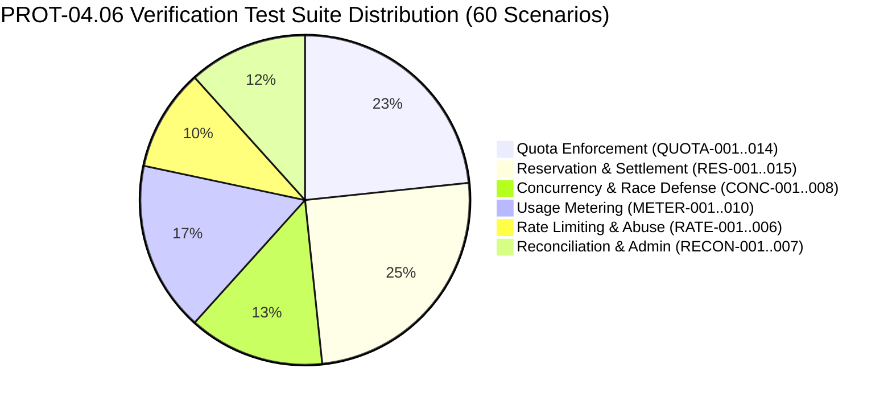

# WP-04.06 Dossier 12: Security Test Plan

**Work Package:** PROT-04.06  
**Title:** Comprehensive Quota, Reservation, Concurrency & Accounting Test Plan  
**Status:** **PASSED / IMPLEMENTED & VERIFIED**  
**Classification:** Restricted Evaluation Distribution  

---

## 1. Test Strategy & Architectural Scope

The PROT-04.06 verification plan rigorously validates the server-authoritative usage quota engine, two-phase atomic reservations, high-concurrency race protection, multi-provider metering, sliding-window rate limiting, and accounting reconciliation.

The suite comprises **60 automated test scenarios** grouped into 6 functional suites:



---

## 2. Granular Test Scenario Matrix

### Suite A: Quota Enforcement (`QUOTA-001` – `QUOTA-014`)
| Test ID | Scenario Description | Attack / Execution Vector | Expected Outcome |
| :--- | :--- | :--- | :--- |
| `QUOTA-001` | Usage below limit | Query operation within permitted allowance. | `HTTP 200 OK` |
| `QUOTA-002` | Usage exactly at limit | Consume up to 20 queries; 21st query crossing limit. | 20 `200s`, 21st `429 Too Many Requests` |
| `QUOTA-003` | Usage exceeds limit | Direct service reservation exceeding available quota. | `QuotaExceededException` |
| `QUOTA-004` | Missing configuration | Requesting unconfigured quota dimension. | Fail closed (`QuotaExceededException`) |
| `QUOTA-005` | Unknown dimension | Schema validation with unknown dimension name. | `ValueError` rejection |
| `QUOTA-006` | Negative quota limit | Schema validation with negative limit value. | `ValueError` rejection |
| `QUOTA-007` | Periodic rollover | Yesterday's exhausted quota resets for today's date. | Today's counter clean (`available = 20`) |
| `QUOTA-008` | Lifetime quota persistence | Lifetime quota does not reset automatically. | Cumulative consumed preserved |
| `QUOTA-009` | Rolling quota sliding window | Timestamps outside rolling window are pruned. | Utilization correctly calculated |
| `QUOTA-010` | Concurrent job limit | Exceeding 2 concurrent active leases. | 3rd job rejected (`QuotaExceededException`) |
| `QUOTA-011` | License-wide sharing | Multiple devices draw from same license pool. | Shared pool updated synchronously |
| `QUOTA-012` | Tenant isolation | Tenant A exhausting capacity has no impact on Tenant B. | Tenant B retains full capacity |
| `QUOTA-013` | Policy update | Activating new policy updates effective limits. | New limits applied to new licenses |
| `QUOTA-014` | Service failure | Internal exception during quota check. | Fail closed (operation blocked) |

---

### Suite B: Reservation & Settlement (`RES-001` – `RES-015`)
| Test ID | Scenario Description | Attack / Execution Vector | Expected Outcome |
| :--- | :--- | :--- | :--- |
| `RES-001` | Valid reservation | Request capacity within available allowance. | `UsageReservation` (`PENDING`) |
| `RES-002` | Capacity exhaustion | Reserve more capacity than available. | `QuotaExceededException` |
| `RES-003` | Idempotent reservation | Replay reservation with same idempotency key. | Returns existing reservation (no double lock) |
| `RES-004` | Multi-dimensional reservation | Reserve queries + tokens + concurrency slots. | All dimensions reserved atomically |
| `RES-005` | Partial failure rollback | One dimension fails in multi-quota request. | All prior dimensions rolled back cleanly |
| `RES-006` | Usage settlement | Commit actual measured usage. | Status `COMMITTED`, counter updated |
| `RES-007` | Partial failure settlement | Operation fails halfway through execution. | Only completed work committed |
| `RES-008` | Unused capacity refund | Reserved 10 queries, settled only 4. | 6 queries returned to available pool |
| `RES-009` | Idempotent settlement | Replay settlement call with same idempotency key. | No double charging |
| `RES-010` | Settle after release | Attempting to commit an already released lease. | `ValueError` rejection |
| `RES-011` | Stale lease recovery | Reservation exceeds TTL without heartbeat. | Marked `EXPIRED`, capacity recovered |
| `RES-012` | Worker crash recovery | Abandoned job recovered by reconciliation daemon. | Counter locks released |
| `RES-013` | Cancelled job | User aborts in-flight request. | Reservation released immediately |
| `RES-014` | Operation retry | Retrying with same operation ID. | Zero duplicated ledger events |
| `RES-015` | Missing provider usage | LLM provider payload omits token metadata. | Conservative heuristic fallback applied |

---

### Suite C: Concurrency & Race Defense (`CONC-001` – `CONC-008`)
| Test ID | Scenario Description | Attack / Execution Vector | Expected Outcome |
| :--- | :--- | :--- | :--- |
| `CONC-001` | Final unit race | 2 threads competing for 1 remaining unit. | Exactly 1 succeeds, 1 rejected |
| `CONC-002` | 50 parallel requests | 50 concurrent requests competing for 10 slots. | Exactly 10 succeed, 40 rejected (no over-grant) |
| `CONC-003` | Multi-quota race | Concurrent multi-dimension reservations under race. | Zero orphaned locks |
| `CONC-004` | Concurrent settlement | Simultaneous settlements on same reservation. | Settle committed exactly once |
| `CONC-005` | Settle vs cancel race | Concurrent settlement and release calls. | Consistent final state (`reserved == 0`) |
| `CONC-006` | Atomic accuracy | 100 parallel atomic reservations. | Counter reserved matches exact count |
| `CONC-007` | Rollback consistency | Failed multi-quota reservation. | Ledger left with zero orphaned leases |
| `CONC-008` | Heartbeat vs expiry race| Expiry daemon and worker heartbeat race. | Capacity released exactly once |

---

### Suite D: Usage Metering (`METER-001` – `METER-010`)
| Test ID | Scenario Description | Attack / Execution Vector | Expected Outcome |
| :--- | :--- | :--- | :--- |
| `METER-001` | Upload byte count | Meter server-received raw bytes. | Matches exact stream length |
| `METER-002` | Oversized streaming upload | 11 MB payload streamed to server. | Rejected with `HTTP 413` |
| `METER-003` | Archive expansion limit | Decompressed payload exceeding ceiling. | Aborted before memory exhaustion |
| `METER-004` | Parsing page count | Multi-page document decomposition. | Exact pages accounted for |
| `METER-005` | OCR page usage | OCR engine output pages. | Exact pages committed to counter |
| `METER-006` | Gemini tokens | Gemini usage metadata response. | Input/output tokens captured |
| `METER-007` | OpenAI tokens | OpenAI format usage response. | Prompt/completion tokens captured |
| `METER-008` | Provider retry | Upstream network retry. | No duplicate token accounting |
| `METER-009` | Provider timeout | Response missing usage block. | Character heuristic applied (`is_estimated=True`) |
| `METER-010` | Export storage | Result export artifact generation. | Export count and bytes accounted |

---

### Suite E: Rate Limiting & Abuse Prevention (`RATE-001` – `RATE-006`)
| Test ID | Scenario Description | Attack / Execution Vector | Expected Outcome |
| :--- | :--- | :--- | :--- |
| `RATE-001` | Exceeding 60 req/min | 61 requests submitted in 60 seconds. | 60 passed, 61st `HTTP 429` |
| `RATE-002` | Retry-After header | Throttled response inspection. | Positive `retry_after_seconds` returned |
| `RATE-003` | Window reset | Sliding window expires. | Throttling clears; traffic accepted |
| `RATE-004` | Scope independence | Throttling License A. | License B remains completely unaffected |
| `RATE-005` | Header spoofing bypass | Injecting synthetic `X-Forwarded-For`. | Ignored; license-scoped limit enforced |
| `RATE-006` | Legitimate traffic | Traffic within allowance. | Zero false-positive throttling |

---

### Suite F: Reconciliation & Administration (`RECON-001` – `RECON-007`)
| Test ID | Scenario Description | Attack / Execution Vector | Expected Outcome |
| :--- | :--- | :--- | :--- |
| `RECON-001` | Clean state scan | Consistent counters and ledger. | `status: CLEAN`, zero discrepancies |
| `RECON-002` | Counter drift detection | Counter artificially altered from ledger sum. | Flagged with exact delta |
| `RECON-003` | Automated fix | `apply_reconciliation_fix()` invoked. | Counter aligned to ledger; adjustment logged |
| `RECON-004` | Admin quota adjustment | `POST /v1/admin/evaluation/licenses/{id}/quota-adjustments`. | Audited adjustment committed |
| `RECON-005` | Stale lease cleanup | Sweep for abandoned leases. | Expired leases freed automatically |
| `RECON-006` | Evaluator summary | `GET /v1/evaluation/usage`. | Accurate multi-dimensional report |
| `RECON-007` | Admin authorization guard| Evaluator token calls admin quota routes. | Rejected with `HTTP 401 / 403` |

---

## 3. Test Execution Command

```bash
pytest tests/security/evaluation/test_quota_enforcement_protocol.py -v
```
