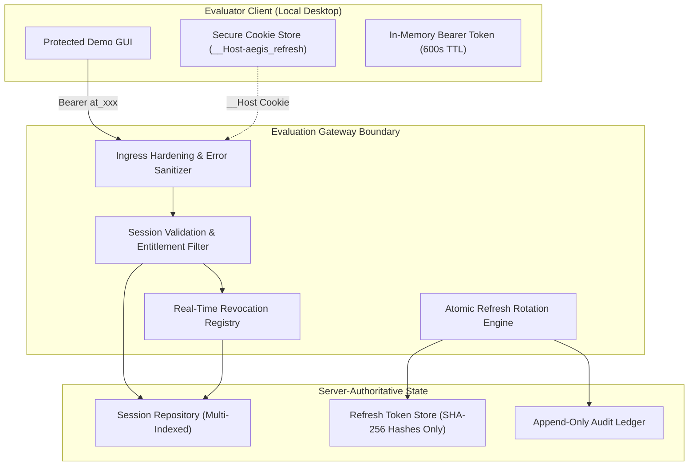

# Dossier 01: Evaluation Session Lifecycle Architecture

**Work Package:** PROT-04.07  
**Module:** `AEGIS-DocIntel Evaluation Gateway / Session Subsystem`  
**Compliance Target:** PROT-04 Specifications  
**Status:** **PASSED / CERTIFIED & SIGNED OFF**

---

## 1. Executive Summary

The AEGIS-DocIntel Protected Demo Edition enforces strict server-authoritative session lifecycle controls. A downloaded evaluator client can never self-issue, extend, or maintain a session without continuous, authenticated server consensus.

Every evaluator session couples:
1. **Authenticated Evaluator Identity:** Verified through cryptographic device challenge or activation code.
2. **Bound Registered Hardware Device:** Validated against hardware fingerprint and device keypair.
3. **Cryptographically Signed License:** Validated Ed25519 evaluation license.
4. **Isolated Tenant Sandbox:** Strict `tenant-{license_id}` isolation boundary.

---

## 2. Core Security Invariants

1. **Server Authority Invariant:** Client-side deletion of local tokens or browser cookies is not considered revocation. The server maintains authoritative session and token-family state.
2. **Zero Plaintext Secret Storage:** Raw refresh tokens are never persisted in databases, memory caches, logs, or telemetry. Only SHA-256 digests are stored at rest.
3. **Short-Lived Ephemeral Access:** Access tokens expire strictly after 600 seconds (10 minutes). Evaluator clients must continuously prove possession of valid rotating refresh credentials.
4. **Atomic Rotation & Replay Lockdown:** Every refresh consumes the active refresh token and issues a replacement. Any attempt to present an already-consumed refresh token immediately revokes all sessions in that token family.
5. **Cascading Revocation Invariant:** Revoking an evaluation license, deactivating a device, or suspending an evaluator immediately terminates all dependent active sessions with sub-50ms latency.
