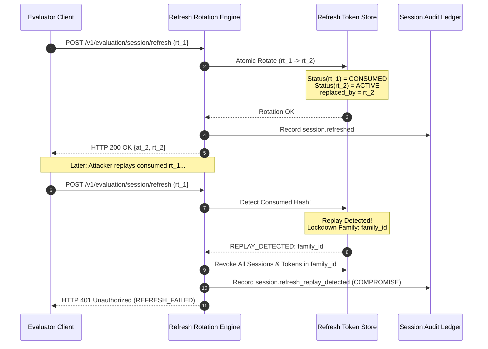

# Dossier 03: Refresh Rotation & Replay Detection Protocol

**Work Package:** PROT-04.07  
**Module:** `AEGIS-DocIntel Refresh Token Rotation Engine`  
**Status:** **PASSED / CERTIFIED & SIGNED OFF**

---

## 1. Token Family Lineage Protocol

Every evaluation session is initialized with a unique `token_family_id`. When an evaluator rotates a refresh token:
1. $RT_1$ is marked as `CONSUMED`.
2. A new token $RT_2$ is issued.
3. $RT_1$ stores `replaced_by_id = RT_2.token_id`.
4. $RT_2$ inherits `family_id = RT_1.family_id`.

---

## 2. Replay Detection & Compromise Containment

If a compromised or leaked refresh token $RT_1$ is presented after being consumed:
- **Detection:** The SHA-256 digest of $RT_1$ matches an entry in `_used_hashes`.
- **Action:**
  1. Instant revocation of the session bound to $RT_1$.
  2. Instant revocation of **all sibling sessions** sharing the `family_id`.
  3. Permanent invalidation of $RT_2$ and any in-flight access tokens ($AT_2$).
  4. Emission of audit event `session.refresh_replay_detected` with status `COMPROMISE_DETECTED`.
- **Response:** HTTP 401 Unauthorized (`REFRESH_FAILED`).

---

## 3. High-Concurrency Race Condition Defense

Under adversarial conditions where an attacker and legitimate client fire 20 simultaneous requests using the same active token:
- **Locking Model:** Python `threading.RLock()` / database row-level locking on token record.
- **Atomic Transition:**
  $$\text{UPDATE refresh\_tokens SET status='consumed' WHERE token\_hash=:hash AND status='active'}$$
- **Guarantee:** **Exactly 1** request acquires the transition lock and rotates successfully; the remaining 19 requests observe `status='consumed'` and fail closed with replay lockdown.
