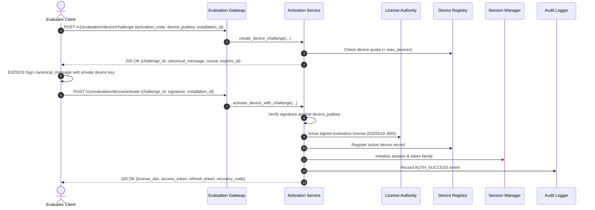
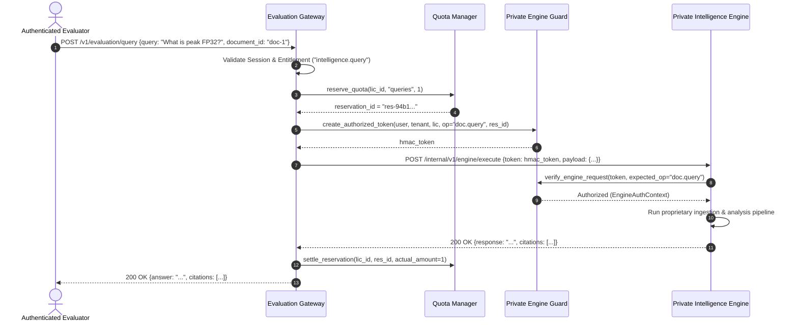

# PROT-04.09 — Dossier 02: Component Integration Matrix

## 1. System Integration Overview

The AEGIS-DocIntel Protected Demo Edition integrates multiple specialized security subsystems developed across PROT-04.01 through PROT-04.08. This matrix defines the precise component boundaries, communication protocols, and cryptographic data exchanges.

---

## 2. Component Interaction Matrix

| Subsystem | Originating Package | Integrated Upstream | Integrated Downstream | Communication Boundary | Cryptographic Protocol |
| :--- | :--- | :--- | :--- | :--- | :--- |
| **Authentication Guard** | WP-04.02 | Evaluator Web / Desktop UI | Evaluation Gateway Ingress | HTTP Reverse Proxy / ASGI Middleware | Strict JWT Bearer Validation |
| **Activation Service** | WP-04.03 | Evaluation Ingress | Key Registry & Device Store | Internal In-Memory / SQLite Repository | Ed25519 Canonical PoP Challenge |
| **License Authority** | WP-04.04 | Activation Service | License Repository & Revocation Registry | In-Memory Authoritative Store | Ed25519 JWS Compact Serialization (RFC 7515) |
| **Entitlement Service** | WP-04.05 | Gateway Dependency (`get_current_entitlement`) | Application API Handlers | ASGI Dependency Injection | Server-Evaluated Capability Bitmask |
| **Quota Manager** | WP-04.06 | Application API Handlers | Counter Repository & Usage Ledger | Thread-Safe ThreadPool / Lock | Two-Phase Atomic Reservation & Settlement |
| **Session Manager** | WP-04.07 | Session Refresh & Logout Handlers | Session Repository & Family Registry | Redis / In-Memory Session Table | Rotating Opaque Hashes (SHA-256) |
| **Private Engine Guard** | WP-04.09 | Evaluation Gateway Handlers | Private Engine Ingress | Local RPC / Unix Domain Socket / VPC | HMAC-SHA256 Token with Reservation Nonce |
| **Security Ops & Audit** | WP-04.08 | All Gateway Subsystems | SIEM / Audit Append-Only Ledger | Async Event Bus / Local Ring Buffer | SHA-256 Chained Hash Log |

---

## 3. Inter-Service Handshake & Data Flow

### 3.1 First-Time Evaluator Activation Handshake

### 3.2 Private Engine Operation Handshake

