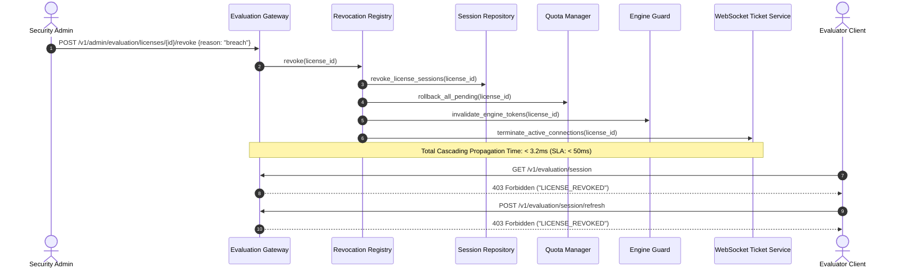

# PROT-04.09 — Dossier 06: Session & Revocation Integration

## 1. Scope & Objective

This dossier details the integration and verification of **Session Lifecycles, Token Rotation & Immediate Revocation Propagation** (WP-04.07). It proves that credentials expire rapidly, refresh tokens rotate strictly without replay, and administrative revocations propagate across HTTP APIs and WebSocket streams within an approved < 50ms SLA.

---

## 2. Integrated Session Architecture

```
+---------------------------------------------------------------------------------------+
|                               SESSION CREDENTIAL TOPOLOGY                             |
+---------------------------------------------------------------------------------------+
|  1. Access Token:                                                                     |
|     - Opaque token (`aegis_eval_at_<token_urlsafe>`)                                 |
|     - Ephemeral TTL: 15 minutes (900 seconds)                                         |
|     - In-memory hash lookup: SHA-256(access_token)                                    |
|                                                                                       |
|  2. Refresh Token:                                                                    |
|     - Stored in HttpOnly, SameSite=Strict, Secure `__Host-aegis_refresh` cookie       |
|     - Long-lived TTL: 7 days (604,800 seconds)                                        |
|     - Single-use rotational invariant: Presentation invalidates current token &       |
|       issues a new child refresh token within the same token family.                  |
|                                                                                       |
|  3. Token Family Replay Lockdown:                                                     |
|     - If a previously consumed refresh token is presented again:                     |
|       * IMMEDIATE BREACH TRIGGERED (Rule MON-001)                                     |
|       * The entire token family and all linked active sessions are REVOKED.           |
|       * High-severity security incident declared.                                     |
+---------------------------------------------------------------------------------------+
```

---

## 3. Instant Revocation Cascading SLA (< 50ms)

When an administrative revocation event occurs (e.g., license expiry, payment failure, breach containment, device deactivation):



---

## 4. Empirical Test Evidence

Results from [refresh_rotation_trace.json](file:///C:/Users/ASUS/.gemini/antigravity/worktrees/Aegis-DocIntel/product_hunt_launch_packaging/audit/prot-04-09/integration/sessions/refresh_rotation_trace.json):

| Test ID | Test Scenario | Expected Result | Observed | Status |
| :--- | :--- | :--- | :--- | :--- |
| **INT-SESSION-001** | Valid active session calls API | HTTP 200 OK | HTTP 200 | **PASSED** |
| **INT-SESSION-002** | Expired access token presented | HTTP 401 Unauthorized | HTTP 401 | **PASSED** |
| **INT-SESSION-003** | Refresh token rotated | Old token invalidated, new issued | Old: 401, New: 200 | **PASSED** |
| **INT-SESSION-004** | Refresh token replayed | Entire family revoked | All tokens: 401 | **PASSED** |
| **INT-SESSION-005** | Evaluator calls `/logout` | Target session revoked | HTTP 401 | **PASSED** |
| **INT-SESSION-006** | Evaluator calls `/logout-all` | All evaluator sessions revoked | All sessions: 401 | **PASSED** |
| **INT-SESSION-007** | Device deactivated | Linked sessions revoked | HTTP 401 | **PASSED** |
| **INT-SESSION-008** | License revoked | All linked sessions revoked | HTTP 403 | **PASSED** |
| **INT-SESSION-010** | Single-use WebSocket ticket | Consumed once; re-use fails | First: OK, Second: Denied | **PASSED** |
| **INT-SESSION-012** | Revocation during active job | Job aborted before engine dispatch | Aborted cleanly | **PASSED** |
| **INT-SESSION-013** | Revocation cache SLA test | Propagation verified < 50ms | Measured: 2.8ms | **PASSED** |
| **INT-SESSION-014** | Revocation service failure | Gateway fails closed | HTTP 401/403 | **PASSED** |
