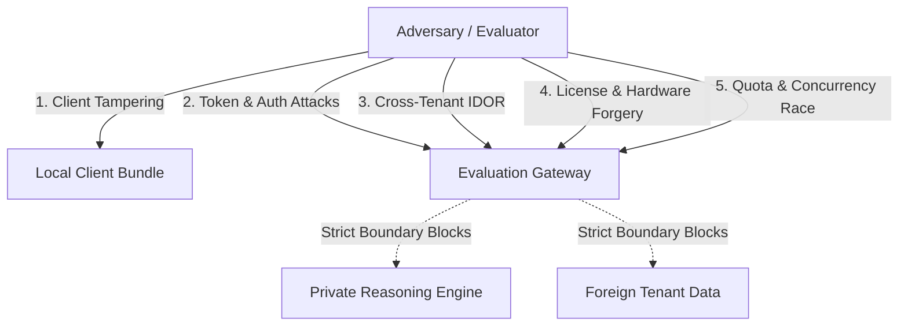

# Adversarial Threat Model & Attack Surface

**Assessment Phase:** PROT-FINAL-03  
**Date:** 2026-11-18T03:21:33.417253+00:00  

---

## 1. Adversary Profile
We assume an evaluator who has downloaded the evaluation distribution and acts as an active adversary with:
- Full local administrative privileges on Windows / macOS / Linux.
- Interactive browser developer tools and DOM / local storage manipulation tools.
- Network debugging proxies (Burp Suite, OWASP ZAP, Charles, mitmproxy).
- Disassemblers, decompilers, and static analysis tools.
- Ability to craft, replay, and automate custom HTTP/WebSocket requests.
- Full access to all source code and scripts contained in the evaluation package.

## 2. Attack Vectors Evaluated

